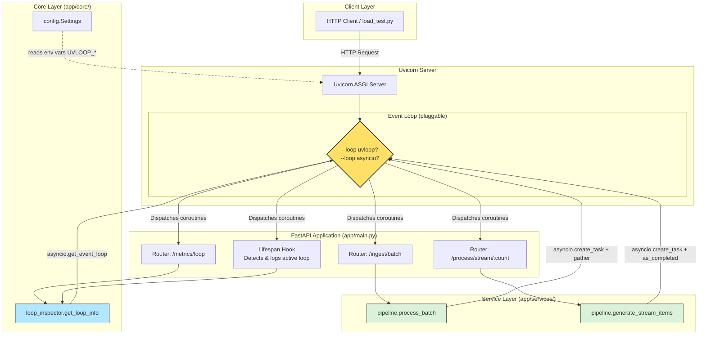
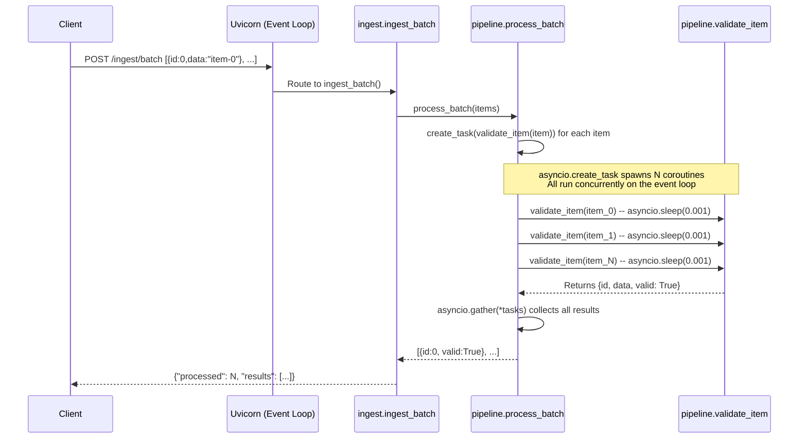
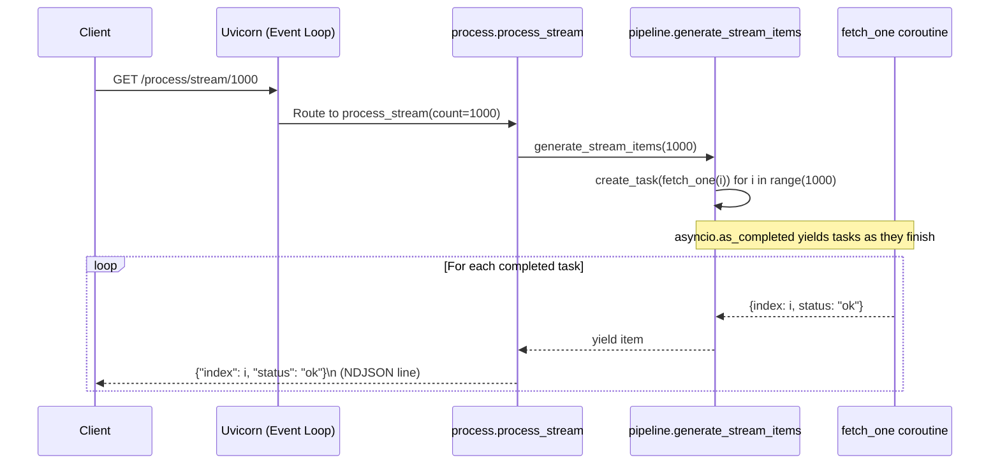
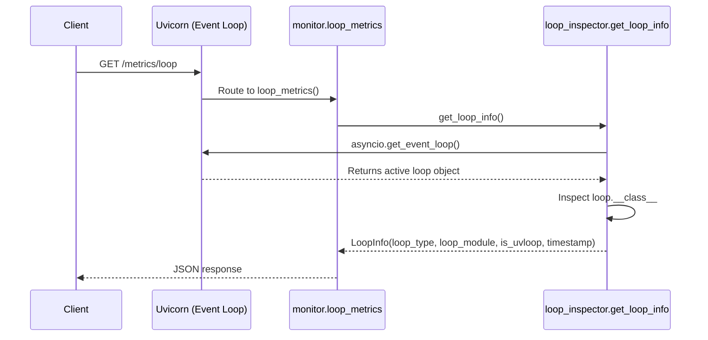
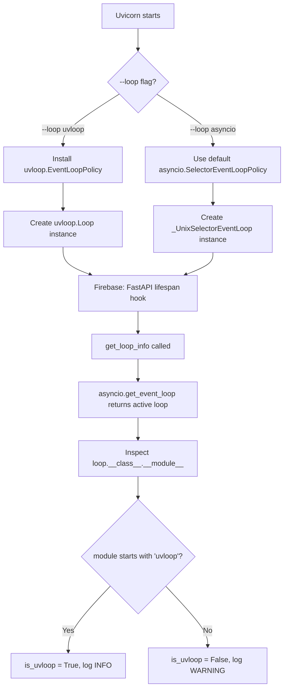

# uvloop_service

A high-throughput FastAPI microservice that demonstrates the performance impact of replacing Python's default `asyncio` event loop with **uvloop** — a drop-in replacement built in C on top of `libuv` (the same engine that powers Node.js). The only change between "fast" and "slow" modes is a single Uvicorn `--loop` flag; **no source code changes are required**.

---

## Table of Contents

1. [What is uvloop?](#what-is-uvloop)
2. [Why Does It Matter?](#why-does-it-matter)
3. [Project Architecture](#project-architecture)
4. [Request Flow Diagrams](#request-flow-diagrams)
5. [Component Deep Dive](#component-deep-dive)
6. [API Reference](#api-reference)
7. [How Loop Detection Works](#how-loop-detection-works)
8. [Benchmark Results](#benchmark-results)
9. [End-to-End Tutorial](#end-to-end-tutorial)
10. [Configuration](#configuration)
11. [Constraints and Notes](#constraints-and-notes)

---

## What is uvloop?

Python's `asyncio` module uses an event loop to schedule and execute coroutines, handle I/O callbacks, and manage timers. The **default event loop** is written in pure Python and runs inside the CPython interpreter.

**uvloop** is a fast, drop-in replacement for the default asyncio event loop. It is written in **Cython** and wraps **libuv**, the high-performance I/O library that also powers Node.js. Because libuv is implemented in C and optimized at a low level for non-blocking I/O, uvloop achieves significantly faster event loop iteration cycles compared to the pure-Python default.

Key properties:

| Property             | Default asyncio Loop                    | uvloop                                   |
|----------------------|------------------------------------------|------------------------------------------|
| Implementation       | Pure Python                              | Cython / C (libuv)                       |
| TCP throughput       | Baseline                                 | ~2x higher (synthetic benchmarks)        |
| HTTP request latency | Baseline                                 | ~15-30% lower under load                  |
| Compatibility        | All platforms                            | Linux and macOS only (no Windows)         |
| Installation         | Built into Python                        | `pip install uvloop`                     |
| Swap mechanism       | Default                                  | `uvicorn --loop uvloop` or policy install |

---

## Why Does It Matter?

In an async Python web service, every incoming HTTP request, every database query, and every upstream HTTP call passes through the event loop. The loop is the bottleneck that governs how fast your application can cycle through coroutines and resume suspended I/O operations.

When you switch from the default asyncio loop to uvloop:

1. **More I/O cycles per second** — The loop can poll and dispatch ready sockets faster.
2. **Lower per-request latency** — Each coroutine resumes sooner after I/O readiness.
3. **Higher throughput under concurrency** — More simultaneous connections are handled within the same time window.

This project makes the difference **measurable**: you run the exact same application code with two different event loops and compare side by side.

---

## Project Architecture

```
uvloop_service/
├── app/
│   ├── __init__.py                 # Package marker ("FastAPI application with uvloop visibility.")
│   ├── main.py                     # FastAPI app factory + lifespan hook
│   ├── api/
│   │   ├── __init__.py
│   │   ├── ingest.py               # POST /ingest/batch
│   │   ├── process.py              # GET /process/stream/{count}
│   │   └── monitor.py              # GET /metrics/loop
│   ├── core/
│   │   ├── __init__.py
│   │   ├── config.py               # pydantic-settings configuration
│   │   └── loop_inspector.py       # Runtime event loop detection
│   └── services/
│       ├── __init__.py
│       └── pipeline.py             # Concurrent async task generators
├── tests/
│   ├── __init__.py
│   └── test_loop.py                # Loop detection unit test
├── fastapienv/                     # Virtual environment (created with `uv venv`)
├── start.sh                        # Start with uvloop (port 8000)
├── start_default.sh                # Start with asyncio (port 8001)
├── load_test.py                    # Side-by-side benchmark script
├── pyproject.toml                  # Project metadata (managed via uv)
└── README.md
```

### Architectural Diagram



---

## Request Flow Diagrams

### POST /ingest/batch Flow



### GET /process/stream/{count} Flow



### GET /metrics/loop Flow



---

## Component Deep Dive

### app/main.py — Application Factory

The entry point creates a `FastAPI` instance with a **lifespan context manager**. On startup, it inspects the running event loop and logs whether uvloop is active. This is the only place the application explicitly acknowledges the event loop choice — all other code is pure `async`/`await` and is loop-agnostic.

```python
@asynccontextmanager
async def lifespan(app: FastAPI):
    info = get_loop_info()
    if info.is_uvloop:
        logger.info(f"Active event loop: {info.loop_type}")
    else:
        logger.warning(f"Standard event loop detected: {info.loop_type}")
    yield
```

The lifespan hook fires **once** when Uvicorn starts the application, before any requests are accepted. The `yield` statement marks the point where the application is "ready" and keeps the context alive until shutdown.

### app/core/loop_inspector.py — Runtime Loop Detection

This module introspects the **currently running** asyncio event loop at call time and returns a frozen dataclass:

```python
@dataclass(frozen=True)
class LoopInfo:
    loop_type: str       # e.g. "uvloop.Loop" or "asyncio.unix_events._UnixSelectorEventLoop"
    loop_module: str     # e.g. "uvloop" or "asyncio.unix_events"
    is_uvloop: bool      # True if the module starts with "uvloop"
    timestamp: str        # ISO 8601 UTC timestamp of when the check was made
```

The `is_uvloop` flag is determined by checking whether `loop.__class__.__module__` starts with `"uvloop"`. This works because uvloop replaces the default loop class with `uvloop.Loop`, whose module is `"uvloop"`.

### app/core/config.py — Settings

Uses `pydantic-settings` `BaseSettings` to load configuration from environment variables with the `UVLOOP_` prefix:

| Env Variable       | Default           | Description                  |
|---------------------|-------------------|------------------------------|
| `UVLOOP_APP_NAME`  | `"uvloop_service"` | Application title            |
| `UVLOOP_DEBUG`      | `false`           | Enable debug mode            |
| `UVLOOP_HOST`       | `"0.0.0.0"`      | Server bind host             |
| `UVLOOP_PORT`       | `8000`            | Server bind port             |

### app/services/pipeline.py — Concurrent Async Task Generators

This is the core workload layer. It contains two functions that deliberately spawn many concurrent coroutines so the event loop's efficiency becomes the dominant performance factor:

**`validate_item(item)`** — Simulates an I/O-bound validation by sleeping for 1 ms per item. Each call is a single async unit of work.

**`process_batch(items)`** — Takes a list of dicts and creates an `asyncio.Task` for each one via `asyncio.create_task`, then collects all results with `asyncio.gather`. This means all 50 items in a batch run **concurrently** — the total wall time approaches ~1 ms rather than ~50 ms.

**`generate_stream_items(count)`** — Creates `count` async tasks, then uses `asyncio.as_completed` to yield results as they finish. This is an **async generator**: each result is yielded individually as a streaming NDJSON response.

### app/api/ — Route Handlers

| File           | Prefix        | Endpoints                        |
|----------------|---------------|----------------------------------|
| `ingest.py`   | `/ingest`     | `POST /ingest/batch`            |
| `process.py`  | `/process`   | `GET /process/stream/{count}`   |
| `monitor.py`  | `/metrics`   | `GET /metrics/loop`             |

Each file creates an `APIRouter` and the `main.py` includes all three routers into the app.

### load_test.py — Benchmark Script

The benchmark script:

1. Opens an `httpx.AsyncClient` with 500 max connections and 30s timeout.
2. Calls `GET /metrics/loop` on each server to **verify which loop is active**.
3. Fires **1,000 concurrent** `POST /ingest/batch` requests (each with a 50-item payload).
4. Measures wall-clock elapsed time and computes requests per second.
5. Prints a comparison table showing uvloop vs. default asyncio.

### start.sh and start_default.sh — Launch Scripts

| Script              | Loop        | Port | Purpose                                    |
|---------------------|-------------|------|--------------------------------------------|
| `start.sh`          | `uvloop`    | 8000 | Run with the high-performance event loop   |
| `start_default.sh` | `asyncio`   | 8001 | Run with the standard Python event loop    |

Both activate the same virtual environment and run the same application — the only difference is the `--loop` flag passed to Uvicorn.

### tests/test_loop.py — Unit Test

Tests that `get_loop_info()` correctly identifies the event loop, even when uvloop is not installed (it gracefully falls back to the default loop).

---

## API Reference

### POST /ingest/batch

Accepts a JSON array of items and processes them concurrently.

**Request:**

```json
[
  {"id": 0, "data": "item-0"},
  {"id": 1, "data": "item-1"}
]
```

**Response:**

```json
{
  "processed": 2,
  "results": [
    {"id": 0, "data": "item-0", "valid": true},
    {"id": 1, "data": "item-1", "valid": true}
  ]
}
```

Each item is processed by a separate `asyncio.Task` running `validate_item()`, which simulates I/O with a 1 ms sleep.

### GET /process/stream/{count}

Streams `count` processed items as **NDJSON** (newline-delimited JSON). Each line is a separate JSON object yielded as soon as it completes.

**Request:** `GET /process/stream/3`

**Response:**

```
{"index": 0, "status": "ok"}
{"index": 1, "status": "ok"}
{"index": 2, "status": "ok"}
```

The `Content-Type` is `application/x-ndjson`.

### GET /metrics/loop

Returns metadata about the currently active event loop.

**Response:**

```json
{
  "loop_type": "uvloop.Loop",
  "loop_module": "uvloop",
  "is_uvloop": true,
  "timestamp": "2026-05-20T10:30:00.123456+00:00"
}
```

| Field          | Type    | Description                                                      |
|----------------|---------|------------------------------------------------------------------|
| `loop_type`    | string  | Fully qualified class name of the event loop (e.g. `uvloop.Loop`) |
| `loop_module`  | string  | Python module of the loop class (e.g. `uvloop`)                  |
| `is_uvloop`    | boolean | `true` if the loop module starts with `"uvloop"`                 |
| `timestamp`    | string  | ISO 8601 UTC timestamp of when the check was made               |

---

## How Loop Detection Works



The detection mechanism is simple and relies on Python's runtime introspection:

1. **Uvicorn** reads the `--loop` CLI flag and sets the event loop policy accordingly.
2. When the app starts, the **lifespan hook** calls `get_loop_info()`.
3. `get_loop_info()` calls `asyncio.get_event_loop()` to get the currently running loop.
4. It inspects `loop.__class__.__module__` and `loop.__class__.__qualname__` to determine the loop type.
5. If the module starts with `"uvloop"`, it sets `is_uvloop = True` and logs at INFO level; otherwise it logs a WARNING.
6. The `/metrics/loop` endpoint uses the same function to return live loop metadata in the response.

---

## Benchmark Results

Test: 1,000 concurrent requests to `POST /ingest/batch` (payload of 50 items each).

| Metric            | uvloop          | asyncio (default) | Improvement |
|-------------------|-----------------|-------------------|-------------|
| **Elapsed Time**  | 3.01 s          | 5.90 s            | 49.0% faster |
| **Throughput**    | 332 req/s       | 170 req/s         | 95% more RPS |

These results were produced on macOS with a single Uvicorn worker (`--workers 1`).

### Why the Difference?

The workload in this service is **I/O-bound and highly concurrent** — each request spawns 50 async tasks, each sleeping for 1 ms. Under these conditions, the event loop's efficiency in scheduling and resuming coroutines directly determines throughput. uvloop's C-level implementation of `poll`, `call_soon`, and `_run_once` has lower per-iteration overhead, so it can cycle through more ready callbacks per second.

---

## End-to-End Tutorial

This tutorial walks you through setting up, running, benchmarking, and understanding the uvloop_service project from scratch.

### Prerequisites

- **Python 3.12+** installed on your system
- **macOS or Linux** (uvloop does not support Windows)
- A terminal (or two)

### Step 1: Clone or Navigate to the Project

```bash
cd /path/to/fastapi_code/uvloop_service
```

### Step 2: Create and Activate a Virtual Environment

The virtual environment `fastapienv` lives **inside the project directory** (current working directory). If you already have it, skip to activation:

```bash
# Create it (using uv — the package manager used in this project)
uv venv fastapienv

# Or with stdlib venv
python -m venv fastapienv

# Activate
source fastapienv/bin/activate
```

### Step 3: Install Dependencies

Using `uv` (recommended — this project was set up with uv):

```bash
uv pip install fastapi uvicorn uvloop pydantic-settings httpx pytest
```

Or with plain `pip`:

```bash
pip install fastapi uvicorn uvloop pydantic-settings httpx pytest
```

**What each package does:**

| Package            | Purpose                                           |
|--------------------|---------------------------------------------------|
| `fastapi`          | ASGI web framework for building the API           |
| `uvicorn`          | ASGI server that runs the FastAPI application     |
| `uvloop`           | High-performance event loop replacement           |
| `pydantic-settings`| Environment-variable-driven configuration        |
| `httpx`            | Async HTTP client used by the benchmark script    |
| `pytest`           | Test framework for running the unit tests         |

### Step 4: Understand the Application Structure

Take a moment to review the files:

```bash
ls -R app/
```

You should see:

```
app/:
__init__.py  main.py  api/  core/  services/

app/api/:
__init__.py  ingest.py  monitor.py  process.py

app/core/:
__init__.py  config.py  loop_inspector.py

app/services/:
__init__.py  pipeline.py
```

**Key insight:** There is **zero application code** that references uvloop. The only place uvloop enters the picture is at the Uvicorn server level via the `--loop` flag.

### Step 5: Start the uvloop Server

Open **Terminal 1** and run:

```bash
./start.sh
```

This executes:

```bash
uvicorn app.main:app --loop uvloop --workers 1 --host 0.0.0.0 --port 8000
```

You should see:

```
INFO:app.main:Active event loop: uvloop.Loop
INFO:     Uvicorn running on http://0.0.0.0:8000 (Press CTRL+C to quit)
```

The `INFO:app.main:Active event loop: uvloop.Loop` message confirms uvloop was successfully installed.

### Step 6: Start the Default asyncio Server

Open **Terminal 2** and run:

```bash
./start_default.sh
```

This executes:

```bash
uvicorn app.main:app --loop asyncio --workers 1 --host 0.0.0.0 --port 8001
```

You should see:

```
WARNING:app.main:Standard event loop detected: asyncio.unix_events._UnixSelectorEventLoop
INFO:     Uvicorn running on http://0.0.0.0:8001 (Press CTRL+C to quit)
```

Note the **WARNING** level log — the app explicitly warns when it detects the standard event loop.

### Step 7: Verify the Event Loops

Open **Terminal 3** and test both servers:

```bash
# Check uvloop server (port 8000)
curl -s http://127.0.0.1:8000/metrics/loop | python -m json.tool

# Check asyncio server (port 8001)
curl -s http://127.0.0.1:8001/metrics/loop | python -m json.tool
```

**Expected response from port 8000 (uvloop):**

```json
{
    "loop_type": "uvloop.Loop",
    "loop_module": "uvloop",
    "is_uvloop": true,
    "timestamp": "2026-05-20T10:30:00.123456+00:00"
}
```

**Expected response from port 8001 (asyncio):**

```json
{
    "loop_type": "asyncio.unix_events._UnixSelectorEventLoop",
    "loop_module": "asyncio.unix_events",
    "is_uvloop": false,
    "timestamp": "2026-05-20T10:30:00.654321+00:00"
}
```

### Step 8: Test the Batch Ingest Endpoint

Send a batch of items to each server:

```bash
curl -s -X POST http://127.0.0.1:8000/ingest/batch \
  -H "Content-Type: application/json" \
  -d '[{"id": 1, "data": "hello"}, {"id": 2, "data": "world"}]' | python -m json.tool
```

**Response:**

```json
{
    "processed": 2,
    "results": [
        {"id": 1, "data": "hello", "valid": true},
        {"id": 2, "data": "world", "valid": true}
    ]
}
```

The `"valid": true` field is added by `validate_item()`, which simulates I/O processing with a 1 ms sleep.

### Step 9: Test the Streaming Endpoint

Stream 5 items from each server:

```bash
curl -s http://127.0.0.1:8000/process/stream/5
```

**Response:**

```
{"index": 0, "status": "ok"}
{"index": 1, "status": "ok"}
{"index": 2, "status": "ok"}
{"index": 3, "status": "ok"}
{"index": 4, "status": "ok"}
```

Each line is a separate JSON object (NDJSON format). Items arrive as they are completed by `asyncio.as_completed`, so the order is not guaranteed.

### Step 10: Run the Benchmark

Open **Terminal 3** (or any terminal with the virtual environment activated):

```bash
source fastapienv/bin/activate
python load_test.py
```

**What happens:**

1. The script first calls `GET /metrics/loop` on each server to confirm which loop is active.
2. It then fires **1,000 concurrent** `POST /ingest/batch` requests (each carrying a 50-item payload) against **both** servers sequentially.
3. It measures elapsed wall time and computes throughput (requests/second).
4. It prints a comparison table.

**Sample output:**

```
Load test: comparing uvloop vs default asyncio
Make sure both servers are running:
  Terminal 1: ./start.sh          (port 8000, uvloop)
  Terminal 2: ./start_default.sh  (port 8001, default loop)

Loop info: {'loop_type': 'uvloop.Loop', 'loop_module': 'uvloop', 'is_uvloop': True, 'timestamp': '...'}
[uvloop] Elapsed: 3.01s | RPS: 332
Loop info: {'loop_type': 'asyncio.unix_events._UnixSelectorEventLoop', 'loop_module': 'asyncio.unix_events', 'is_uvloop': False, 'timestamp': '...'}
[default] Elapsed: 5.90s | RPS: 170

--- Comparison ---
uvloop   : 3.01s  332 req/s
default  : 5.90s  170 req/s
Improvement: 49.0% faster with uvloop
```

### Step 11: Run the Unit Tests

```bash
source fastapienv/bin/activate
pytest tests/ -v
```

The test verifies that `get_loop_info()` correctly returns a `LoopInfo` dataclass with a boolean `is_uvloop` field, whether or not uvloop is installed.

### Step 12: Explore the Code

Now that you have seen the service in action, here are suggested areas to explore:

1. **Change the sleep duration** in `pipeline.py` — reduce `asyncio.sleep(0.001)` to `asyncio.sleep(0)` and re-run the benchmark. Notice how the performance gap narrows, because CPU-bound work is less affected by the event loop choice.

2. **Increase the batch size** — change the `PAYLOAD` in `load_test.py` from 50 items to 500 and re-run. A larger payload amplifies the concurrency advantage.

3. **Add workers** — change `--workers 1` to `--workers 4` in `start.sh` and observe how multi-process parallelism interacts with uvloop.

4. **Compare with `asyncio.to_thread`** — add a blocking endpoint and test it under both loops to see that uvloop only helps with async I/O, not blocking calls.

### Step 13: Clean Up

```bash
# In Terminal 1: press Ctrl+C to stop the uvloop server
# In Terminal 2: press Ctrl+C to stop the asyncio server
# In Terminal 3: deactivate the virtual environment
deactivate
```

---

## Configuration

All configuration is managed through environment variables with the `UVLOOP_` prefix, powered by `pydantic-settings`.

| Environment Variable | Default             | Description                     |
|----------------------|---------------------|---------------------------------|
| `UVLOOP_APP_NAME`    | `uvloop_service`    | Application name in OpenAPI docs|
| `UVLOOP_DEBUG`       | `false`             | Enable FastAPI debug mode       |
| `UVLOOP_HOST`        | `0.0.0.0`           | Server bind address             |
| `UVLOOP_PORT`        | `8000`              | Server bind port                |

Example:

```bash
UVLOOP_DEBUG=true UVLOOP_PORT=9000 uvicorn app.main:app --loop uvloop
```

---

## Constraints and Notes

- **Zero code changes** are required to switch loops; only the Uvicorn `--loop` flag changes.
- `uvloop` is compatible with **Linux and macOS only**; there is no Windows support.
- All endpoints use pure `async`/`await` patterns — no blocking `time.sleep` or synchronous I/O.
- The application remains fully functional on the standard `asyncio` loop if `uvloop` is unavailable.
- The `--loop uvloop` flag tells Uvicorn to install `uvloop.EventLoopPolicy()` before creating the event loop. This replaces `asyncio.SelectorEventLoopPolicy` globally for the process.
- Results will vary based on hardware, OS, Python version, and workload characteristics. I/O-bound workloads benefit most; CPU-bound workloads see minimal improvement from uvloop.