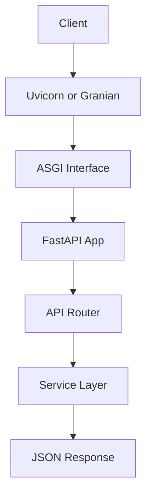

# FastAPI ASGI — Uvicorn & Granian

A hands-on learning project that teaches **how FastAPI runs on ASGI servers**, with working code you can run on both **Uvicorn** and **Granian**.

---

## Project Overview

This project is a minimal but production-aligned FastAPI application designed to teach the relationship between FastAPI, the ASGI interface, and the servers that power it. It includes endpoints for health checks, CRUD-like item operations, and compute simulations (both CPU-bound and IO-simulated) so you can observe how different ASGI servers handle each type of workload.

### Endpoints

| Method | Path | Purpose |
|--------|------|---------|
| GET | `/health` | Liveness check — returns status and app name |
| GET | `/api/v1/items` | List all items |
| POST | `/api/v1/items` | Create a new item |
| GET | `/api/v1/items/{item_id}` | Get an item by ID |
| GET | `/api/v1/compute/light` | Light CPU-bound computation (fibonacci) |
| GET | `/api/v1/compute/io-simulated` | Simulated IO with `asyncio.sleep` |

---

## What is ASGI?

**ASGI** stands for **Asynchronous Server Gateway Interface**. It is the spiritual successor to WSGI (Web Server Gateway Interface) and defines a standard asynchronous interface between web servers and Python web frameworks.

### WSGI vs ASGI

| Aspect | WSGI | ASGI |
|--------|------|------|
| Protocol support | HTTP only | HTTP, WebSockets, HTTP/2 |
| Concurrency model | Synchronous | Asynchronous |
| Python async support | No | Yes (`async`/`await`) |
| Notable servers | Gunicorn, uWSGI | Uvicorn, Granian, Hypercorn, Daphne |
| Notable frameworks | Flask, Django (sync) | FastAPI, Starlette, Django (async) |

An ASGI server receives incoming HTTP requests, converts them into ASGI scope dicts and event messages, and passes them to the ASGI application (your FastAPI app). The application processes the request asynchronously and returns the response through the same interface.

### The ASGI Lifecycle

1. The server opens a connection and creates an ASGI **scope** (a dict describing the request).
2. The server calls the application's `async def __call__(scope, receive, send)` method.
3. The application reads the request body via `receive()`, processes it, and writes the response via `send()`.
4. The server transmits the response to the client.

---

## How FastAPI Connects to ASGI Servers

FastAPI is an **ASGI framework** — it does not listen on a port or handle network I/O by itself. Instead, it implements the ASGI interface (`async def __call__(scope, receive, send)`). The ASGI server (Uvicorn or Granian) is responsible for:

- Binding to a host/port
- Accepting TCP connections
- Parsing HTTP requests into ASGI scope dicts
- Passing those scopes to the FastAPI application
- Sending the response back over the wire

```text
┌─────────────────────────────────────────────────────────┐
│  ASGI Server (Uvicorn / Granian)                        │
│                                                         │
│  1. Binds to host:port                                  │
│  2. Accepts connections, parses HTTP                    │
│  3. Calls app(scope, receive, send)                     │
│  4. Sends the response back                             │
└──────────────┬──────────────────────────────────────────┘
               │ ASGI interface
               ▼
┌──────────────────────────────────────────────────────────┐
│  FastAPI Application                                     │
│                                                          │
│  - Routes request to correct endpoint                    │
│  - Validates request data (Pydantic)                     │
│  - Calls service layer                                   │
│  - Serializes and returns response                       │
└──────────────────────────────────────────────────────────┘
```

### Request Flow



---

## Uvicorn vs Granian

Both are production-ready ASGI servers, but they differ in architecture and implementation language.

### Comparison Table

| Feature | Uvicorn | Granian |
|---------|---------|---------|
| **Language** | Python + C extensions (uvloop) | Rust (via PyO3) |
| **Event loop** | asyncio (default) or uvloop | Rust tokio runtime |
| **Multi-worker** | Via Gunicorn + uvicorn.workers or `--workers` | Built-in `--workers` flag |
| **Interface** | ASGI, WSGI (limited) | ASGI, ASGIl, RSGI |
| **Hot reload** | `--reload` (built-in) | `--reload` (built-in) |
| **Maturity** | Very mature, widely used | Newer, rapidly maturing |
| **Performance** | Fast (especially with uvloop) | Often faster in benchmarks due to Rust core |
| **Ecosystem** | Largest ASGI community | Growing community |
| **Process model** | Single-process by default; multi via gunicorn/workers | Multi-process built-in with Rust scheduler |

### When to Use Which

- **Use Uvicorn** when you want the most mature ecosystem, need `--reload` during development, or plan to use Gunicorn's process management in production.
- **Use Granian** when you want maximum single-server throughput, prefer a zero-config multi-worker setup, or want to avoid the Gunicorn dependency chain.

---

## Worker Model Explanation

### Single Worker (Development)

Both servers default to a single worker process with one event loop:

```bash
uvicorn app.main:app --host 0.0.0.0 --port 8000
granian --interface asgi app.main:app --host 0.0.0.0 --port 8000
```

One process, one event loop — fine for development and debugging.

### Multi-Worker (Production)

In production, you run multiple worker processes to utilize all CPU cores and increase throughput:

**Uvicorn multi-worker:**

```bash
uvicorn app.main:app --workers 4
```

Uvicorn spawns N worker processes, each running its own event loop. A parent process manages them.

**Gunicorn + Uvicorn workers (recommended for production):**

```bash
gunicorn app.main:app -w 4 -k uvicorn.workers.UvicornWorker --bind 0.0.0.0:8000
```

Gunicorn acts as the process manager, and each worker is a Uvicorn event loop. This gives you:
- Process management (graceful restarts, signals)
- Worker heartbeat monitoring
- Pre-fork process model

**Granian multi-worker:**

```bash
granian --interface asgi app.main:app --workers 4
```

Granian handles multi-worker natively — no need for Gunicorn. Each worker gets its own Rust runtime thread.

### Worker Count Recommendation

A common formula: `workers = (2 x CPU cores) + 1`

For a 4-core machine: `2 * 4 + 1 = 9` workers.

---

## Concurrency Explanation

FastAPI is an **async framework**. When an endpoint is defined with `async def`, it runs on the server's event loop. When defined with plain `def`, it runs in a threadpool executor.

### How concurrent requests are handled

```text
                   ┌──────────────────────┐
                   │  ASGI Server          │
                   │  (event loop)         │
                   └──────┬───────────────┘
                          │
            ┌─────────────┼─────────────┐
            │             │             │
         Request 1    Request 2    Request 3
         (async)      (async)      (sync def)
            │             │             │
            ▼             ▼             ▼
     await sleep()   await sleep()   threadpool
     (yields to      (yields to      (does not
      event loop)     event loop)     block loop)
```

- **`async def` endpoints** yield control back to the event loop at every `await`, allowing other requests to progress concurrently.
- **`def` endpoints** (synchronous) are dispatched to a threadpool so they don't block the event loop.

In this project:
- `/compute/light` uses `def` (CPU-bound) — runs in threadpool
- `/compute/io-simulated` uses `async def` (IO-bound) — runs on the event loop
- This pattern lets you see how each concurrency model behaves under load.

---

## Setup & Run

### Prerequisites

- Python 3.11+
- [uv](https://docs.astral.sh/uv/) installed

### Install Dependencies

```bash
uv init
uv venv fastapi_asgi_env
source fastapi_asgi_env/bin/activate
uv pip install fastapi uvicorn granian pytest httpx
```

### Run with Uvicorn (Development)

```bash
uvicorn app.main:app --reload
```

The `--reload` flag watches for file changes and restarts automatically.

### Run with Granian

```bash
granian --interface asgi app.main:app
```

For development with auto-reload:

```bash
granian --interface asgi app.main:app --reload
```

### Production Run Examples

**Uvicorn (production):**

```bash
uvicorn app.main:app --host 0.0.0.0 --port 8000 --workers 4
```

**Gunicorn + Uvicorn workers (production):**

```bash
pip install gunicorn
gunicorn app.main:app -w 4 -k uvicorn.workers.UvicornWorker --bind 0.0.0.0:8000
```

**Granian (production):**

```bash
granian --interface asgi app.main:app --host 0.0.0.0 --port 8000 --workers 4
```

### Docker

**Build and run with Uvicorn:**

```bash
docker build -f Dockerfile.uvicorn -t fastapi-asgi-uvicorn .
docker run -p 8000:8000 fastapi-asgi-uvicorn
```

**Build and run with Granian:**

```bash
docker build -f Dockerfile.granian -t fastapi-asgi-granian .
docker run -p 8000:8000 fastapi-asgi-granian
```

---

## Project Structure

```text
fastapi_asgi_uvicorn_granian/
  app/
    __init__.py
    main.py              # FastAPI app factory and ASGI callable
    api/
      __init__.py
      v1/
        __init__.py
        router.py        # Aggregates all v1 endpoint routers
        endpoints/
          __init__.py
          health.py       # GET /health
          items.py        # CRUD endpoints for items
          compute.py      # CPU-bound and IO-simulated endpoints
    core/
      __init__.py
      config.py          # Pydantic Settings (reads from .env)
    services/
      __init__.py
      items.py           # In-memory item store (CRUD operations)
      compute.py         # Light CPU compute and IO simulation logic
  tests/
    __init__.py
    conftest.py          # Shared httpx AsyncClient fixture
    test_health.py       # Tests for /health
    test_items.py        # Tests for /items endpoints
    test_compute.py      # Tests for /compute endpoints
  Dockerfile.uvicorn     # Production Docker image using Uvicorn
  Dockerfile.granian     # Production Docker image using Granian
  README.md
  pyproject.toml          # Project metadata and dependencies
  .env.example            # Example environment variables
```

### File Explanations

- **`app/main.py`** — Creates the FastAPI application using a `create_app()` factory. The `app` object at module level is the ASGI callable that Uvicorn/Granian import. Includes the v1 router.

- **`app/core/config.py`** — Uses `pydantic-settings` to define a `Settings` class that reads from environment variables and `.env` files. Controls app name, host, port, and worker count.

- **`app/api/v1/router.py`** — Aggregates all v1 sub-routers (health, items, compute) under the `/api/v1` prefix.

- **`app/api/v1/endpoints/health.py`** — Simple health-check endpoint returning `{"status": "ok", "app": "..."}`.

- **`app/api/v1/endpoints/items.py`** — Defines `GET /items`, `POST /items`, and `GET /items/{item_id}`. Uses Pydantic models for request/response validation.

- **`app/api/v1/endpoints/compute.py`** — Two endpoints: `/compute/light` (synchronous CPU-bound fibonacci) and `/compute/io-simulated` (async IO simulation with `asyncio.sleep`).

- **`app/services/items.py`** — In-memory `ItemStore` using a dataclass. Provides `list_items()`, `get_item()`, and `create_item()` functions.

- **`app/services/compute.py`** — `light_compute()` runs fibonacci; `io_simulated()` runs `asyncio.sleep()`. Both return timing data for benchmarking.

- **`tests/conftest.py`** — Shared `pytest` fixture creating an `httpx.AsyncClient` with `ASGITransport` for testing without a running server.

- **`pyproject.toml`** — Defines project metadata, dependencies (fastapi, uvicorn, granian, pydantic-settings), dev dependencies (pytest, pytest-asyncio, httpx), and pytest configuration.

---

## Running Tests

```bash
pytest -v
```

All tests use `httpx.AsyncClient` against the in-memory ASGI app — no server startup needed.

---

## Simple Benchmark Instructions

You can use [wrk](https://github.com/wg/wrk) or [hey](https://github.com/rakyll/hey) to benchmark the endpoints.

### Install wrk (macOS)

```bash
brew install wrk
```

### Install hey (macOS)

```bash
brew install hey
```

### Benchmark Examples

**Health endpoint (lightweight):**

```bash
wrk -t4 -c100 -d10s http://localhost:8000/health
hey -n 10000 -c 100 http://localhost:8000/health
```

**IO-simulated endpoint (async sleep):**

```bash
wrk -t4 -c100 -d10s http://localhost:8000/api/v1/compute/io-simulated?delay=0.01
hey -n 10000 -c 100 http://localhost:8000/api/v1/compute/io-simulated?delay=0.01
```

**Light compute endpoint (CPU-bound):**

```bash
wrk -t4 -c100 -d10s "http://localhost:8000/api/v1/compute/light?n=10000"
hey -n 10000 -c 100 "http://localhost:8000/api/v1/compute/light?n=10000"
```

### Comparing Uvicorn vs Granian

1. Start Uvicorn, run the benchmarks, record results.
2. Stop Uvicorn, start Granian, run the same benchmarks.
3. Compare requests/sec, latency percentiles, and error rates.

Example:

```bash
# Terminal 1 — Uvicorn
uvicorn app.main:app --workers 4

# Terminal 2 — Benchmark
wrk -t4 -c200 -d30s http://localhost:8000/health

# Then repeat with Granian
granian --interface asgi app.main:app --workers 4
wrk -t4 -c200 -d30s http://localhost:8000/health
```

---

## Gunicorn + Uvicorn Worker Explanation

In production, the most common way to run FastAPI with Uvicorn is behind **Gunicorn** using the `uvicorn.workers.UvicornWorker` class.

### Why Gunicorn?

- **Process management**: Gunicorn forks worker processes, monitors them, and restarts crashed workers.
- **Graceful restarts**: You can send `SIGHUP` to Gunicorn to reload workers without dropping connections.
- **Signal handling**: Gunicorn handles `SIGTERM`, `SIGINT`, etc., for clean shutdowns.
- **Pre-fork model**: The master process binds the port, then forks workers. This avoids port-binding races.

### Architecture

```text
┌─────────────────────────────────────┐
│           Gunicorn Master            │
│  (process manager, signal handler)    │
└──────┬──────────┬──────────┬────────┘
       │          │          │
  ┌────▼───┐ ┌───▼────┐ ┌──▼─────┐
  │ Worker │ │ Worker  │ │ Worker │
  │  (1)   │ │  (2)    │ │  (3)   │
  │ uvloop │ │ uvloop  │ │ uvloop │
  └────────┘ └─────────┘ └────────┘
```

### Running

```bash
gunicorn app.main:app \
  -w 4 \
  -k uvicorn.workers.UvicornWorker \
  --bind 0.0.0.0:8000 \
  --timeout 120 \
  --graceful-timeout 30
```

Key flags:
- `-w 4` — Number of worker processes
- `-k uvicorn.workers.UvicornWorker` — Use Uvicorn's async worker class
- `--timeout 120` — Kill workers that take longer than 120s
- `--graceful-timeout 30` — Give workers 30s to finish requests before force-killing

> **Note:** Granian does not need Gunicorn because it has built-in multi-worker support via its Rust runtime.

---

## Environment Variables

Copy `.env.example` to `.env` and customize:

```bash
cp .env.example .env
```

| Variable | Default | Description |
|----------|---------|-------------|
| `APP_NAME` | `fastapi-asgi-demo` | Application name (shown in `/health`) |
| `APP_HOST` | `0.0.0.0` | Host to bind |
| `APP_PORT` | `8000` | Port to bind |
| `WORKERS` | `1` | Number of worker processes |

---

## License

This project is for educational purposes. Use it freely.