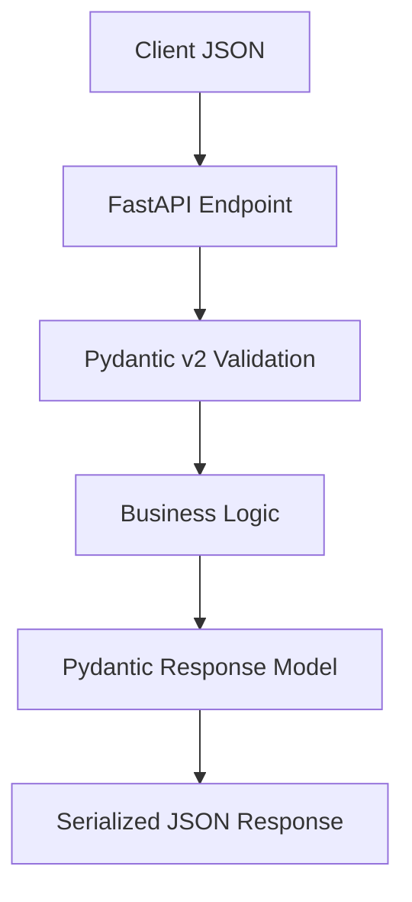

# FastAPI Pydantic v2 Validation

A hands-on learning project demonstrating **Pydantic v2** validation, serialization, and advanced features within FastAPI through a "User Registration and Profile API."

## What Pydantic Does in FastAPI

Pydantic is FastAPI's data validation engine. When a client sends a request:

1. **Request Validation**: FastAPI passes the raw request body to a Pydantic `BaseModel`. Pydantic validates types, constraints, and custom validators. If validation fails, FastAPI returns a `422 Unprocessable Entity` with detailed error messages.
2. **Response Serialization**: The route handler returns data (a model instance or dict). If a `response_model` is specified, FastAPI runs it through Pydantic serialization — filtering fields, computing computed fields, applying serializers, and resolving aliases.

## Request Validation Flow

```text
Client JSON -> FastAPI Endpoint -> Pydantic v2 Validation -> Service Layer
```

1. Client sends JSON in the request body
2. FastAPI detects the `Body` parameter type (a Pydantic model)
3. Pydantic validates the data: type coercion, `Field` constraints, `field_validator`, `model_validator`
4. If valid, the validated model instance is passed to your handler
5. If invalid, a `422` response with error details is returned automatically

## Response Serialization Flow

```text
Service Layer -> Pydantic Response Model -> Serialized JSON Response -> Client
```

1. Your handler returns a model instance, dict, or ORM object
2. FastAPI processes it through the `response_model`
3. Pydantic serializes: excludes unset fields, applies `field_serializer`, computes `computed_field`, resolves aliases
4. The result is sent as JSON to the client



## Pydantic v1 vs v2: Key Differences

| Feature | Pydantic v1 | Pydantic v2 |
|---------|-------------|-------------|
| Validator decorator | `@validator` | `@field_validator` |
| Root validator | `@root_validator` | `@model_validator(mode='after')` |
| Configuration | Inner `class Config` | `model_config = ConfigDict(...)` |
| Serializer | `@json_encoders` dict | `@field_serializer` decorator |
| Computed fields | `@property` (not in schema) | `@computed_field` (in schema & JSON) |
| Core engine | Pure Python | Rust-powered (`pydantic-core`) |
| Union validation | Slow iteration | Discriminated unions with fast dispatch |
| Ad-hoc validation | Not built-in | `TypeAdapter` for any type |
| Performance | Baseline | 5-50x faster |

## Why Rust-Powered Validation Matters

Pydantic v2 uses `pydantic-core`, written in Rust, as its validation engine. This means:

- **5-50x faster** validation and serialization compared to v1
- Lower CPU usage under heavy request loads
- Deterministic performance without Python GIL bottlenecks during core validation
- The Rust core handles type coercion, constraint checking, and structural validation before any Python-level custom validators run

The speedup is most noticeable for batch operations, large payloads, and high-throughput APIs.

## Setup

```bash
uv venv fastapi_pydantic_v2_env
source fastapi_pydantic_v2_env/bin/activate
uv pip install -e ".[dev]"
```

## Running the API

```bash
uvicorn app.main:app --reload
```

Open `http://127.0.0.1:8000/docs` for the interactive Swagger UI.

## Running Tests

```bash
pytest -v
```

## Running Benchmarks

```bash
python benchmark_validation.py
```

## Valid Payload Examples

### Register User

```json
{
  "username": "johndoe",
  "email": "john@example.com",
  "password": "Str0ng!Pass",
  "confirm_password": "Str0ng!Pass",
  "first_name": "John",
  "last_name": "Doe",
  "address": {
    "street": "123 Main St",
    "city": "Springfield",
    "state": "IL",
    "zip_code": "62701"
  }
}
```

### Update Profile (partial)

```json
{
  "first_name": "Jane",
  "phone": "+14155551234"
}
```

### Notification Preference (email)

```json
{
  "type": "email",
  "email_address": "notifications@example.com"
}
```

### Notification Preference (sms)

```json
{
  "type": "sms",
  "phone_number": "+14155551234"
}
```

## Invalid Payload Examples

### Invalid Email

```json
{
  "username": "johndoe",
  "email": "not-an-email",
  "password": "Str0ng!Pass",
  "confirm_password": "Str0ng!Pass",
  "first_name": "John",
  "last_name": "Doe"
}
```

Response: `422` — `value is not a valid email address`

### Weak Password (no uppercase, no digit, no special char)

```json
{
  "username": "johndoe",
  "email": "john@example.com",
  "password": "weakpass",
  "confirm_password": "weakpass",
  "first_name": "John",
  "last_name": "Doe"
}
```

Response: `422` — `Password must contain at least one uppercase letter, must contain at least one digit, must contain at least one special character`

### Password Mismatch

```json
{
  "username": "johndoe",
  "email": "john@example.com",
  "password": "Str0ng!Pass",
  "confirm_password": "Different1!",
  "first_name": "John",
  "last_name": "Doe"
}
```

Response: `422` — `passwords do not match`

### Invalid Notification Type

```json
{
  "type": "push",
  "device_token": "abc123"
}
```

Response: `422` — `Unable to discriminate union`

### Invalid ZIP Code

```json
{
  "street": "123 Main St",
  "city": "Springfield",
  "state": "IL",
  "zip_code": "invalid"
}
```

Response: `422` — `String should match pattern '^\\d{5}(-\\d{4})?$'`

## Schema Reference

| Schema | Purpose | Pydantic v2 Features |
|--------|---------|----------------------|
| `Address` | Nested address model | `BaseModel`, `Field` constraints, regex pattern, defaults |
| `UserRegister` | Registration request | `field_validator` (password), `model_validator` (password match), `Field` (pattern, min/max), `ConfigDict` (`str_strip_whitespace`), nested `Address` |
| `UserUpdate` | Partial profile update | All-optional fields with `None` defaults, `EmailStr` |
| `EmailNotification` | Email notification type | `Literal` type for discriminated union |
| `SMSNotification` | SMS notification type | `Literal` type, `Field` pattern |
| `NotificationPreference` | Discriminated union | `Annotated[Union[...], Field(discriminator=...)]` |
| `UserPublicResponse` | Safe public response | `computed_field` (`display_name`), `from_attributes`, excludes password |
| `UserProfile` | Detailed user profile | `computed_field` (`full_name`), `field_serializer` (phone masking), `Field(alias=...)`, `ConfigDict` (`populate_by_name`) |
| `user_register_adapter` | Batch validation | `TypeAdapter(list[UserRegister])` |
| `notification_adapter` | Ad-hoc union validation | `TypeAdapter(NotificationPreference)` |

## API Endpoints

| Method | Path | Description |
|--------|------|-------------|
| `POST` | `/api/v1/users/` | Register a new user |
| `GET` | `/api/v1/users/{user_id}` | Get user profile (with computed fields and masked phone) |
| `PATCH` | `/api/v1/users/{user_id}` | Update user profile |
| `GET` | `/api/v1/users/` | List all users |
| `POST` | `/api/v1/users/validate-notification` | Validate notification preference (discriminated union) |
| `POST` | `/api/v1/users/validate-batch` | Validate a batch of users (TypeAdapter) |

## Project Structure

```text
4_fastapi_pydantic_v2_validation/
  app/
    __init__.py
    main.py
    api/
      __init__.py
      routes_users.py
    schemas/
      __init__.py
      user.py
    services/
      __init__.py
      user_service.py
  tests/
    __init__.py
    conftest.py
    test_users.py
    test_schemas.py
  benchmark_validation.py
  README.md
  pyproject.toml
```