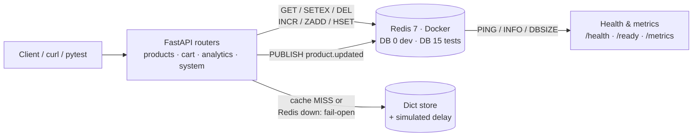
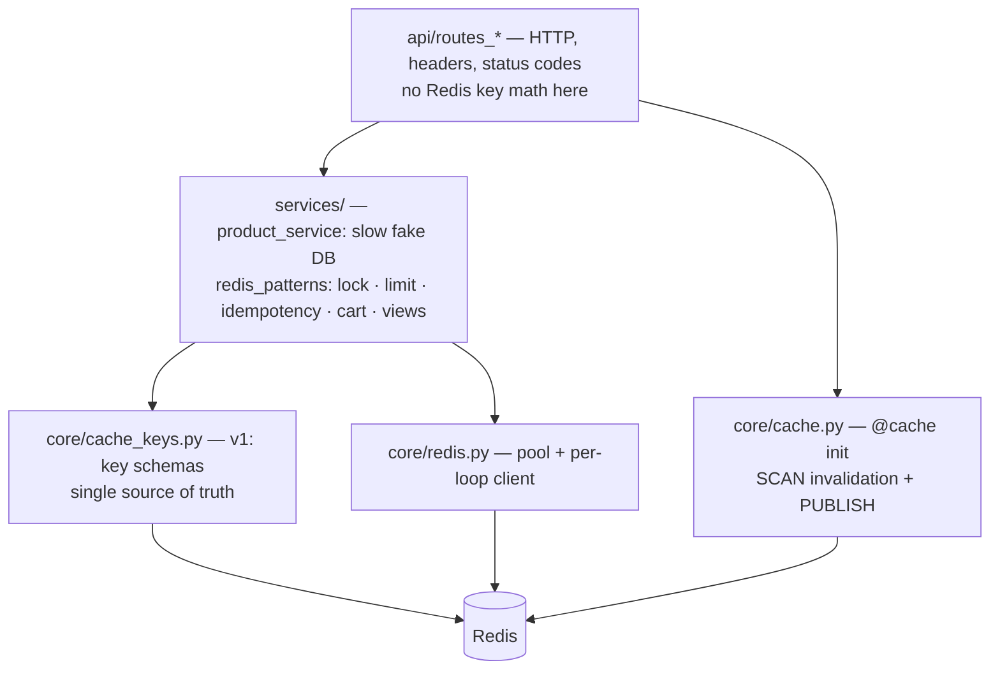
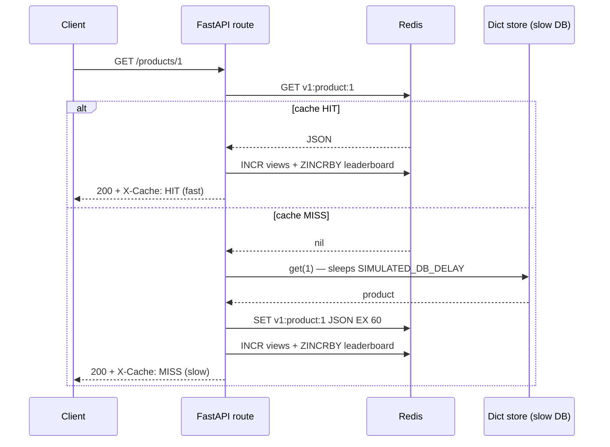
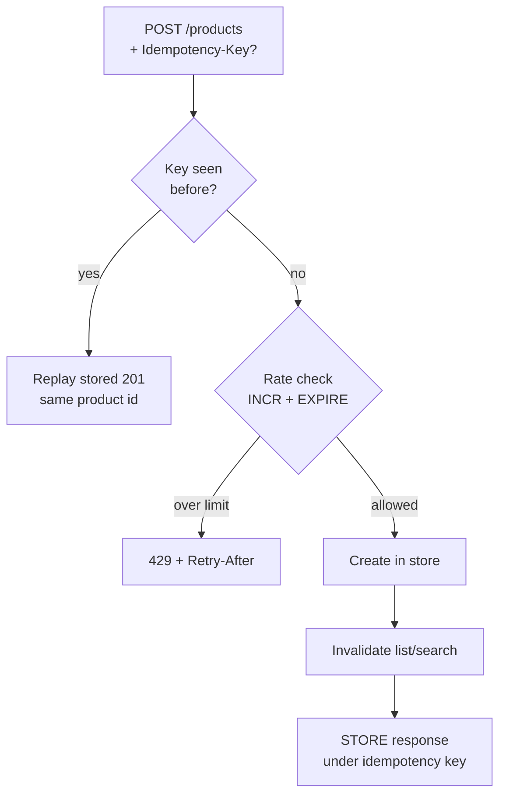
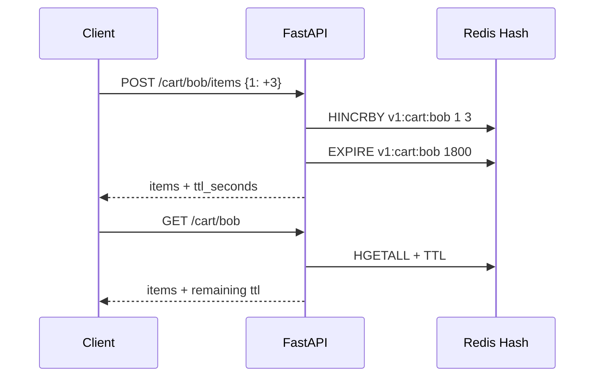
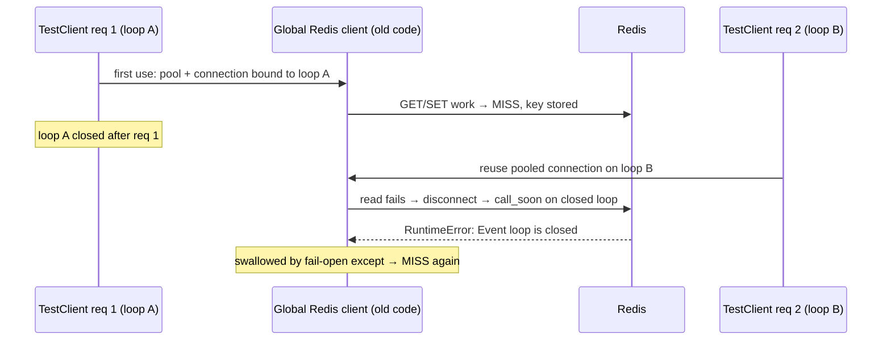
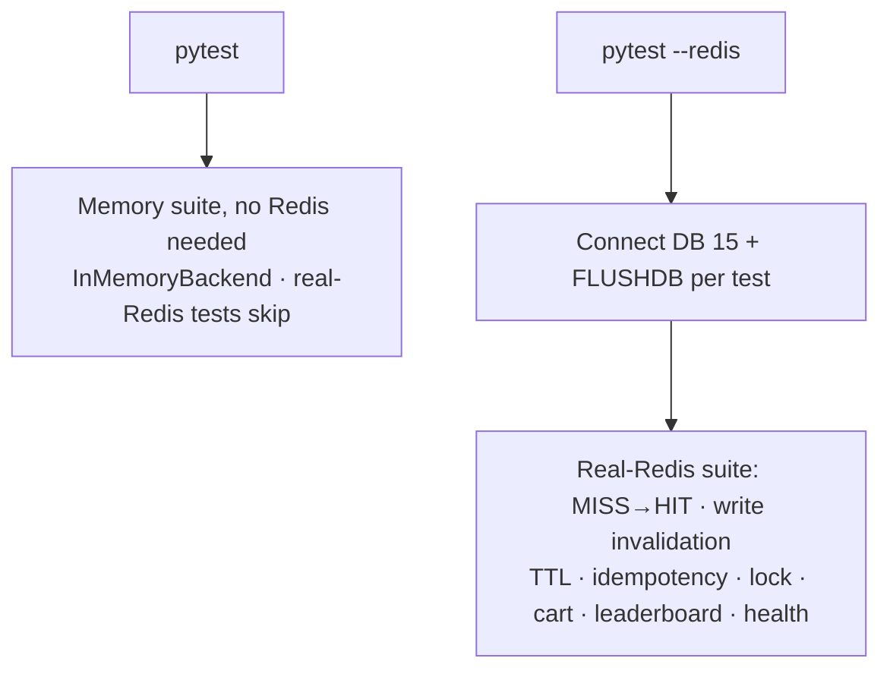

# FastAPI + Real Redis — Product Management Backend

A learning project that teaches **Redis in FastAPI using a real Redis server**
(`redis:7-alpine` in Docker) — no mocks, no in-memory substitutes at runtime.
The demo domain is a small **product management backend** (products, carts,
view analytics) chosen so that every endpoint exercises a different Redis
pattern you will reuse in production.

Related plan: [PLAN.md](PLAN.md).

---

## 1. What you will learn

| Concept | Where to see it |
|---|---|
| Cache-aside (manual `GET` → DB → `SETEX`) | `GET /api/v1/products/{id}`, `app/api/routes_products.py` |
| Cache hit vs miss (`X-Cache` header) | Same endpoint; first call `MISS` (~0.4 s simulated DB delay), repeat calls `HIT` (ms) |
| Per-resource TTLs | Product 60 s, list 15 s, search 30 s (`app/core/config.py`) |
| Write invalidation (`DEL` + `SCAN` + `UNLINK`) | `PUT/PATCH/DELETE /api/v1/products/{id}`, `app/core/cache.py` |
| Decorator caching vs manual caching | `GET /api/v1/products/featured` (`@cache` from `fastapi-cache2`) vs manual cache-aside above |
| Distributed lock / stampede guard (`SET NX PX`) | `GET /api/v1/products/{id}?use_lock=true` → `X-Lock` header |
| Counters + leaderboard (`INCR`, `ZINCRBY`) | `GET /api/v1/analytics/top-viewed` |
| Unique visitors (`PFADD` / `PFCOUNT`, HyperLogLog) | `GET /api/v1/analytics/product/{id}` |
| Hash + TTL state (shopping cart) | `POST /GET /api/v1/cart/{user}[/items]`, 30-min expiry |
| Fixed-window rate limiting (`INCR` + `EXPIRE` → `429`) | `POST /api/v1/products` (per-IP) |
| Idempotency keys (`SET NX EX`, 24 h replay) | `POST /api/v1/products` with `Idempotency-Key` header |
| Autocomplete / tags (Sorted Set / Set) | `GET /api/v1/products/autocomplete?prefix=lap` |
| Pub/Sub cache-invalidation events | `GET /events/subscribe-hint`, `PUBLISH` on every product write |
| Health / readiness / metrics (`PING`, `INFO`, `DBSIZE`) | `GET /health`, `/ready`, `/metrics/redis` |
| Fail-open reads | Every manual cache helper catches Redis errors and falls through to the DB |

### System overview — how the pieces fit

At a high level this is a classic **cache-aside** service: FastAPI owns the HTTP
layer, a (deliberately slow) dict store plays the role of the database, and real
Redis sits in the middle doing caching, counters, locks, rate limits and events.



- **Reads** try Redis first; on miss (or Redis outage) they fall through to the
  store, then populate Redis with a TTL. Every read also bumps analytics.
- **Writes** update the store first, then invalidate the affected keys and
  publish an event so other replicas can drop stale copies.
- **Guards** (rate limit, idempotency, locks) run *before* the store is touched.

---

## 2. Prerequisites

- Python ≥ 3.11, [uv](https://docs.astral.sh/uv/) installed
- Docker running (Redis runs as a container; no local Redis install needed)

---

## 3. Setup — virtual environment with uv (inside this folder)

All commands run in `5_fastapi_redis_cache2/`:

```bash
uv --version && python3 --version
uv venv .venv --python 3.12
source .venv/bin/activate
which python && python --version
uv pip install -e ".[dev]"
```

Notes:

- The venv **must live in this folder** as `.venv` (already in `.gitignore`; never commit it or `.env`).
- VS Code → select `./.venv/bin/python` as the interpreter.
- Rebuild from scratch: `deactivate; rm -rf .venv; uv venv .venv; source .venv/bin/activate; uv pip install -e ".[dev]"`.
- If `pyproject.toml` changes, re-run the install command (and `uv lock`/`uv sync` to refresh `uv.lock`).

---

## 4. Setup — Redis (Docker) and the app

```bash
source .venv/bin/activate
docker compose up -d
docker exec 5_fastapi_redis_cache2-redis-1 redis-cli PING   # expect PONG
cp .env.example .env                                        # optional, defaults work
uvicorn app.main:app --reload
```

- Interactive docs: http://localhost:8000/docs
- Optional Redis UI: `docker compose --profile tools up redis-commander` → http://localhost:8081
- Full stack via compose: `docker compose up --build` (app + Redis; app waits for Redis healthy)

---

## 5. Project structure

```text
app/
  main.py                    # App factory; Redis-only lifespan (PING fail-fast on boot)
  core/config.py             # Settings: Redis URL/pool/timeouts, TTLs, rate-limit, cart, locks
  core/redis.py              # ConnectionPool + client, cached PER event loop (see §9)
  core/cache_keys.py         # Versioned key schemas (v1:...) — single source of truth
  core/cache.py              # fastapi-cache2 init, SCAN invalidation, pub/sub publish
  schemas/product.py         # ProductCreate/Update/Out, CartItemIn/Out
  services/product_service.py# Dict store + simulated DB latency + call counters
  services/redis_patterns.py # lock, rate-limit, idempotency, cart, view-tracking helpers
  api/routes_products.py     # Product CRUD, cache-aside, search, featured, autocomplete
  api/routes_cart.py         # Cart (Hash + TTL)
  api/routes_analytics.py    # Top-viewed leaderboard, per-product stats
  api/routes_system.py       # /health, /ready, /metrics/redis, /cache/ttl, subscribe hint
  api/routes_weather.py      # Legacy fastapi-cache2 decorator demo (kept for regression)
tests/
  conftest.py                # Memory client fixture + --redis real-Redis fixture (DB 15)
  test_weather.py / test_edge_cases.py / test_cache_key_strategy.py
  test_products_redis.py     # Real-Redis suite (skipped without --redis)
```

### Layer map — what each layer owns



- `api/` translates HTTP ↔ domain and sets observability headers (`X-Cache`,
  `X-Views`, `X-Lock`, `Retry-After`).
- `services/` holds the reusable Redis logic; routes stay thin.
- `core/` holds cross-cutting setup: settings, connection management, key
  naming, decorator init and invalidation. Nothing outside `core/cache_keys.py`
  hand-builds a key.

---

## 6. API quick reference

Products (`/api/v1/products`):

| Method | Endpoint | Notes |
|---|---|---|
| `POST` | `/api/v1/products` | Rate-limited per IP; supports `Idempotency-Key`; invalidates list/search cache |
| `GET` | `/api/v1/products?page=&size=&category=&sort=&q=` | Cached 15 s under hashed query key; `X-Cache`, `X-Cache-TTL` |
| `GET` | `/api/v1/products/search?q=` | Cached 30 s |
| `GET` | `/api/v1/products/featured` | `fastapi-cache2 @cache` decorator path (contrast with manual) |
| `GET` | `/api/v1/products/autocomplete?prefix=` | ZSET prefix completion |
| `GET` | `/api/v1/products/{id}` (`?use_lock=true`) | Cache-aside; `X-Cache`, `X-Views`, optional `X-Lock` |
| `PUT`/`PATCH` | `/api/v1/products/{id}` | Update + invalidate single, list, search + publish event |
| `DELETE` | `/api/v1/products/{id}` | Delete + same invalidation |
| `DELETE` | `/api/v1/products/cache` | `SCAN`-delete list/search/featured keys |

Cart (`/api/v1/cart`), analytics (`/api/v1/analytics`), system (`/health`, `/ready`,
`/metrics/redis`, `/cache/ttl?key=`, `/events/subscribe-hint`) — see §1 table.

### Request flows — read path vs write path

**Read path (cache-aside).** The same shape is reused for single product, list
and search — only the key and TTL differ:



**Write path (invalidate + notify).** Writes go to the store first, then remove
everything that could now be stale, then tell other replicas:

```mermaid
flowchart TD
    W[POST create · PUT · PATCH · DELETE] --> DBW[Update dict store]
    DBW --> D1[DEL v1:product:{id}]
    D1 --> D2[SCAN + UNLINK<br/>v1:products:list:*<br/>v1:products:search:*]
    D2 --> P[PUBLISH v1:events:product-updates {id}]
    P --> S[Other API replicas<br/>drop their stale copies]
```

---

## 7. Try it end to end (real Redis)

```bash
# 1. MISS (slow, ~0.4 s simulated DB) then HIT (fast)
curl -i http://localhost:8000/api/v1/products/1 | grep -i "x-cache\|x-views"
curl -i http://localhost:8000/api/v1/products/1 | grep -i "x-cache\|x-views"

# 2. Write invalidates the cache → next read is MISS again
curl -X PUT http://localhost:8000/api/v1/products/1 \
  -H 'Content-Type: application/json' -d '{"price": 1299.0}'
curl -i http://localhost:8000/api/v1/products/1 | grep -i "x-cache"

# 3. Inspect what is really in Redis (this is the point of the project)
docker exec 5_fastapi_redis_cache2-redis-1 redis-cli --scan --pattern 'v1:*'
docker exec 5_fastapi_redis_cache2-redis-1 redis-cli TTL "v1:product:1"
docker exec 5_fastapi_redis_cache2-redis-1 redis-cli ZREVRANGE v1:leaderboard:views 0 4 WITHSCORES

# 4. Cart with TTL, idempotency replay, rate limiting
curl -X POST http://localhost:8000/api/v1/cart/bob/items \
  -H 'Content-Type: application/json' -d '{"product_id": 1, "qty": 3}'
curl -X POST http://localhost:8000/api/v1/products \
  -H 'Content-Type: application/json' -H 'Idempotency-Key: demo-123' \
  -d '{"name":"Demo","sku":"D-1","price":9.99,"stock":5,"category":"test","tags":[]}'
curl -X POST http://localhost:8000/api/v1/products \
  -H 'Content-Type: application/json' -H 'Idempotency-Key: demo-123' \
  -d '{"name":"Demo","sku":"D-1","price":9.99,"stock":5,"category":"test","tags":[]}'  # same id

# 5. Failure drill: stop Redis → reads still work (fail-open), health degrades
docker stop 5_fastapi_redis_cache2-redis-1
curl -s http://localhost:8000/api/v1/products/1 | head -c 120; echo
curl -s http://localhost:8000/health; echo
docker start 5_fastapi_redis_cache2-redis-1
```

---

## 8. Redis key map (all versioned under `v1:`)

> Convention: `v1:` prefix versions the whole schema so you can roll to `v2:` without flushing prod. Never hand-build keys — use `app/core/cache_keys.py`.

| Key | Redis type | TTL | Written on | Read on | Purpose |
|---|---|---|---|---|---|
| `v1:product:{id}` | String(JSON) | `EX 60s` (`CACHE_TTL_PRODUCT`) | `GET /products/{id}` MISS → `SET`; deleted on `PUT/PATCH/DELETE` | `GET /products/{id}` → `GET` | Cache-aside single product. Avoids `SIMULATED_DB_DELAY` (~0.4s). `X-Cache: HIT/MISS`. |
| `v1:products:list:{qh}` | String(JSON) | `EX 15s` (`CACHE_TTL_LIST`) | `GET /products?page=&size=&category=&sort=&q=` MISS → `SET` | Same list endpoint → `GET` | List cache. `qh = sha256(json.dumps(query, sort_keys=True))[:16]` (`cache_keys.py::list_key`): (1) `sort_keys=True` → `?page=1&size=20` and `?size=20&page=1` hit same key, (2) `sha256` → fixed-length key no matter how long `q/category` are (avoids huge keys, spaces/special chars, Redis 512MB key limit), (3) `[:16]` → 64-bit, short but collision-safe enough for cache (collision = just a wrong HIT that expires in 15s, not data loss). Short TTL + `SCAN`-delete on write bound stale pages + cardinality. |
| `v1:products:search:{norm}` | String(JSON) | `EX 30s` (`CACHE_TTL_SEARCH`) | `GET /products/search?q=` MISS → `SET` | Same search endpoint → `GET` | Search cache. `norm = q.strip().lower()` so `Lap`/`lap` share one key. `SCAN`-deleted on write. |
| `v1:products:featured` | String(JSON) | `EX 60s` | `GET /products/featured` via `@cache` decorator | Same | Decorator path (`fastapi-cache2`), contrast with manual cache-aside above. Cleared via `DEL` in `invalidate_product()`. |
| `v1:product:{id}:views` | String counter | none (persistent) | Every product read → `INCR` in `track_view()` | `GET /analytics/product/{id}`, `X-Views` header | Total views. Separate from cache key so analytics survive cache expiry/eviction. No TTL — grows monotonically. |
| `v1:visitors:{id}` | HyperLogLog | none | Every product read → `PFADD <client-ip>` | `GET /analytics/product/{id}` → `PFCOUNT` | Unique viewers, ~12KB fixed memory regardless of traffic. Approximate (0.81% err) — use for trends, not billing. |
| `v1:leaderboard:views` | Sorted Set (`member=product_id`, `score=views`) | none | Every product read → `ZINCRBY 1` | `GET /analytics/top-viewed` → `ZREVRANGE 0 N-1 WITHSCORES` | Global ranking for "trending / most-viewed" widget. `O(log N)` update, sorted read with no DB scan. See §7.3. |
| `v1:cart:{user}` | Hash (`field=product_id`, `value=qty`) | `EXPIRE 1800s` refreshed on every `HINCRBY` | `POST /cart/{user}/items` → `HINCRBY + EXPIRE` | `GET /cart/{user}` → `HGETALL + TTL` | Ephemeral per-user state. Abandoned carts evaporate automatically. Lowercase `user` in `cart_key()`. |
| `v1:idempotency:{key}` | String(JSON response) | `EX 24h` (`IDEMPOTENCY_TTL`) | `POST /products` with `Idempotency-Key` → `SET NX EX` after store write | Same `POST` retry → `GET` replay | Duplicate-submit guard. Replay returns stored `201` body with same `id`, never creates twice. Key = client-supplied header value. |
| `v1:ratelimit:{scope}:{window}` | String counter | `EXPIRE = window` (60s) | `POST /products` pre-check → `INCR`; `EXPIRE` only when `count==1` | Same | Fixed-window rate limit (10/min/IP default). `window = now // 60`. Over limit → `429 + Retry-After`. Fail-open here, fail-closed in prod auth/billing. |
| `v1:lock:product:{id}` | String (`value=uuid token`) | `PX 5000ms` | `GET /products/{id}?use_lock=true` → `SET NX PX` | Released via `GET == token → DEL` in `finally` | Stampede guard: only one request does DB load on hot-key MISS. `X-Lock: acquired/contention-or-redis-down`. Token prevents deleting someone else's lock. |
| `v1:autocomplete` | Sorted Set (`member=lower(name)`, `score=0`) | none | Startup seed + `POST /products` → `ZADD` | `GET /products/autocomplete?prefix=` → `ZRANGE 0 -1` + python prefix filter | Prefix completion demo. Single global ZSET; score unused (all 0, lexicographic use). Production would use `ZRANGEBYLEX` or Search index. |
| `v1:product:{id}:tags` | Set (`member=tag`) | none | `POST /products` → `SADD` | `redis-cli SMEMBERS` (no HTTP read yet) | Facet/filter primitive (`SISMEMBER`, `SINTER` across products). Kept to show Set vs ZSET vs Hash choice. |
| `v1:events:product-updates` | Pub/Sub channel (not stored) | N/A | `invalidate_product()` → `PUBLISH {id}` on every create/update/delete | Manual `SUBSCRIBE` (see `/events/subscribe-hint`) | Cross-replica invalidation signal. Today redundant (single shared Redis — `DEL` is already visible). Needed only if you add per-replica local memory cache. No subscriber is running in this codebase. |

### How to inspect (copy-paste)

```bash
docker exec 5_fastapi_redis_cache2-redis-1 redis-cli --scan --pattern 'v1:*' | sort
docker exec 5_fastapi_redis_cache2-redis-1 redis-cli TTL "v1:product:1"
docker exec 5_fastapi_redis_cache2-redis-1 redis-cli GET "v1:product:1" | head -c 200; echo
docker exec 5_fastapi_redis_cache2-redis-1 redis-cli ZREVRANGE v1:leaderboard:views 0 4 WITHSCORES
docker exec 5_fastapi_redis_cache2-redis-1 redis-cli PFCOUNT "v1:visitors:1"
docker exec 5_fastapi_redis_cache2-redis-1 redis-cli HGETALL "v1:cart:bob"
```

### Lifecycle rules

* Ephemeral (`EXPIRE`): `product:{id}`, `list:*`, `search:*`, `featured`, `cart:*`, `ratelimit:*`, `lock:*`, `idempotency:*` (long 24h but still ephemeral).
* Persistent: `product:{id}:views`, `visitors:{id}`, `leaderboard:views`, `autocomplete`, `product:{id}:tags` — survive cache flushes; grow until explicitly deleted. Guard cardinality (list keys via short TTL + hashed query; leaderboard via top-N reads, not full scan).
* Invalidation: single key via `DEL`, patterns via `SCAN + UNLINK` (`app/core/cache.py::scan_delete`) — never `KEYS` outside local debugging. `UNLINK` is non-blocking; falls back to `DEL` on error.

Production rule demonstrated here: invalidate with `SCAN` + `UNLINK`/`DEL`
(`app/core/cache.py::scan_delete`) — never `KEYS` outside local debugging.

### Pattern flows — guards, cart, analytics

**Create guard chain (idempotency → rate limit → write).** Cheap Redis checks run
before the expensive store write; a retried `POST` with the same key never
creates a duplicate:



**Cart (ephemeral per-user state).** A Redis Hash holds `product_id → qty` and
every touch refreshes the 30-minute TTL — abandoned carts evaporate on their own:



**Analytics (counters without a DB write).** Every product read fans out to three
structures; dashboards read them back with no store access at all:

```mermaid
flowchart LR
    V[Every product read] --> I[INCR v1:product:{id}:views]
    I --> Z[ZINCRBY v1:leaderboard:views]
    V --> H[PFADD v1:visitors:{id} client-ip]
    Z --> T[GET /analytics/top-viewed<br/>ZREVRANGE]
    H --> U[GET /analytics/product/{id}<br/>PFCOUNT unique viewers]
```

---

## 9. Bug we hit and fixed: `Event loop is closed` on the 2nd request

**Symptoms.** Under tests (and any re-used client), the first `GET /api/v1/products/1`
returned `X-Cache: MISS`, but every later identical request *also* returned `MISS`
— even though `redis-cli` proved the key existed with a valid TTL. Reads never hit
the cache, yet nothing raised: responses were all HTTP 200.

**Root cause.** Two layers combined:

1. Starlette's `TestClient` spins up a **fresh event loop (portal) per request**.
2. `redis.asyncio` connections **bind their transports to the loop that created
   them**. Our original `app/core/redis.py` held **one global client/pool**, created
   on request 1's loop. On request 2 (new loop), reusing the pooled connection
   failed inside `redis-py` with `RuntimeError: Event loop is closed`
   (surfacing in `connection.py::read_response → disconnect → loop.call_soon`).
3. Every manual cache helper wraps Redis calls in `try/except → fall through to DB`
   (fail-open by design), so the exception was **silently swallowed** and each
   request looked like a legitimate `MISS`. The `except: pass` hid a real bug —
   found only by temporarily logging the traceback to a file.

**Fix** (`app/core/redis.py`): cache one pool + client **per running event loop**
(keyed by `id(asyncio.get_running_loop())`). Production (uvicorn) has a single
loop → still exactly one client. Tests (one loop per request) → one client per
loop. Result: `pytest --redis` went from 10 failures to **40 passed**.

**Takeaways for production:**

- Never share one `redis.asyncio` client across event loops or processes
  (same applies to gunicorn/uvicorn workers: one pool **per worker process**).
- Fail-open `except: pass` around cache calls is correct for availability, but log
  the exception (at least at debug/warning) — silent excepts turn real bugs into
  "the cache just never hits".
- When debugging "always MISS", check in order: wrong key/DB, TTL already expired,
  serialization mismatch, and finally client/loop health (`PING`).

What happened, as a sequence:



---

## 10. Testing

```bash
source .venv/bin/activate
pytest             # memory backend; real-Redis tests skip (no Redis needed)
pytest --redis -v  # real Docker Redis on DB 15 (requires: docker compose up -d)
```

- `--redis` suite covers: MISS→HIT, update/delete invalidation, list invalidation on
  create, search cache, TTL inspector, idempotency replay, lock header, cart Hash+TTL,
  views/leaderboard, autocomplete, `/health` `/ready` `/metrics/redis`.
- Test isolation: DB `15` + `FLUSHDB` per test; dev server uses DB `0`.
- Current status: `40 passed` with `--redis`; `27 passed, 13 skipped` without.



---

## 11. Configuration (`.env`, see `.env.example`)

| Variable | Default | Purpose |
|---|---|---|
| `REDIS_URL` | `redis://localhost:6379/0` | Connection URL (compose app service uses `redis://redis:6379/0`) |
| `REDIS_POOL_SIZE` / `REDIS_SOCKET_TIMEOUT` | `20` / `2.0` | Pool size, connect/read timeout (s) |
| `CACHE_TTL_PRODUCT` / `CACHE_TTL_LIST` / `CACHE_TTL_SEARCH` | `60` / `15` / `30` | Per-resource TTLs (s) |
| `SIMULATED_DB_DELAY` | `0.4` | Fake DB latency so HIT vs MISS is measurable |
| `IDEMPOTENCY_TTL` | `86400` | Idempotency record lifetime (24 h) |
| `RATE_LIMIT_MAX` / `RATE_LIMIT_WINDOW_S` | `10` / `60` | Fixed-window limit per scope |
| `CART_TTL_S` | `1800` | Cart expiry (30 min) |

---

## 12. Production checklist (what this project deliberately leaves open)

- [ ] Replace the dict store with Postgres/SQLModel; keep Redis as cache, not source of truth
- [ ] One Redis pool per worker process; tune `max_connections` from load tests
- [ ] Fail-**closed** rate-limit/idempotency on auth/billing paths (here they fail open for learning)
- [ ] Bounded list-cache cardinality (short TTL + hashed normalized keys + deny-listed sort fields)
- [ ] `UNLINK` (non-blocking) everywhere in request paths; `SCAN COUNT` tuned, never `KEYS`
- [ ] `/ready` (Redis `PING`) wired to K8s readiness probe; alert on `keyspace_misses` ratio and pool exhaustion
- [ ] Redis persistence (`appendonly yes`, volume — already in compose) + backup/restore drill
- [ ] Auth on Redis (`requirepass` / ACL) and TLS in transit for non-local deployments
