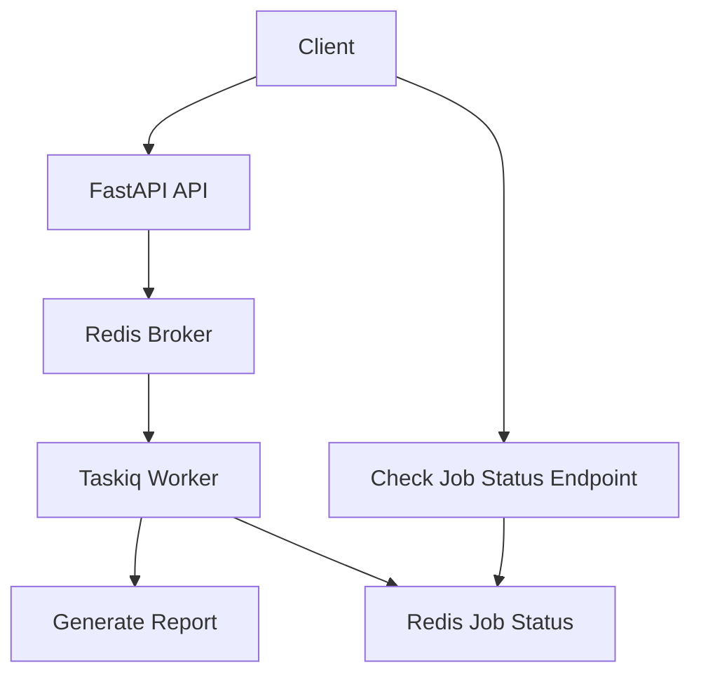

# FastAPI Taskiq Background Jobs

An "Email Report Generator API" that teaches background task queues for FastAPI using **Taskiq** as the async-first task queue, with Redis as both the message broker and status store.

## Why Background Tasks?

Heavy work — report generation, email sending, data processing — should **not** run inside the request-response lifecycle. If a report takes 30 seconds to generate, the client waits 30 seconds for an HTTP response, and the server thread is blocked for 30 seconds. This leads to:

- **Poor user experience** — long waits with no feedback
- **Resource exhaustion** — server threads blocked instead of handling new requests
- **Timeouts** — load balancers and clients time out before the work finishes

The solution: **dispatch the work to a background worker** and return a job ID immediately. The client polls for status.

## Architecture

### API Process vs Worker Process

| Role | Responsibility | Command |
|------|---------------|---------|
| **API** | Accept requests, dispatch tasks, serve status | `uvicorn app.main:app` |
| **Worker** | Execute background tasks, update status | `taskiq worker app.core.broker:broker app.tasks.report_tasks` |
| **Redis** | Message broker + job status store | `docker compose up redis` |

The **API process** receives HTTP requests, creates a job record in Redis, and enqueues a task via the broker. It never runs the actual report generation. The **worker process** picks up tasks from the broker, executes them, and updates job status in Redis.

### Broker Concept

A **broker** is the message queue that decouples the API from the worker. When the API calls `task.kiq()`, it serializes the task arguments and pushes them to Redis. The worker listens to Redis and pulls tasks for execution. Neither process directly calls the other — they communicate through the broker.

### Job Status Tracking

Each submitted job gets a UUID. Status is stored as a Redis hash with fields: `job_id`, `status`, `report_type`, `created_at`, `started_at`, `completed_at`, `error`, `result`. The lifecycle is:

```
pending → processing → completed
                    └→ failed
```



## Taskiq vs Celery vs Dramatiq

| Feature | Taskiq | Celery | Dramatiq |
|---------|--------|--------|----------|
| Async-native | Yes | No (requires eventlet/gevent) | No |
| Broker support | Redis, RabbitMQ, etc. | Redis, RabbitMQ, SQS, etc. | Redis, RabbitMQ |
| FastAPI integration | `taskiq-fastapi` | Manual | Manual |
| Result backend | Pluggable (Redis built-in) | Pluggable | Limited |
| Retry middleware | Built-in (Simple + Smart) | Built-in | Built-in |
| API style | `.kiq()` method | `.delay()` / `.apply_async()` | `.send()` |
| Typed | Full type hints | Partial | Partial |
| Maintenance | Active | Mature, slow releases | Active |
| Learning curve | Low | High (boilerplate) | Low |

### Celery Alternative Notes

The equivalent setup in Celery would use:

```python
# Celery broker setup (for comparison)
from celery import Celery

celery_app = Celery(
    "reports",
    broker="redis://localhost:6379/0",
    backend="redis://localhost:6379/1",
)

@celery_app.task(bind=True, max_retries=3)
def generate_report_celery(self, job_id, report_type):
    # synchronous code
    ...
```

Key differences: Celery is synchronous by default, requires more boilerplate, and lacks native FastAPI dependency injection. Taskiq's `.kiq()` is async-first and integrates with FastAPI via `taskiq-fastapi`.

## Retry and Failure Handling

### Retry with Taskiq

Taskiq provides two retry middlewares:

- **SimpleRetryMiddleware** — retries on any exception, configurable per-task via `retry_on_error=True` and `max_retries=N`
- **SmartRetryMiddleware** — adds exponential backoff and jitter

This project includes a retry example:

```python
# tasks/report_tasks.py
@broker.task(retry_on_error=True, max_retries=3)
async def generate_report_with_retry(job_id, report_type, ...):
    ...
```

Submit with `retry=true` to use it:

```bash
curl -X POST http://localhost:8000/reports/submit \
  -H "Content-Type: application/json" \
  -d '{"report_type": "sales", "retry": true}'
```

### Failure Handling

When a task fails:

1. The worker catches the exception
2. Job status is updated to `failed` with the error message
3. If retries are enabled, the task is re-queued (up to `max_retries`)
4. After all retries are exhausted, the job remains in `failed` status

The status endpoint returns the error:

```bash
curl http://localhost:8000/reports/{job_id}/status
# {"status": "failed", "error": "...", ...}
```

## Setup and Running

### Install

```bash
uv venv fastapi_taskiq_env
source fastapi_taskiq_env/bin/activate
uv pip install -e ".[dev]"
```

### Start Redis

```bash
docker compose up redis -d
```

### Set environment variables

```bash
cp .env.example .env
```

### Run the API

```bash
uvicorn app.main:app --reload
```

### Run the worker

```bash
taskiq worker app.core.broker:broker app.tasks.report_tasks
```

### Run with Docker Compose (all services)

```bash
docker compose up --build
```

## API Endpoints

### Submit a Report Job

```bash
curl -X POST http://localhost:8000/reports/submit \
  -H "Content-Type: application/json" \
  -d '{"report_type": "sales"}'
```

Response (202):

```json
{
  "job_id": "550e8400-e29b-41d4-a716-446655440000",
  "status": "pending",
  "message": "Report job 'sales' submitted. Use GET /reports/550e8400-.../status to check progress."
}
```

Valid report types: `sales`, `financial`, `user_activity`

### Check Job Status

```bash
curl http://localhost:8000/reports/{job_id}/status
```

Response (200):

```json
{
  "job_id": "550e8400-e29b-41d4-a716-446655440000",
  "status": "completed",
  "report_type": "sales",
  "created_at": "2025-01-15T10:00:00+00:00",
  "started_at": "2025-01-15T10:00:01+00:00",
  "completed_at": "2025-01-15T10:00:06+00:00",
  "error": "",
  "result": "Sales Report generated at 2025-01-15T10:00:06+00:00. Total revenue: $1,234,567."
}
```

## Running Tests

```bash
pytest -v
```

Tests use `fakeredis` (no Redis server required) and mock the Taskiq broker dispatching.

## Project Structure

```
app/
  main.py                  # FastAPI app factory with lifespan
  api/
    routes_reports.py      # POST /reports/submit, GET /reports/{job_id}/status
  core/
    config.py              # Settings via pydantic-settings
    broker.py              # RedisStreamBroker + RedisAsyncResultBackend
  tasks/
    report_tasks.py        # Taskiq tasks: generate_report, generate_report_with_retry
  services/
    report_service.py      # Redis status tracking + report simulation
tests/
  conftest.py              # Fixtures: fakeredis, mock broker
  test_submit_report.py    # Submit endpoint tests
  test_job_status.py       # Status endpoint tests
  test_edge_cases.py       # Edge case + service lifecycle tests
docker-compose.yml
Dockerfile
pyproject.toml
.env.example
```