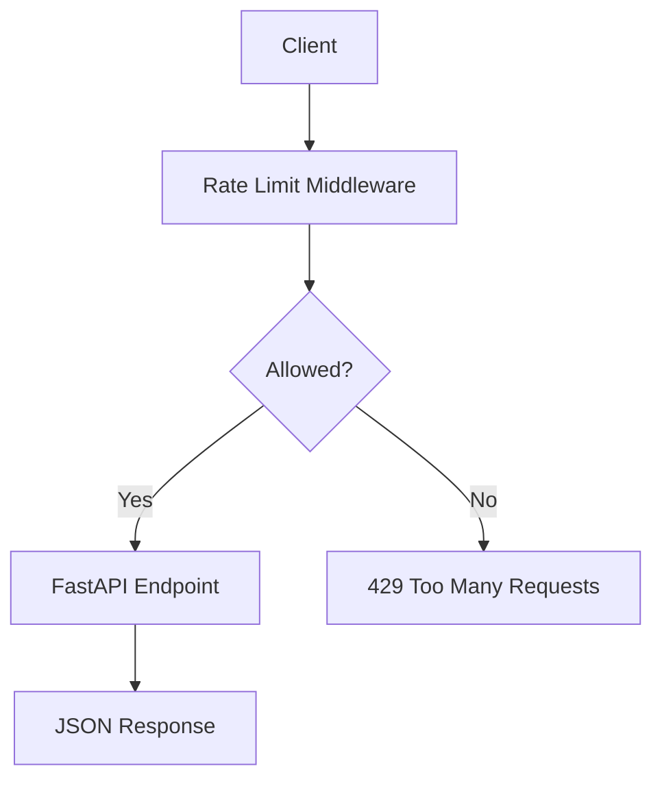

# FastAPI Slowapi Rate Limiting - Public Quotes API

A hands-on learning project demonstrating API rate limiting in FastAPI using **Slowapi** with a Public Quotes API.

## What is Rate Limiting?

Rate limiting controls how many requests a client can make to an API within a given time window. When a client exceeds the allowed number of requests, the server responds with `429 Too Many Requests` instead of processing the request.

Rate limiting is implemented as middleware or a decorator layer that:

1. Identifies the client (by IP address, API key, or user token)
2. Checks a counter for that client against the configured limit
3. Allows the request if under the limit, or rejects it with a `429` response

## Why Rate Limiting Protects Scalability

Without rate limiting, a single client (or bot) can flood your API with requests, consuming server resources and degrading performance for everyone else. Rate limiting provides:

- **Fair access**: Ensures no single client monopolizes server resources
- **Cost control**: Prevents unexpected spikes in compute, database, or third-party API costs
- **DDoS mitigation**: Throttles abusive traffic patterns before they overwhelm the server
- **Predictable performance**: Keeps response times stable under load
- **Monetization**: Enables tiered plans (free, pro, enterprise) with different quotas

## IP-Based Limits

The simplest rate limiting strategy identifies clients by their IP address. Every request from the same IP increments a shared counter.

```
Client (192.168.1.10) --> 5 requests/min limit
  Request 1: 200 OK
  Request 2: 200 OK
  ...
  Request 6: 429 Too Many Requests
```

IP-based limiting is easy to implement but has limitations: users behind NAT or proxies share an IP, and attackers can rotate IPs.

## Token/User-Based Limits

A more precise strategy identifies clients by an API key, bearer token, or user ID from a request header. Each unique key gets its own rate limit counter, allowing:

- Per-account quotas regardless of IP changes
- Different limits for different users or plans
- Better auditability of who is consuming resources

```
Client (X-API-Key: pro_alice) --> 20 requests/min limit
Client (X-API-Key: free_bob)  -->  3 requests/min limit
```

## Fixed Window vs Moving Window

| Concept | Fixed Window | Moving Window (Sliding) |
|---|---|---|
| How it works | Counts requests from the start of a time window (e.g., 12:00:00 to 12:01:00) | Counts requests in the last N seconds from the current moment |
| Burst behavior | Allows 2x burst at window boundary (use all limit at end of window, then all limit at start of next) | Smoother distribution; no boundary burst |
| Implementation | Simple counter per window | Requires storing timestamps or weighted counters |
| Slowapi support | Default strategy | Available via `strategy="moving-window"` |

Slowapi uses **fixed window** by default, which is sufficient for most use cases.

## Per-Plan Limits

This project demonstrates tiered rate limits based on the API key prefix:

| Plan | Key Prefix | Rate Limit on `/premium` |
|---|---|---|
| Free | `free_` | 3/minute |
| Pro | `pro_` | 20/minute |
| Admin | `admin_` | 1000/minute |

The `dynamic_plan_limit()` function inspects the `X-API-Key` header at request time and returns the appropriate limit string.

## Rate Limit Headers

When `headers_enabled=True`, Slowapi adds the following headers to successful responses:

| Header | Description |
|---|---|
| `x-ratelimit-limit` | Maximum requests allowed in the window |
| `x-ratelimit-remaining` | Requests remaining in the current window |
| `x-ratelimit-reset` | Unix timestamp when the window resets |
| `retry-after` | Seconds until the limit resets (present on all responses) |

## Custom 429 Response

By default, Slowapi returns a plain text response on rate limit exceeded. This project registers a custom exception handler that returns a structured JSON body:

```json
{
  "error": "Rate limit exceeded",
  "detail": "5 per 1 minute"
}
```

## Production Concerns

### Reverse Proxy Header Warning

When running behind a reverse proxy (Nginx, Cloudflare, AWS ALB), the client IP seen by FastAPI is the proxy IP, not the real client IP. To rate limit by real client IP:

1. Configure the proxy to forward the real IP in `X-Forwarded-For` or `X-Real-IP` headers
2. Use Slowapi's `get_ipaddr()` utility (respects `X-Forwarded-For`) instead of `get_remote_address()`
3. **Security**: Ensure the proxy sets these headers; otherwise, clients can spoof them to bypass limits

```python
from slowapi.util import get_ipaddr

# Respects X-Forwarded-For header
limiter = Limiter(key_func=get_ipaddr, headers_enabled=True)
```

### Redis-Backed Rate Limit Storage

In production with multiple server instances, in-memory storage does not share rate limit counters across processes. Use Redis for shared storage:

```python
limiter = Limiter(
    key_func=get_remote_address,
    storage_uri="redis://localhost:6379/0",
)
```

Redis storage ensures all instances enforce the same limits. Without it, horizontal scaling effectively multiplies your per-instance limit by the number of instances.

## Architecture



## Setup

```bash
uv venv fastapi_slowapi_env
source fastapi_slowapi_env/bin/activate
uv pip install -e ".[dev]"
```

## Running the Server

```bash
uvicorn app.main:app --reload
```

Open the interactive docs at `http://127.0.0.1:8000/docs`.

## API Endpoints

| Method | Path | Rate Limit | Key | Description |
|---|---|---|---|---|
| `GET` | `/api/v1/quotes` | 10/minute | IP | List all public quotes |
| `GET` | `/api/v1/quotes/random` | 5/minute | IP | Get a random public quote |
| `GET` | `/api/v1/quotes/{quote_id}` | 5/minute | `X-API-Key` header | Get a quote by ID |
| `GET` | `/api/v1/quotes/premium` | 3-1000/min | `X-API-Key` header (plan-based) | Get premium quotes |

## Example Requests

List all quotes (IP-limited):

```bash
curl http://127.0.0.1:8000/api/v1/quotes/
```

Get a random quote (IP-limited, 5/minute):

```bash
curl http://127.0.0.1:8000/api/v1/quotes/random
```

Get a quote by ID (requires API key):

```bash
curl -H "X-API-Key: free_demo" http://127.0.0.1:8000/api/v1/quotes/1
```

Access premium quotes with different plans:

```bash
# Free plan (3/minute)
curl -H "X-API-Key: free_demo" http://127.0.0.1:8000/api/v1/quotes/premium

# Pro plan (20/minute)
curl -H "X-API-Key: pro_developer" http://127.0.0.1:8000/api/v1/quotes/premium

# Admin plan (1000/minute)
curl -H "X-API-Key: admin_superuser" http://127.0.0.1:8000/api/v1/quotes/premium
```

Trigger a 429 response:

```bash
# Send 6 rapid requests to hit the 5/minute limit on /random
for i in $(seq 1 6); do
  curl -s -o /dev/null -w "%{http_code}\n" http://127.0.0.1:8000/api/v1/quotes/random
done
```

## Testing

```bash
pytest -v
```

Tests verify:

- All endpoints return correct data (200)
- Repeated requests eventually return 429
- Different API keys get independent rate limits
- Rate limit headers are present in responses
- Per-plan limits: free keys hit 429 faster than pro/admin keys
- Missing API key falls back to IP-based limiting
- Custom 429 JSON error body format
- Nonexistent quote IDs return 404

## Project Structure

```text
7_fastapi_slowapi_rate_limiting/
  app/
    __init__.py
    main.py                  # App factory and limiter registration
    api/
      __init__.py
      routes_quotes.py       # Quote endpoints with rate limit decorators
    core/
      __init__.py
      config.py              # Pydantic settings
      rate_limit.py           # Limiter, key functions, plan logic, 429 handler
    services/
      __init__.py
      quote_service.py        # In-memory quote data and queries
  tests/
    __init__.py
    conftest.py               # Test fixtures with rate limit reset
    test_quotes.py             # Endpoint data correctness tests
    test_rate_limit.py         # 429 behavior, headers, key isolation, plan tests
    test_edge_cases.py         # Missing key fallback, different route limits, 429 format
  pyproject.toml
  README.md
```