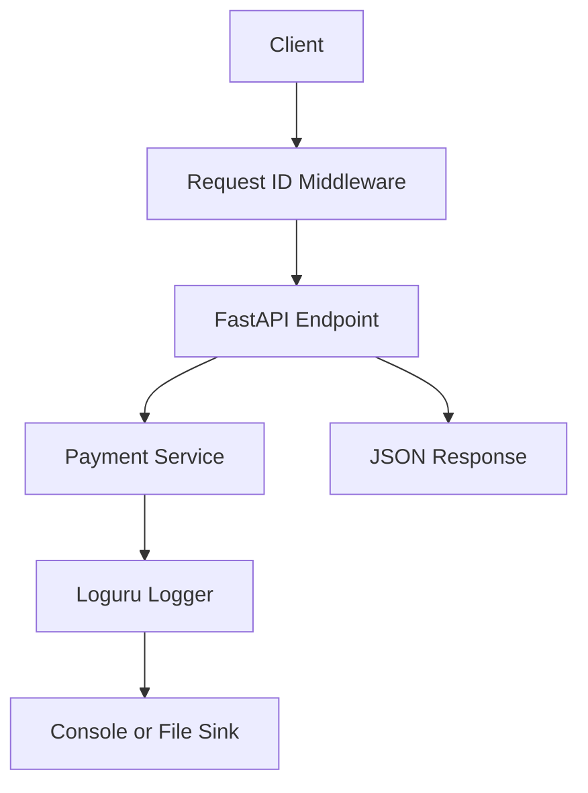

# FastAPI Loguru Structured Logging - Payment Events API

A hands-on learning project demonstrating production-style structured logging in FastAPI using **Loguru**, with async-safe `enqueue=True`, request correlation IDs, and a Payment Events API.

## Why Logging Matters

In development, `print()` works. In production, you need structured, searchable, and asynchronous logging because:

- **Debugging**: When something breaks at 3 AM, logs are your only evidence
- **Observability**: You need to track request flows across services
- **Auditing**: Who did what and when? Logs provide the trail
- **Alerting**: Log patterns trigger alerts before users notice problems
- **Metrics**: Aggregate logs to measure latency, error rates, and throughput

Without structured logging, you are searching through walls of unstructured text. With it, you can query, filter, and analyze.

## Problems with Blocking Logging

Python's standard `logging` module works synchronously. In an async framework like FastAPI, blocking operations are problematic:

```
Request 1 -> await handler() -> logger.info() -> [waits for I/O write] -> returns response
                                                    |
                                      Other requests are blocked during this write
```

Problems:

- **I/O blocking**: Writing to disk or sending to a remote service blocks the event loop
- **Latency spikes**: Synchronous file writes add milliseconds to every request
- **Competitive output**: Multiple async tasks writing simultaneously can interleave output
- **Standard logging complexity**: Python's `logging` module requires handler, formatter, and filter configuration that is verbose and error-prone

Loguru solves these with `enqueue=True`, which routes log messages through a thread-safe queue.

## Loguru Basics

Loguru is a Python logging library that requires zero configuration to get started:

```python
from loguru import logger

logger.info("Application started")
logger.warning("Something seems off")
logger.error("Something went wrong")
```

Key advantages over `logging`:

| Feature | `logging` | Loguru |
|---|---|---|
| Setup | Multi-step (handler, formatter, level) | Single `logger.add()` call |
| Exception formatting | Manual tracebacks | Automatic with `backtrace=True` |
| Structured output | Requires `jsonformatter` | Built-in `serialize=True` |
| Async safety | Not built-in | `enqueue=True` |
| Rotation | Requires `RotatingFileHandler` | Built-in `rotation` parameter |
| Context data | `logging.adapter` | `logger.bind()` / `logger.contextualize()` |

## `enqueue=True`

When `enqueue=True`, Loguru uses a multiprocessing-safe internal queue. Log messages are placed in a queue and a background thread writes them to the sink. This means:

- **Non-blocking**: The calling coroutine never waits for I/O
- **Thread-safe**: Safe to use across multiple async tasks and threads
- **Process-safe**: Works in multiprocessing scenarios

```python
# Blocking (default) - the current coroutine waits for the write
logger.add("app.log")
# I/O write happens in the same thread/async task

# Non-blocking (enqueue) - a background thread handles the write
logger.add("app.log", enqueue=True)
# The coroutine continues immediately, background thread writes to disk
```

This is critical in FastAPI because you do not want a file write blocking the event loop while a user waits for a response.

## Structured JSON Logging

Structured logs are machine-readable JSON objects instead of human-readable text lines. Compare:

**Unstructured** (hard to parse):
```
2025-01-15 10:30:00 | INFO | Payment created for Alice amount=99.50
```

**Structured** (easy to query):
```json
{
  "timestamp": "2025-01-15T10:30:00.123Z",
  "level": "INFO",
  "message": "Payment created",
  "request_id": "a1b2c3d4-e5f6-7890-abcd-ef1234567890",
  "customer": "Alice",
  "amount": 99.50
}
```

This project configures two output modes:

- **Console** (dev): Pretty colored output with request ID in each line
- **File** (prod): JSON-formatted via `serialize=True`, rotated at 10 MB, retained for 7 days

## Request Correlation IDs

In a microservices architecture, a single user action may span multiple services. Correlation IDs (also called request IDs or trace IDs) link all log entries for a single request.

This project uses `X-Request-ID` as the correlation header:

1. Client sends `X-Request-ID: abc-123` (or the middleware generates a UUID4)
2. Middleware stores the ID in request state and Loguru context
3. Every log line for this request includes the request ID
4. The response echoes back `X-Request-ID: abc-123`

```python
# Middleware flow
request_id = request.headers.get("X-Request-ID") or str(uuid.uuid4())

with logger.contextualize(request_id=request_id):
    # All log calls inside this block include request_id
    logger.info("Processing payment")  # -> {request_id: "abc-123", message: "Processing payment"}
    response = await call_next(request)
```

## Logging Levels

| Level | When to use | Example |
|---|---|---|
| `DEBUG` | Detailed diagnostic information | `logger.debug("Card number masked: ****4242")` |
| `INFO` | Normal operational events | `logger.info("Payment created id=5")` |
| `WARNING` | Something unexpected but recoverable | `logger.warning("Payment not found id=999")` |
| `ERROR` | A failure that needs attention | `logger.error("Payment processing failed")` |
| `CRITICAL` | A failure that stops the system | N/A in this project |

This project uses:
- `DEBUG` for internal details (masked card numbers)
- `INFO` for request lifecycle events (start, complete, created, retrieved)
- `WARNING` for missing resources
- `ERROR` for failures (simulated payment failure, unhandled exceptions)
- `logger.exception()` for errors with full stack traces

## What Not to Log

Never log:

- **Full credit card numbers**: This project stores only the last 4 digits (`card_last_four`)
- **Passwords or API keys**: Even in debug logs
- **Personal data (PII)**: Email addresses, SSNs, full names in production
- **Authorization tokens**: Bearer tokens, session cookies

This project demonstrates safe practices:

```python
def _mask_card(card_number: str) -> str:
    """Only the last 4 digits appear in logs."""
    return f"****{card_number[-4:]}"

# API response only includes card_last_four, never the full number
payment = {
    "card_last_four": card_number[-4:],  # Only last 4 digits in response
    ...
}
```

## Architecture



## Rotating File Logs

This project configures file-based log rotation:

```python
logger.add(
    "logs/app.log",
    level="INFO",
    serialize=True,        # JSON structured output
    enqueue=True,          # Non-blocking writes
    rotation="10 MB",      # Rotate when file reaches 10 MB
    retention="7 days",    # Keep 7 days of rotated logs
    compression="zip",     # Compress rotated files
)
```

Rotation prevents log files from growing indefinitely. Compression saves disk space. Retention policies ensure old logs are cleaned up.

## Centralized Logging

In production with many services, you need centralized log aggregation:

- **ELK Stack** (Elasticsearch, Logstash, Kibana): Collect, search, and visualize logs
- **Loki + Grafana**: Lightweight log aggregation with query language
- **Datadog / New Relic**: SaaS observability platforms

The structured JSON logs this project produces are ready for ingestion by any of these tools.

## Docker Logging Notes

When running in Docker:

- Logs written to stdout/stderr are captured by the Docker logger
- Use `LOGURU_JSON=true` environment variable or set `json_output=True` in `setup_logging()` for structured Docker logs
- Avoid writing logs to files inside containers; use Docker log drivers instead
- Use `json-file` or `local` log drivers with size limits:

```yaml
# docker-compose.yml
services:
  api:
    logging:
      driver: "json-file"
      options:
        max-size: "10m"
        max-file: "3"
```

## Setup

```bash
uv venv fastapi_loguru_env
source fastapi_loguru_env/bin/activate
uv pip install -e ".[dev]"
```

## Running the Server

```bash
uvicorn app.main:app --reload
```

Open the interactive docs at `http://127.0.0.1:8000/docs`.

## API Endpoints

| Method | Path | Description |
|---|---|---|
| `GET` | `/health` | Health check |
| `POST` | `/api/v1/payments/` | Create a payment event |
| `GET` | `/api/v1/payments/` | List all payments |
| `GET` | `/api/v1/payments/{payment_id}` | Get a payment by ID |
| `POST` | `/api/v1/payments/failed` | Simulate a failed payment (returns 500) |

## Example Requests

Create a payment:

```bash
curl -X POST http://127.0.0.1:8000/api/v1/payments/ \
  -H "Content-Type: application/json" \
  -H "X-Request-ID: my-trace-id-123" \
  -d '{"customer": "Alice", "amount": 99.50, "card_number": "4242424242424242"}'
```

List all payments:

```bash
curl http://127.0.0.1:8000/api/v1/payments/
```

Get a specific payment:

```bash
curl http://127.0.0.1:8000/api/v1/payments/1
```

Simulate a failed payment:

```bash
curl -X POST http://127.0.0.1:8000/api/v1/payments/failed
```

Note: The response includes `X-Request-ID` and `X-Process-Time` headers on every request.

## Testing

```bash
pytest -v
```

Tests verify:

- All payment endpoints return correct data and status codes
- Sensitive data (full card numbers) never appears in API responses
- Request ID is generated automatically when not provided
- Request ID is echoed back when provided via `X-Request-ID` header
- Request ID persists on error responses (404, 422, 500)
- `X-Process-Time` header is present on all responses
- Validation errors (422) for invalid input
- Unicode and large amount inputs work correctly
- Payment creation increments IDs and masks card numbers

## Project Structure

```text
9_fastapi_loguru_structured_logging/
  app/
    __init__.py
    main.py                       # App factory with middleware setup
    api/
      __init__.py
      routes_payments.py          # Payment endpoints + failed payment simulation
    core/
      __init__.py
      logging.py                  # Loguru config: JSON, enqueue, rotation, intercept
      middleware.py                # Request ID middleware with correlation context
    services/
      __init__.py
      payment_service.py          # In-memory payment store with masked logging
  tests/
    __init__.py
    conftest.py                   # Test fixtures with store reset
    test_payments.py              # CRUD endpoint correctness and sensitive data checks
    test_request_id.py            # Request ID header behavior and pass-through
    test_edge_cases.py            # Unicode, schema validation, edge case errors
  logs/                           # Created at runtime for rotating file logs
  pyproject.toml
  README.md
```