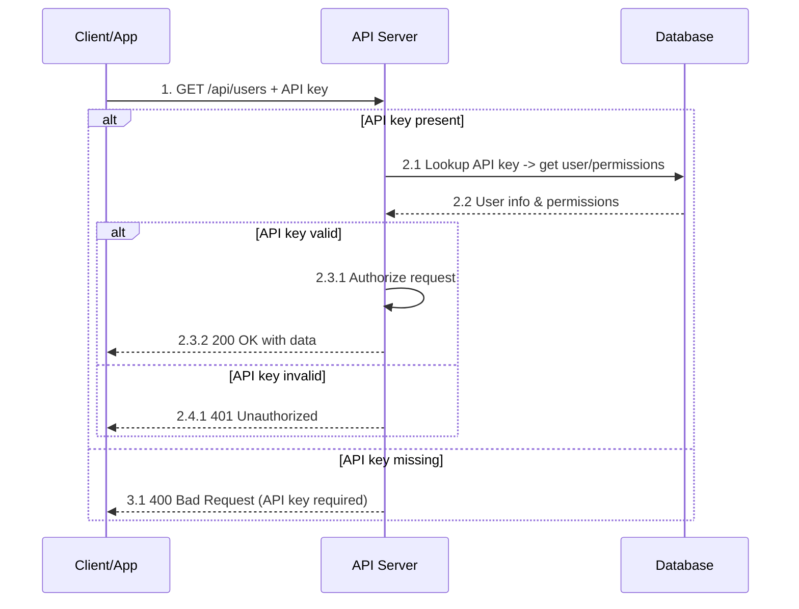
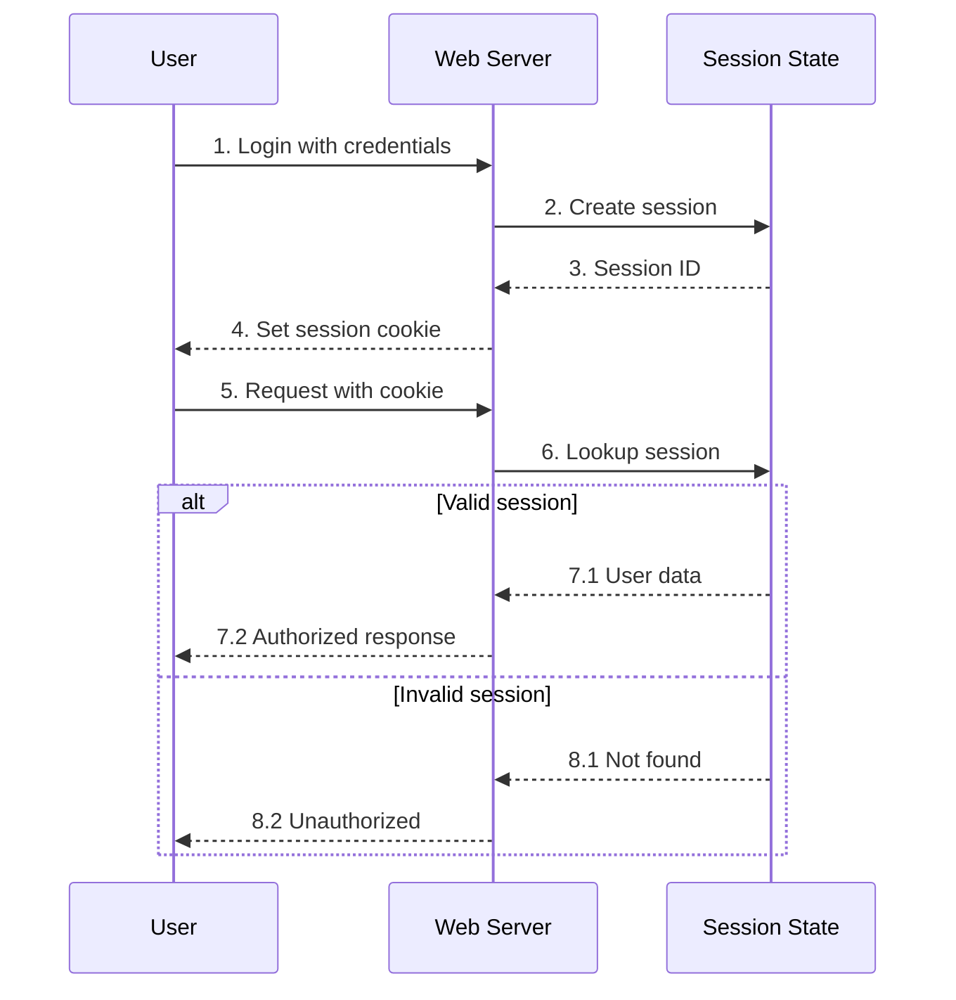
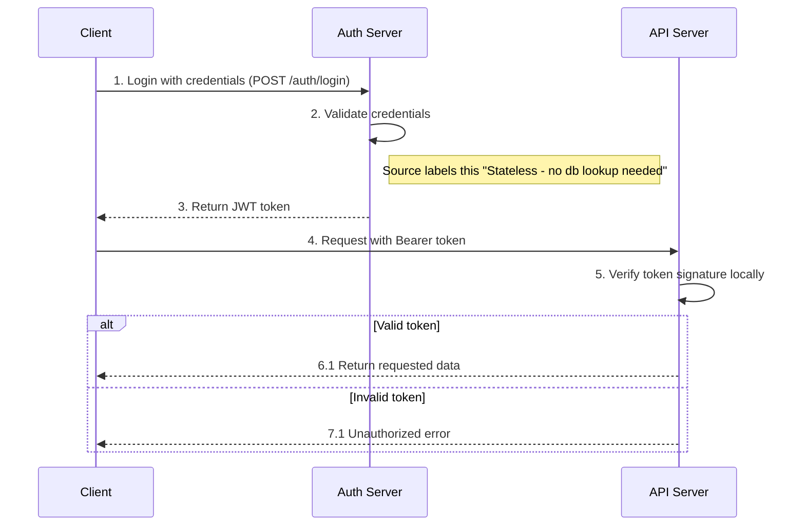
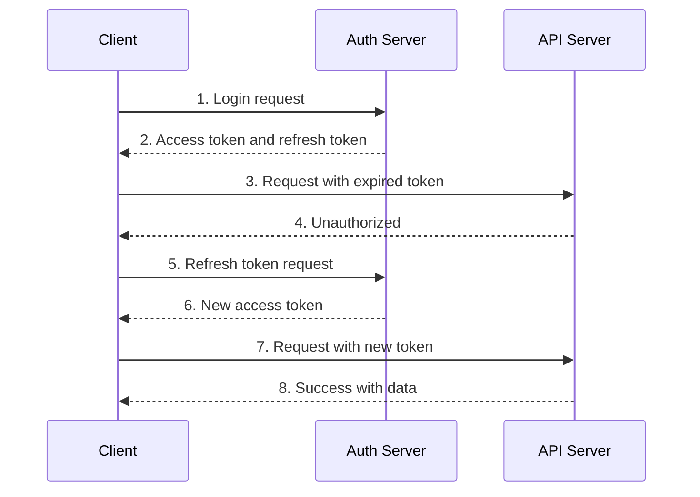
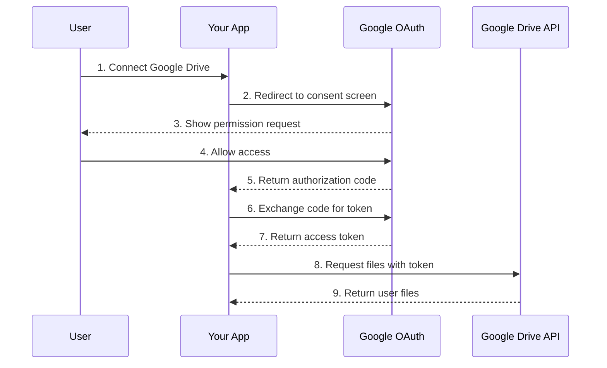
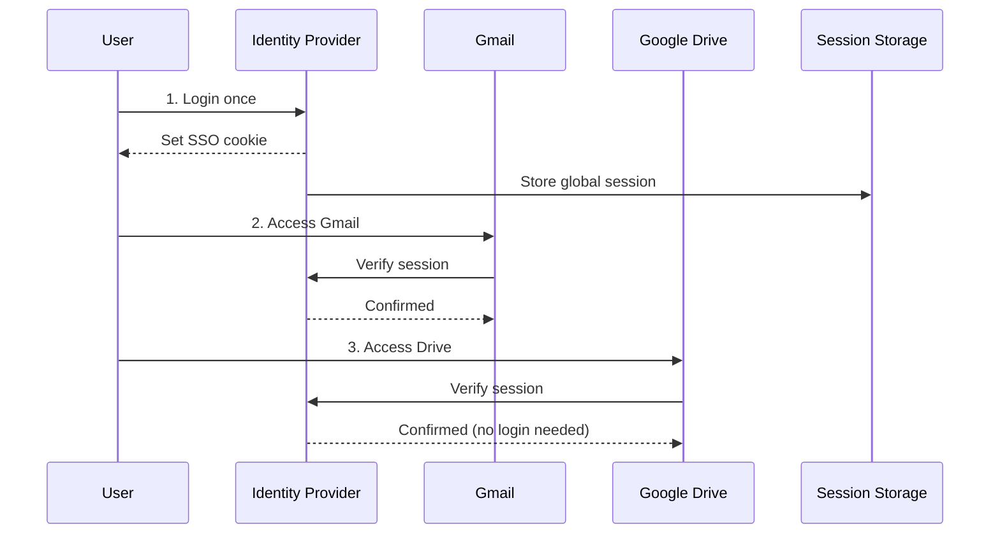
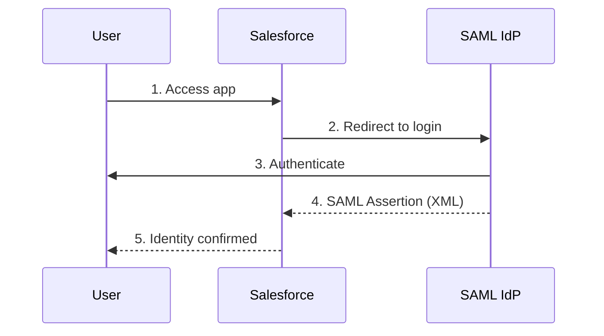
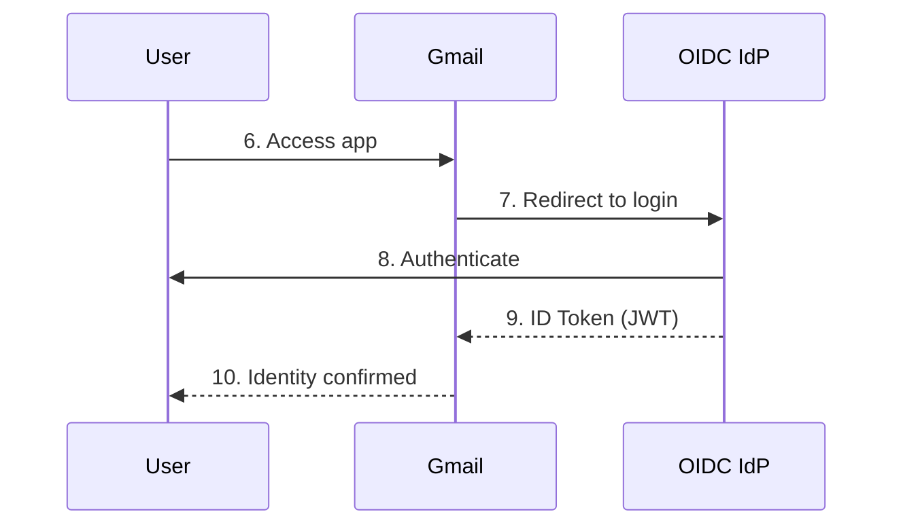

# Authentication, Authorization, Token, and SSO Workflows

> Source-only notes reconstructed from the attached images, in the same order as the images.
>
> Important correction from the source set: the seventh image is explicitly titled **OAuth2 Authorization Flow**, not OIDC authentication. The source itself says OAuth2 here is **authorization only, not authentication**. A separate OIDC authentication sequence appears in the final SSO comparison image, where the IdP returns an **ID Token (JWT)** and the application confirms identity.

---

## 0. High-level map

| Workflow | Client presents / receives | Where validation happens | State / lookup shown in source | Result shown |
|---|---|---|---|---|
| API Key Authentication | API key in `Authorization: ApiKey ...` or `X-API-Key` | API Server | API key lookup in Database | User/permissions are loaded, request is authorized, then data is returned |
| Session Based Authentication | Session cookie containing a Session ID | Web Server + Session State | Session lookup in Session State | Valid session returns user data and an authorized response |
| JWT Bearer Token Authentication | JWT in `Authorization: Bearer eyJ...` | API Server | Token signature is verified locally; no request-time DB lookup is shown | Valid token returns requested data |
| Access + Refresh Token Lifecycle | Access token for API requests; refresh token for renewal | API Server for access token; Auth Server for refresh | Expired access token is rejected, then refresh request goes to Auth Server | New access token is issued and the API request is retried |
| OAuth2 Authorization Flow | Authorization code, then access token | Google OAuth + Google Drive API | Consent, code exchange, token use | App receives permission to access Drive resources |
| OIDC Authentication Flow | ID Token (JWT) | OIDC IdP + application | Login redirect to IdP; ID token returned to app | Application confirms identity |
| SSO Identity Flow | SSO cookie / global session; protocol identity artifact | Identity Provider and applications | Shared/global session is verified by applications | User logs in once and later applications confirm the same session |

---

# 1. API Key Authentication

## 1.1 Architecture shown

```text
+------------+                  +------------+                  +------------+
| Client/App |                  | API Server |                  |  Database  |
+------------+                  +------------+                  +------------+
      |                               |                              |
      | GET /api/users                |                              |
      | + API key header              |                              |
      |------------------------------>|                              |
      |                               | Lookup API key               |
      |                               | -> user / permissions        |
      |                               |----------------------------->|
      |                               |                              |
      |                               |<-----------------------------|
      |                               | User info + permissions      |
      |                               |                              |
      |                               | Authorize request            |
      |                               |                              |
      |<------------------------------|                              |
      | 200 OK with data              |                              |
```

The source accepts either of these request headers:

```http
Authorization: ApiKey abc123xyz456
```

or

```http
X-API-Key: abc123xyz456
```

The source database record is shown as:

```text
| id | key_hash | user_id | scopes | active | created_at |
```

## 1.2 Exact workflow reconstructed



## 1.3 Step-by-step reasoning

1. **Client sends the request with an API key.**  
   The API key is attached to `GET /api/users` using one of the two headers shown above.

2. **The API Server first checks whether the key is present.**  
   Presence determines whether the server continues into the lookup path or immediately returns the missing-key error.

3. **If present, the API Server looks up the key in the Database.**  
   The lookup returns the user and permission information associated with the key.

4. **The stored record includes authorization-related fields.**  
   The source shows `user_id`, `scopes`, and `active`, so the lookup provides information needed for the authorization decision.

5. **If the key is valid, the API Server authorizes the request.**  
   Only after the authorization step does it return `200 OK with data`.

6. **If the key is invalid, the server returns `401 Unauthorized`.**

7. **If the key is missing, the server returns `400 Bad Request (API key required)`.**

## 1.4 Request-path dependency and consequence

```text
API key present
      |
      v
Database lookup
      |
      v
User + permissions
      |
      v
Authorize request
      |
      v
Return data
```

Because the lookup occurs before authorization, the authentication/authorization path shown depends on the database lookup. The same lookup also gives the API Server the current `scopes` and `active` value shown in the key record.

## 1.5 Failure paths

| Condition | Mechanism shown | Effect |
|---|---|---|
| API key missing | Presence check fails | `400 Bad Request (API key required)` |
| API key present but invalid | Lookup/validation does not establish a valid key | `401 Unauthorized` |
| API key valid | User/permissions are loaded, then request is authorized | `200 OK with data` |

---

# 2. Session Based Authentication

## 2.1 Architecture shown

```text
+------+             +------------+             +---------------+
| User |             | Web Server |             | Session State |
+------+             +------------+             +---------------+
   |                       |                             |
   | Login credentials     |                             |
   |---------------------->|                             |
   |                       | Create session              |
   |                       |---------------------------->|
   |                       |<----------------------------|
   |                       | Session ID                  |
   |<----------------------|                             |
   | Set session cookie    |                             |
   |                       |                             |
   | Request with cookie   |                             |
   |---------------------->|                             |
   |                       | Lookup session              |
   |                       |---------------------------->|
   |                       |<----------------------------|
   |                       | User data OR not found      |
   |<----------------------|                             |
   | Authorized/Unauthorized                             |
```

The source draws **Session State** as a component separate from the Web Server, and shows several possible backing-store icons next to it. The exact implementation of every icon is not specified in the source.

## 2.2 Exact workflow reconstructed



## 2.3 Step-by-step reasoning

1. **The user logs in with credentials.**

2. **The Web Server creates a server-side session in Session State.**

3. **Session State returns a Session ID.**

4. **The Web Server sets a session cookie for the user.**

5. **Later requests carry that cookie back to the Web Server.**

6. **The Web Server looks up the session using the Session ID.**  
   The request therefore depends on the session lookup shown in the diagram.

7. **Valid session -> user data -> authorized response.**  
   Session State returns user data, and the Web Server returns the authorized result.

8. **Invalid session -> not found -> unauthorized.**  
   If the session does not exist, the request is rejected.

## 2.4 State placement and consequence

```text
Browser/User
   |
   | session cookie / Session ID
   v
Web Server
   |
   | lookup
   v
Session State
   |
   +--> user data      -> Authorized response
   |
   +--> not found      -> Unauthorized
```

The key architectural property shown is that the session data lives outside the user's request and is retrieved from **Session State** for later requests.

## 2.5 Failure path

| Condition | Session State response | Web Server result |
|---|---|---|
| Valid session | User data | Authorized response |
| Invalid session | Not found | Unauthorized |

---

# 3. JWT Bearer Token Authentication

## 3.1 Architecture shown

```text
+--------+              +-------------+              +------------+
| Client |              | Auth Server |              | API Server |
+--------+              +-------------+              +------------+
    |                         |                           |
    | POST /auth/login        |                           |
    | credentials             |                           |
    |------------------------>|                           |
    |                         | Validate credentials      |
    |                         |                           |
    |<------------------------|                           |
    | JWT token               |                           |
    |                                                     |
    | Authorization: Bearer eyJ...                        |
    |---------------------------------------------------->|
    |                                                     | Verify token
    |                                                     | signature locally
    |                                                     |
    |<----------------------------------------------------|
    | Requested data OR Unauthorized                      |
```

Bearer header shown in the source:

```http
Authorization: Bearer eyJ...
```

## 3.2 Exact workflow reconstructed



## 3.3 Step-by-step reasoning

1. **The client first authenticates to the Auth Server.**  
   The source shows `POST /auth/login` with credentials.

2. **The Auth Server validates the credentials.**  
   The image labels this validation as `Stateless - no db lookup needed`. The source does not specify how the credential source itself is implemented.

3. **The Auth Server returns a JWT token.**

4. **The client sends the JWT to the API Server as a Bearer token.**

5. **The API Server verifies the token signature locally.**  
   This is the central request-time mechanism shown: token verification happens inside the API Server.

6. **Valid token -> requested data.**

7. **Invalid token -> Unauthorized error.**

## 3.4 Request-time consequence

```text
Client request + Bearer JWT
            |
            v
       API Server
            |
            v
 Verify signature locally
       /         \
   valid         invalid
     |              |
     v              v
 requested      Unauthorized
   data
```

Compared with the earlier session and API-key diagrams, this source does **not** show a Session State or Database lookup in the API Server's request-validation path. Instead, the API Server verifies the token signature locally.

---

# 4. Access-and-Refresh-Token Lifecycle

## 4.1 Lifetime and storage rules shown

The source explicitly gives these lifetimes:

| Token | Lifetime shown |
|---|---|
| Access Token | `15 min to 1 hour` |
| Refresh Token | `7 to 30 days` |

The source also states:

```text
Store refresh tokens in httpOnly cookies, never in localStorage
```

The source does not specify where the access token is stored.

## 4.2 Exact workflow reconstructed



## 4.3 Step-by-step reasoning

1. **Client sends a login request to the Auth Server.**

2. **Auth Server returns both an access token and a refresh token.**

3. **The client later calls the API Server with an expired access token.**

4. **The API Server rejects that request as Unauthorized.**

5. **The client sends a refresh-token request to the Auth Server.**

6. **The Auth Server returns a new access token.**

7. **The client retries the API request using the new token.**

8. **The API Server returns success with data.**

## 4.4 How the two token lifetimes interact in the shown flow

```text
Login
  |
  v
+-------------------+       +----------------------+
| Access Token      |       | Refresh Token        |
| 15 min - 1 hour   |       | 7 - 30 days          |
+-------------------+       +----------------------+
         |                            |
         | API request                | Renewal request
         v                            v
     API Server                  Auth Server
         |                            |
   expired -> Unauthorized       new access token
                                      |
                                      v
                                 retry API call
```

The source labels the expired-access-token response as **Unauthorized**; it does not provide a numeric status code in this diagram.

The architectural effect shown is that the short-lived access token can expire while the longer-lived refresh token is still used to obtain a replacement. That introduces a refresh round trip to the Auth Server before retrying the API request.

## 4.5 Source boundary

The images do not specify refresh-token rotation, reuse detection, revocation, or the behavior when the refresh token itself is invalid/expired.

---

# 5. OAuth2 Authorization Flow (the attached OAuth image)

## 5.1 Important classification

The attached source explicitly says:

```text
This is OAuth2 - authorization only, not authentication
```

It also says:

```text
Access token proves the app CAN access resources,
it does NOT identify the user
```

So this image should not be relabeled as OIDC authentication.

## 5.2 Architecture shown

```text
+------+       +----------+       +--------------+       +------------------+
| User |       | Your App |       | Google OAuth |       | Google Drive API |
+------+       +----------+       +--------------+       +------------------+
   |                |                    |                        |
   | Connect Drive  |                    |                        |
   |--------------->|                    |                        |
   |                | Redirect consent   |                        |
   |                |------------------->|                        |
   |<------------------------------------|                        |
   | Show permission request             |                        |
   |------------------------------------>|                        |
   | Allow access                        |                        |
   |                |<-------------------|                        |
   |                | authorization code |                        |
   |                |------------------->|                        |
   |                | exchange code      |                        |
   |                |<-------------------|                        |
   |                | access token       |                        |
   |                |-------------------------------------------->|
   |                | request files with token                    |
   |                |<--------------------------------------------|
   |                | return user files                           |
```

## 5.3 Exact workflow reconstructed



## 5.4 Step-by-step reasoning

1. **The user starts by choosing to connect Google Drive.**

2. **Your App redirects the user into Google OAuth's consent flow.**

3. **Google OAuth shows the permission request to the user.**

4. **The user explicitly allows access.**

5. **Google OAuth returns an authorization code to Your App.**

6. **Your App exchanges that code for a token.**

7. **Google OAuth returns an access token.**

8. **Your App uses the access token to request files from Google Drive API.**

9. **Google Drive API returns the user's files to Your App.**

## 5.5 What this flow proves

```text
User consent
    |
    v
Authorization code
    |
    v
Access token
    |
    v
Permission to call resource API
```

Per the source, the access token demonstrates that the application can access the authorized resource. It is **not** the identity artifact in this diagram.

---

# 6. SSO Identity Protocol - Global Session

This is the eighth attached image: a centralized SSO session shared across multiple applications.

## 6.1 Architecture shown

```text
                         +------------------------------+
                         | Applications                 |
                         |  - Gmail                     |
+------+                 |  - Google Drive              |
| User |                 |  - YouTube                   |
+------+                 +------------------------------+
   |                                  ^
   |                                  |
   | login once                       | verify session
   v                                  |
+-------------------------------------+----+
| Identity Provider (Google, Okta, etc.)  |
+------------------------------------------+
   |                     |
   | set SSO cookie      | store global session
   v                     v
 User browser       +----------------+
                    | Session Storage|
                    +----------------+
```

The source labels the central component `Identity Provider (Google, Okta, etc.)` and shows a separate `Session Storage` component.

## 6.2 Exact workflow reconstructed



> YouTube is displayed as another application in the source, but the image does not draw a separate numbered request/verification sequence for it.

## 6.3 Step-by-step reasoning

1. **The user logs in once with the Identity Provider.**

2. **The Identity Provider sets an SSO cookie.**

3. **The Identity Provider stores a global session in Session Storage.**

4. **When the user accesses Gmail, Gmail verifies the session with the Identity Provider.**

5. **The Identity Provider confirms the session, so Gmail accepts the existing login.**

6. **When the user later accesses Google Drive, Drive also verifies the session.**

7. **The Identity Provider confirms it, and the source explicitly marks this as `no login needed`.**

## 6.4 Architectural consequence

```text
                 login once
User --------------------------------> Identity Provider
                                         |
                                         | global session
                                         v
                                   Session Storage
                                         ^
                                         |
                 verify session          |
Application A ---------------------------+
Application B ---------------------------+
```

The effect shown is that applications do not require another login when the Identity Provider can confirm the existing global session.

---

# 7. SSO Identity Protocols - SAML and OIDC Comparison

This is the ninth attached image. It places a SAML identity flow and an OIDC identity flow side by side.

## 7.1 SAML side: Salesforce + SAML IdP

### Exact workflow reconstructed



### Step-by-step reasoning

1. **User accesses Salesforce.**
2. **Salesforce redirects the user to the SAML IdP.**
3. **The user authenticates with the IdP.**
4. **The IdP returns a `SAML Assertion (XML)` to Salesforce.**
5. **Salesforce confirms the user's identity.**

## 7.2 OIDC Authentication Flow: Gmail + OIDC IdP

### Exact workflow reconstructed



### Step-by-step reasoning

1. **User accesses Gmail.**
2. **Gmail redirects the user to the OIDC IdP for login.**
3. **The user authenticates with the OIDC IdP.**
4. **The OIDC IdP returns an `ID Token (JWT)` to Gmail.**
5. **Gmail confirms the user's identity.**

### Identity artifact

```text
OIDC IdP
   |
   | ID Token (JWT)
   v
Application
   |
   v
Identity confirmed
```

This is the OIDC authentication sequence present in the source set. The image does not show additional OIDC protocol steps beyond redirect, authentication, ID token return, and identity confirmation.

## 7.3 Source-level comparison

| Property visible in source | SAML flow | OIDC flow |
|---|---|---|
| Example application | Salesforce | Gmail |
| Identity provider | SAML IdP | OIDC IdP |
| Login behavior | Application redirects to IdP | Application redirects to IdP |
| User action | Authenticate | Authenticate |
| Identity artifact returned to app | `SAML Assertion (XML)` | `ID Token (JWT)` |
| Final result | `Identity confirmed` | `Identity confirmed` |

## 7.4 Common identity pattern shown

```text
User accesses application
          |
          v
Application redirects to IdP
          |
          v
User authenticates at IdP
          |
          v
IdP returns identity artifact
     /                     \
SAML Assertion (XML)     ID Token (JWT)
     \                     /
          v
Application confirms identity
```

The source shows the same high-level identity goal with different identity artifacts:

- **SAML:** `SAML Assertion (XML)`
- **OIDC:** `ID Token (JWT)`

No additional protocol-level comparison is specified in the source.

---

# 8. End-to-end comparison for interviews

## 8.1 Where request-time trust comes from

```text
API KEY
Client key -> API Server -> Database lookup -> user/scopes/active -> authorize

SESSION
Session cookie -> Web Server -> Session State lookup -> user data -> authorize

JWT
Bearer JWT -> API Server -> local signature verification -> allow/reject

ACCESS + REFRESH
Access token -> API Server
     expired -> Unauthorized -> Refresh token -> Auth Server -> new access token -> retry

OAUTH2 AUTHORIZATION
User consent -> authorization code -> access token -> resource API

OIDC AUTHENTICATION
Login at OIDC IdP -> ID Token (JWT) -> application confirms identity

SSO
Login once -> IdP global session -> applications verify same session -> no repeat login
```

## 8.2 The most important distinctions visible in the sources

| Question | API Key | Session | JWT Bearer | Access + Refresh | OAuth2 | OIDC | SSO |
|---|---|---|---|---|---|---|---|
| What is sent on normal requests? | API key | Session cookie | Bearer JWT | Access token | Access token to resource API | ID token is returned to app in shown login flow | Application relies on IdP-confirmed session / identity artifact |
| Is a server-side lookup shown on every request? | Yes, key lookup | Yes, session lookup | No; signature verification is local | API request is token-based; refresh goes to Auth Server when needed | Resource API receives access token | Login flow goes through OIDC IdP | Applications verify session with IdP in shown SSO diagram |
| What is the identity / permission output? | User + permissions/scopes | User data | Valid token -> requested data | New access token after refresh | Permission to access resource | Identity confirmed | Identity confirmed across applications |
| Explicit failure shown | Missing -> 400; invalid -> 401 | Session not found -> Unauthorized | Invalid token -> Unauthorized | Expired token -> Unauthorized | Not specified in source | Not specified in source | Not specified in source |

---

# 9. Interview-ready recall

## API Key Authentication

**Condition -> mechanism -> effect**

```text
API key arrives
  -> lookup key record
  -> load user + permissions
  -> authorize
  -> return data
```

Failure split in the source:

```text
missing key -> 400 Bad Request
invalid key -> 401 Unauthorized
```

The database schema explicitly includes `key_hash`, `user_id`, `scopes`, `active`, and `created_at`.

## Session Based Authentication

```text
login
  -> create server-side session
  -> return Session ID in cookie
  -> later request sends cookie
  -> web server looks up session
  -> user data or not found
```

Core dependency: every authenticated request shown depends on Session State lookup.

## JWT Bearer Token Authentication

```text
login to Auth Server
  -> receive JWT
  -> send Bearer JWT to API Server
  -> API verifies signature locally
  -> data or Unauthorized
```

Core request-path difference in the source: API-side validation is local rather than a shown session/key datastore lookup.

## Access + Refresh Token

```text
login -> access + refresh
access expires -> Unauthorized
refresh token -> Auth Server -> new access token
retry -> success
```

Source rules: access token `15 min to 1 hour`; refresh token `7 to 30 days`; refresh token stored in `httpOnly` cookies, never `localStorage`.

## OAuth2 Authorization

```text
connect Drive
  -> consent
  -> authorization code
  -> exchange code
  -> access token
  -> call Drive API
```

Source distinction: access token proves permission to access resources; it does not identify the user.

## OIDC Authentication

```text
access app
  -> redirect to OIDC IdP
  -> authenticate
  -> ID Token (JWT)
  -> identity confirmed
```

## SSO Identity Protocol

```text
login once at IdP
  -> SSO cookie + global session
  -> app verifies session
  -> confirmed
  -> another app verifies same session
  -> confirmed, no new login
```

Protocol artifacts shown:

```text
SAML -> SAML Assertion (XML)
OIDC -> ID Token (JWT)
```

---

# 10. Source fidelity notes

- The API-key database record is reconstructed exactly from the visible column names in the source.
- The session workflow preserves the source's numbered `1` through `8.2` sequence.
- The JWT workflow combines the two attached JWT screenshots into one continuous `1` through `7.1` sequence.
- The access/refresh workflow combines its two screenshots into one continuous `1` through `8` lifecycle.
- The attached Google Drive diagram is preserved as **OAuth2 Authorization Flow** because the source itself explicitly says it is not authentication.
- The requested **OIDC Authentication Flow** is reconstructed from the OIDC half of the final SSO comparison image, where the returned identity artifact is `ID Token (JWT)`.
- The first SSO image shows a global session and repeated session verification across applications; the second shows the concrete SAML-vs-OIDC identity artifacts.

