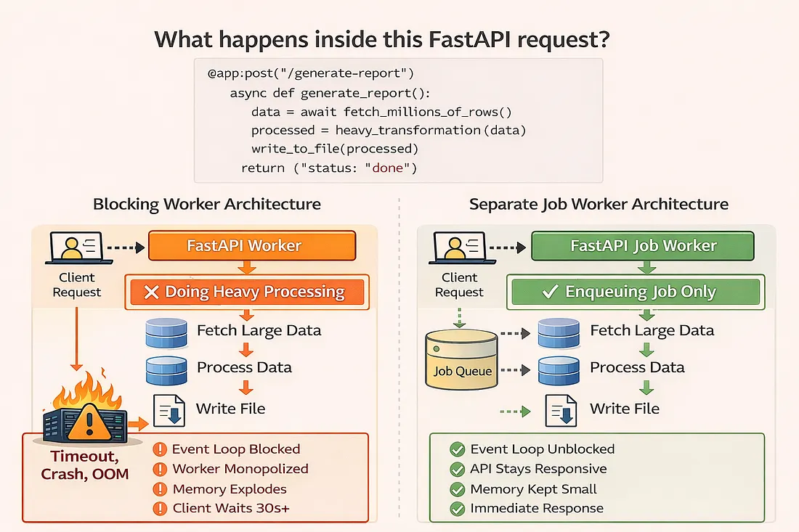

# FastAPI at Scale (Part 2): Background Jobs, Async Limits, and Parallel Processing

## Why async alone is not enough and how to keep your API responsive under real load

In Part 1, we addressed the most visible threats to large-data APIs: unbounded queries, memory explosions, and slow pagination. We transformed endpoints into pipelines by utilizing filtering, chunking, and streaming.

But even with perfect data flow, many FastAPI systems still collapse under load.

* Not because of the database.
* Not because of serialization.
* However, this is due to what happens inside the request lifecycle.

This article is about what breaks after you fix your queries:

* long-running jobs inside endpoints
* CPU-heavy transformations
* file generation and compression
* accidental worker starvation

And most importantly: how to move heavy work out of the request path without losing correctness or observability.

---

## The Second Illusion: “Async Will Save Me”

A common belief:

> “FastAPI is async. It should handle long tasks efficiently.”

This is only half true.

### Async helps when your code is:

* waiting for the database
* waiting for the network
* waiting for the disk

### Async does not help when your code is:

* compressing files
* transforming large datasets
* serializing huge objects
* performing CPU-heavy calculations

In those cases, the event loop is blocked just as effectively as in synchronous code.

Your API may look asynchronous, but your worker is still stuck.

---

## The Real Bottleneck: Request Lifecycle

Consider this endpoint:

```python
@app.post("/generate-report")
async def generate_report():
    data = await fetch_millions_of_rows()
    processed = heavy_transformation(data)
    write_to_file(processed)
    return {"status": "done"}

```

This does everything in one request:

1. Fetches massive data
2. Processes it in memory
3. Writes to disk
4. Only then responds

### Problems:

* Request timeouts
* The worker is blocked for seconds or minutes
* Other requests queue up
* Autoscaling triggers unnecessarily
* Failures are unrecoverable

This is not a slow endpoint.

**This is a fragile architecture.**



---

## Rule #5: Heavy Work Must Leave the Request Path

Your API should accept work, not perform it.

### The correct model:

```text
Client Request
      |
      v
   FastAPI
      |
      v
 Job Queue / Background Worker
      |
      v
 Long Processing
      |
      v
 Storage / Callback / Polling

```

### This design gives you:

* fast API responses
* resilient job processing
* retry mechanisms
* observability
* horizontal scaling

---

### Option 1: FastAPI BackgroundTasks (For Lightweight Jobs Only)

FastAPI provides a built-in way to run background work:

```python
from fastapi import BackgroundTasks

def write_audit_log(user_id: int):
    with open("audit.log", "a") as f:
        f.write(f"{user_id} accessed report\n")

@app.post("/report")
async def generate_report(background_tasks: BackgroundTasks):
    background_tasks.add_task(write_audit_log, user_id=42)
    return {"status": "processing"}

```

#### When this is acceptable:

* logging
* small notifications
* sending a single email
* lightweight I/O

#### When it is not:

* file generation
* large exports
* data aggregation
* CPU-heavy tasks

> BackgroundTasks still run inside the same worker process. They do not protect you from memory or CPU exhaustion.

---

### Option 2: Dedicated Worker Architecture (Production-Grade)

For heavy workloads, you need:

* a queue
* one or more worker processes
* task isolation

#### Architecture

```text
FastAPI → Queue → Worker → Storage → Client

```

#### Example: Job Submission Endpoint

```python
import uuid

@app.post("/export")
async def start_export():
    job_id = str(uuid.uuid4())
    await enqueue_export_job(job_id)
    return {"job_id": job_id, "status": "queued"}

```

Now your API:

* returns immediately
* never blocks
* remains responsive under load

#### Polling Endpoint for Job Status

```python
@app.get("/export/{job_id}")
async def export_status(job_id: str):
    status = await get_job_status(job_id)
    return {"job_id": job_id, "status": status}

```

Clients:

1. submit job
2. poll for status
3. download when ready

This pattern scales cleanly even under thousands of concurrent jobs.

---

## Rule #6: Parallelism ≠ Concurrency

Async gives you concurrency.

Heavy workloads need parallelism.

If your job:

* compresses files
* writes Parquet
* aggregates millions of records
* performs ML inference

You must use multiple processes.

### Multiprocessing for Chunked Exports

Let’s say you are exporting millions of rows into Parquet.

#### Worker Code

```python
from multiprocessing import Pool
import pyarrow.parquet as pq
import pyarrow as pa

def process_chunk(chunk):
    table = pa.Table.from_pandas(chunk)
    pq.write_to_dataset(table, root_path="/data/export")

def run_export_job():
    chunks = fetch_chunks_from_db()
    with Pool(processes=4) as pool:
        pool.map(process_chunk, chunks)

```

#### Why this works:

* Each process uses separate CPU cores
* Memory is distributed
* failures are isolated
* throughput scales linearly with cores

---

## Rule #7: Don’t Let Workers Starve

If your API and background tasks share the same process pool, you will eventually see:

* high latency
* dropped requests
* unpredictable timeouts

### Anti-Pattern

```text
FastAPI Workers:
  - serving requests
  - generating files
  - compressing data
  - transforming datasets

```

### Correct Separation

```text
FastAPI Workers → HTTP Only
Background Workers → CPU / File / Data

```

This separation is the difference between:

* “works in staging”
* “survives production”

---

## Rule #8: Make Jobs Idempotent

At scale, failures are guaranteed:

* process crashes
* node restarts
* partial writes

Your background tasks must be safe to retry.

### Example: Idempotent Job

```python
def export_job(job_id: str):
    if export_exists(job_id):
        return  # already done

data = fetch_data(job_id)
write_export(job_id, data)

```

This ensures:

* no duplicates
* safe retries
* consistency after restarts

---

## Observability: You Can’t Scale What You Can’t See

Once work leaves the request path, you must track:

* job queue size
* job duration
* failures per job type
* worker CPU / memory

### Minimal Logging Example

```python
import logging

logger = logging.getLogger(__name__)

def export_job(job_id: str):
    logger.info("Starting export %s", job_id)
    try:
        run_export(job_id)
        logger.info("Completed export %s", job_id)
    except Exception as e:
        logger.exception("Export failed %s", job_id)
        raise

```

At scale, visibility is stability.

---

## Mental Model: APIs Are Orchestrators, Not Workers

Once datasets grow large, your FastAPI service should:

* accept requests
* validate inputs
* schedule work
* expose results

It should not:

* crunch massive datasets
* write large files
* perform heavy computation

Those belong to a different tier of your system.

---

## Recap: What Part 2 Teaches

* **✔** Async does not solve CPU or memory pressure
* **✔** Heavy work must leave the request lifecycle
* **✔** Background workers protect API responsiveness
* **✔** Parallelism requires multiprocessing
* **✔** Job systems must be idempotent and observable