## What is uvloop?

Python's `asyncio` module uses an event loop to schedule and execute coroutines, handle I/O callbacks, and manage timers. The **default event loop** is written in pure Python and runs inside the CPython interpreter.

| Installation         | Built into Python                        | `pip install uvloop`                     |
| Swap mechanism       | Default                                  | `uvicorn --loop uvloop` or policy install |

---

When you switch from the default asyncio loop to uvloop:

1. **More I/O cycles per second** — The loop can poll and dispatch ready sockets faster.
2. **Lower per-request latency** — Each coroutine resumes sooner after I/O readiness.
3. **Higher throughput under concurrency** — More simultaneous connections are handled within the same time window.

---

## System Design Perspective: scenario-based problems

This section answers: "Where does uvloop sit in a real architecture, and what problem does it actually solve vs. what it does NOT solve?" Each scenario is a design interview-style problem with a diagram.

### Scenario 1: Flash-sale ingest burst — 50k webhooks in 10 seconds

**Problem:** Payment provider fires 50k `POST /ingest/batch` callbacks in a burst. Single FastAPI pod collapses: p99 goes 50ms → 8s, then timeouts cascade.

**Where uvloop helps / where it doesn't:**
- Helps: drain the accept-queue faster. Same pod handles ~2x concurrent validations before queueing, as proven by the 332 vs 170 RPS benchmark.
- Does NOT help: if Postgres can only do 200 writes/sec, a faster loop just fails faster. You need backpressure.

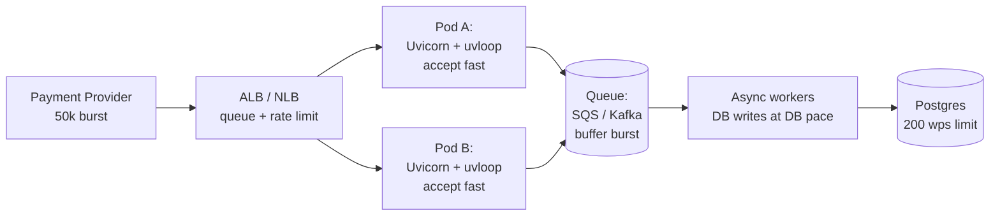

**Design takeaways:**
1. uvloop buys headroom at the edge (accept + validate), queue absorbs the burst, workers protect the DB.
2. Scale order: uvloop first (free), then `--workers N`, then HPA pods, then queue. Don't scale pods to fix a loop problem, and don't expect the loop to fix a DB problem.
3. Observe `GET /metrics/loop` + queue depth + DB connections together. If loop is uvloop but queue still grows, bottleneck moved downstream — correct.

### Scenario 2: Mobile BFF fan-out — one request, six upstreams

**Problem:** `GET /profile` must gather orders, billing, recommendations, auth, pricing, and inventory. Sequential calls = 6 x 80ms = 480ms p50. Under 2k RPS, default loop adds another 200ms of scheduling delay.

**Design with uvloop:**

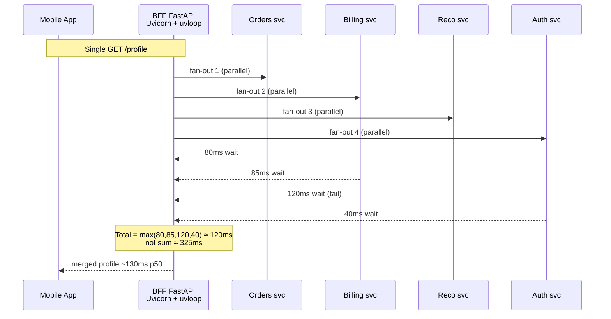

**Design takeaways:**
1. Latency becomes `max(upstream)` not `sum(upstream)` — but only if the loop can wake all 6 waits promptly. That wake-up speed is exactly what uvloop improves.
2. Tail latency rules: set per-upstream timeout + fallback (e.g., reco fails → return cached), plus connection-pool limits (e.g., 500 max). Without timeouts, one slow upstream holds the BFF slot and nullifies the loop gain.
3. Circuit breaker per upstream. A faster loop retry-storms a dying downstream faster — add bulkhead + retry-with-jitter.

### Scenario 3: 20k long-lived connections — SSE / WebSocket fan-out

**Problem:** Live scores / chat / notifications: 20k clients hold open SSE streams (same shape as `GET /process/stream/{count}`). Default loop spends most CPU just polling idle sockets; new broadcasts get delayed.

**Design with uvloop:**

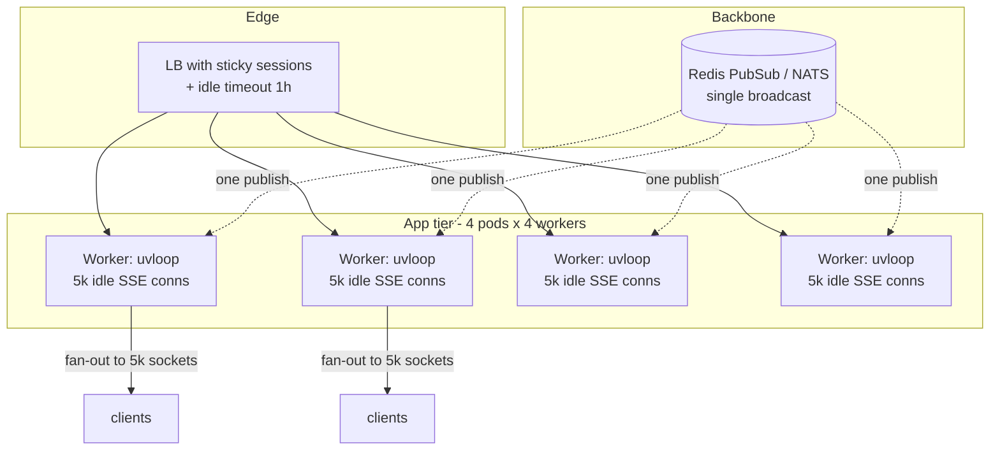

**Design takeaways:**
1. This is the classic C10k problem — libuv (under uvloop) was built for it: polling thousands of mostly-idle sockets with low per-iteration cost. Biggest architectural win per pod.
2. One worker cannot hold 20k conns regardless of loop — scale as `pods x workers`, use sticky sessions, and broadcast via pub/sub so each worker fans out locally.
3. Watch file-descriptor limits, LB idle timeouts, and heartbeat interval. Loop is rarely the first limit here — ulimit and LB are.

### Scenario 4: Slow-upstream proxy — payments / LLM gateway

**Problem:** Each request waits 3–10s on a slow upstream (payment gateway, LLM). Thread-per-request servers need 1000 threads for 1000 concurrent waits and die on context switches. Async + uvloop holds the same 1000 waits on one worker.

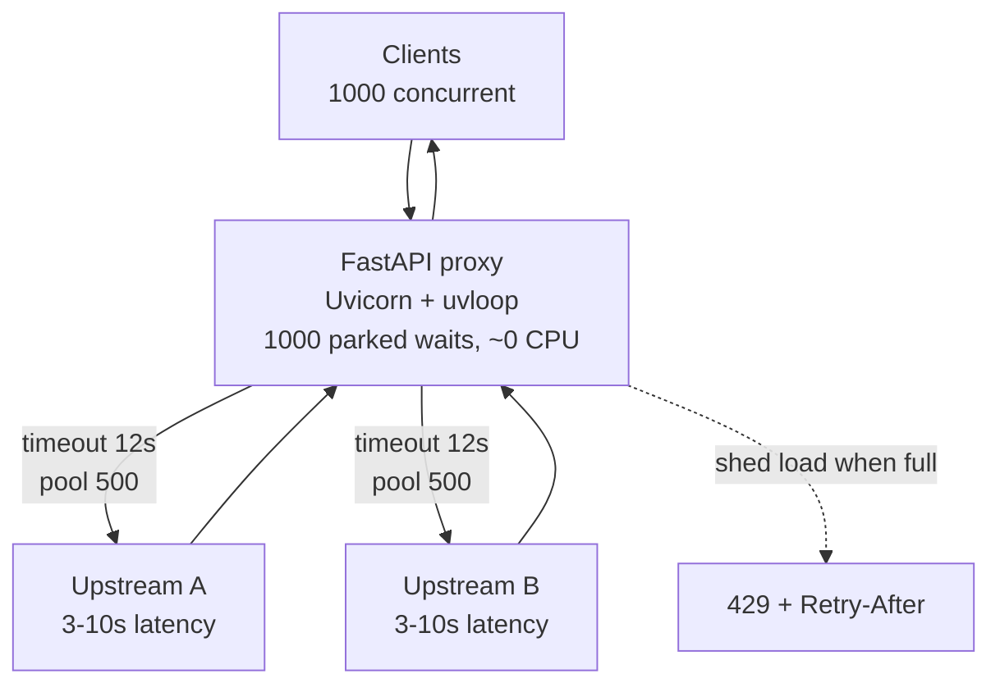

**Design takeaways:**
1. Async already beats threads here; uvloop extends the ceiling (more parked waits per worker before p99 degrades).
2. Mandatory: upstream timeout, max-connection pool cap, and load shedding (return 429 when in-flight > cap). A faster loop without shedding just queues longer and times out later.
3. Capacity plan by upstream latency, not CPU: `workers_needed ≈ concurrent_waits / waits_per_worker`. Add workers/pods when event-loop lag grows while CPU stays low.

### How to tell in production which bottleneck you have

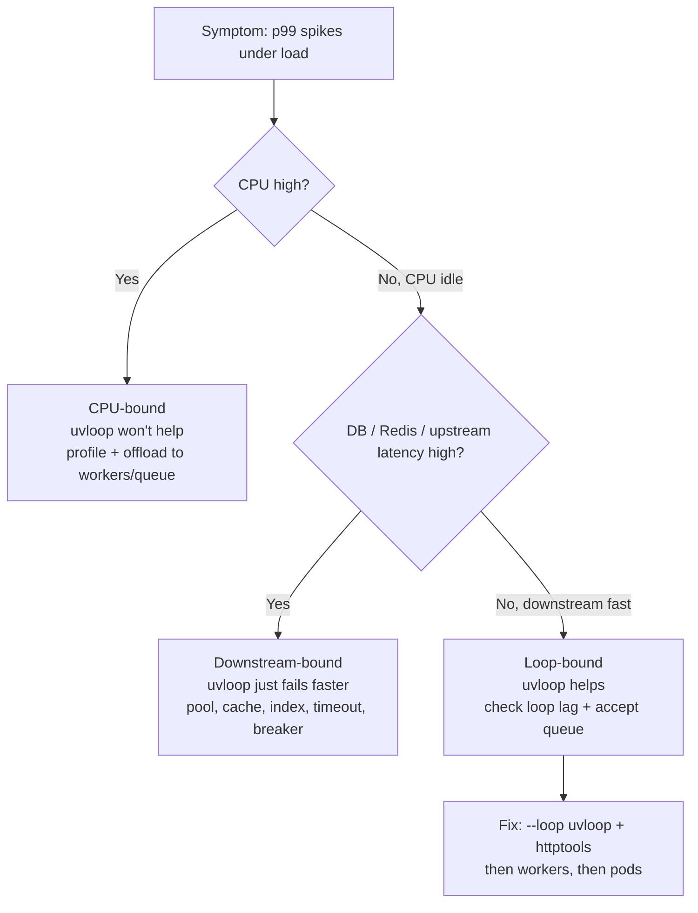

Track together: `is_uvloop` from `/metrics/loop`, event-loop lag (time between scheduled vs executed callback), HTTP accept-queue depth, downstream latency, CPU. If lag is high while CPU and downstream are healthy — that is the exact signature uvloop fixes, matching the `0.1_uvloop_service` benchmark setup.

---

## What is ARQ?

**ARQ** (Async Redis Queue) is a lightweight, `asyncio`-native background job queue backed by **Redis**. It is the async successor to RQ.

Core idea: FastAPI **enqueues** (fast, ~1ms Redis `ZADD`), returns `job_id` immediately, and a separate **worker process** picks up and executes the task asynchronously.

| Primitive | What it does | Project example |
|---|---|---|
| `enqueue_job()` | Push job onto Redis sorted set | `POST /payments/process` → `enqueue_job("process_payment", id)` |
| `ctx` dict | First arg to every task: `redis`, `job_try`, `job_id` + `on_startup` resources | `ctx["redis"].enqueue_job(...)` for chaining/fan-out |
| `_job_id` | Deduplication / idempotency key; second enqueue returns `None` | `welcome_email_{user.id}`, `payment_{idempotency_key}` |
| `Retry(defer=N)` | Re-enqueue with delay; `job_try` increments; dies after `max_tries` | `raise Retry(defer=ctx["job_try"]*5)` in image/webhook tasks |
| `_defer_by` / `_defer_until` | Schedule future execution | Report → email chained with `_defer_by=60` |
| `func()` | Per-task override: `timeout`, `max_tries`, `keep_result`, `name` | `func(process_payment, max_tries=3)`, `func(..., timeout=600)` |
| `cron()` | Recurring jobs: `hour/minute`, `unique`, `run_at_startup` | Hourly session cleanup, daily 2AM job-result purge |
| `WorkerSettings` | Worker recipe: `functions`, `cron_jobs`, `on_startup/shutdown`, `max_jobs`, `queue_name` | `WorkerSettings` (mono) vs `WorkerSettingsEmail/Payment/Report` (micro) |
| `Job.status()/result()` | Poll lifecycle: `queued` → `in_progress` → `complete` | `GET /jobs/{job_id}/status` |

Request lifecycle (`0.2_task_queue_project`):

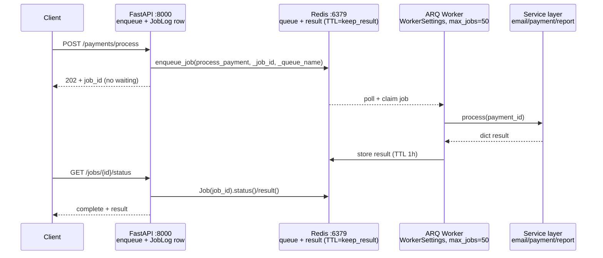

Monolith vs microservice (both in project):

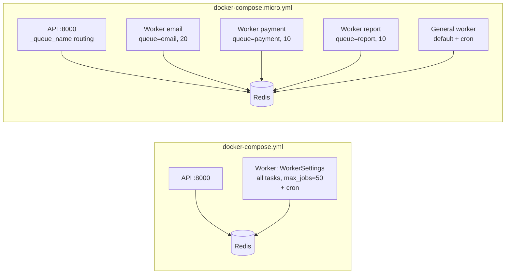

---

## System Design Perspective: scenario-based problems

### Scenario 1: Signup burst — don't let email kill p99

**Problem:** `POST /users/` must insert user + send welcome email + admin notify. Email SMTP takes 2–5s. Doing it inline: p99 explodes, timeouts cascade.

**Design with ARQ:**

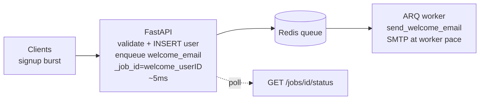

**Takeaways:**
1. Edge stays fast (accept + persist + enqueue); slow work moves to worker pool sized by `max_jobs`.
2. `_job_id` gives dedup for free — double-click / retry-safe signup sends one email.
3. Redis result is volatile (`keep_result=3600`); `job_logs` table is the durable audit trail for support/dashboards.

### Scenario 2: Payments — at-least-once execution, exactly-once effect

**Problem:** Charging twice is a correctness bug, not a latency bug. Network retries + user double-submit re-enqueue the same payment.

**Design with ARQ:**

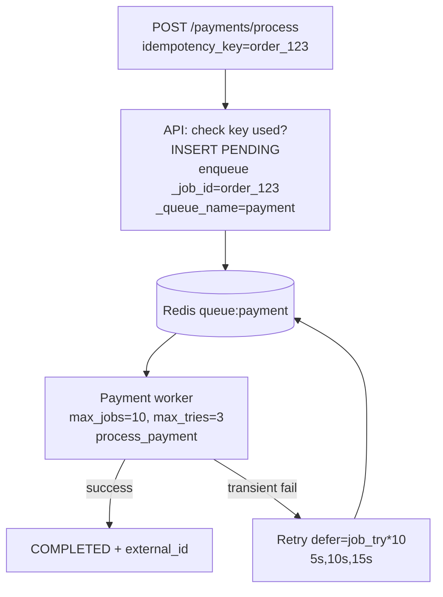

**Takeaways:**
1. ARQ delivers **at-least-once**; idempotency makes the effect **exactly-once**: `_job_id` dedups the queue, `idempotency_key` column short-circuits the DB, `max_tries=3` caps money-burning retries.
2. Isolate blast radius: `queue_name="payment"` + `max_jobs=10` so a report backlog never starves payments and gateway throttling is respected.
3. Sync/async dual mode (`async_mode=false` calls `PaymentService` inline) is for tests/dev only — in prod always enqueue.

### Scenario 3: Reports + batch notify — chaining and fan-out

**Problem:** Generate PDF (30–120s, CPU-heavy) then email it; or notify 10k users. Sequential in-request = timeout; sequential in one task = slow.

**Design with ARQ:**

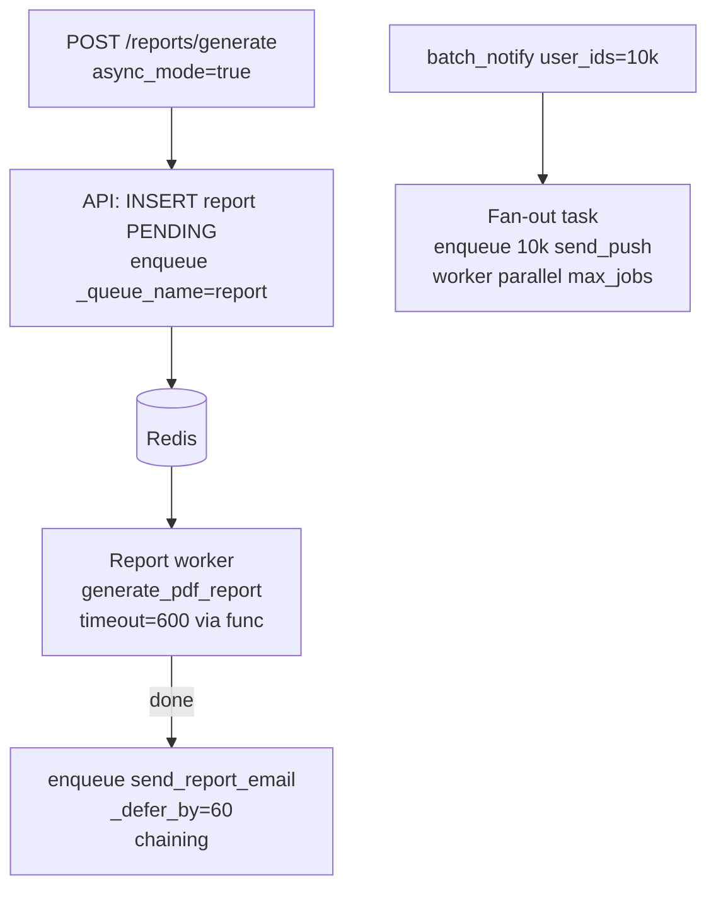

**Takeaways:**
1. **Chaining** (`_defer_by`) models workflows without a workflow engine; **fan-out** turns 1 slow task into N parallel tasks bounded by `max_jobs`.
2. Size the pool by task cost: reports `max_jobs=10` (heavy), email `max_jobs=20` (fast, SMTP-limited). One shared `max_jobs=50` monolith is fine until one domain starves others — then split queues.
3. `func()` per-task tuning is the interview answer to "different SLAs per job type": long PDF gets `timeout=600, keep_result=3600`; thumbnails get `keep_result=86400`.

### Scenario 4: Cleanup + operability — cron, lifecycle, health

**Problem:** Expired sessions and old Redis results grow forever. Each of 4 micro-workers running cleanup = 4x deletes + lock fights.

**Design with ARQ:**

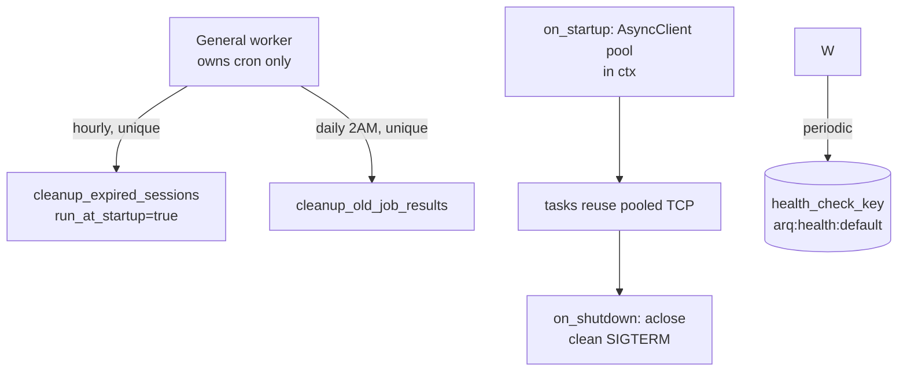

**Takeaways:**
1. `cron(..., unique=True)` + single owner worker = no overlapping runs across replicas.
2. `on_startup/on_shutdown` is where shared, expensive resources live (e.g., one `httpx.AsyncClient` per worker, reused across thousands of webhook dispatches).
3. Observe `health_check_key` + queue depth + `job_try` rate + worker `max_jobs` saturation. Queue growing while workers idle = wrong `queue_name` routing — most common ARQ misconfig.

### How to tell in production which bottleneck you have

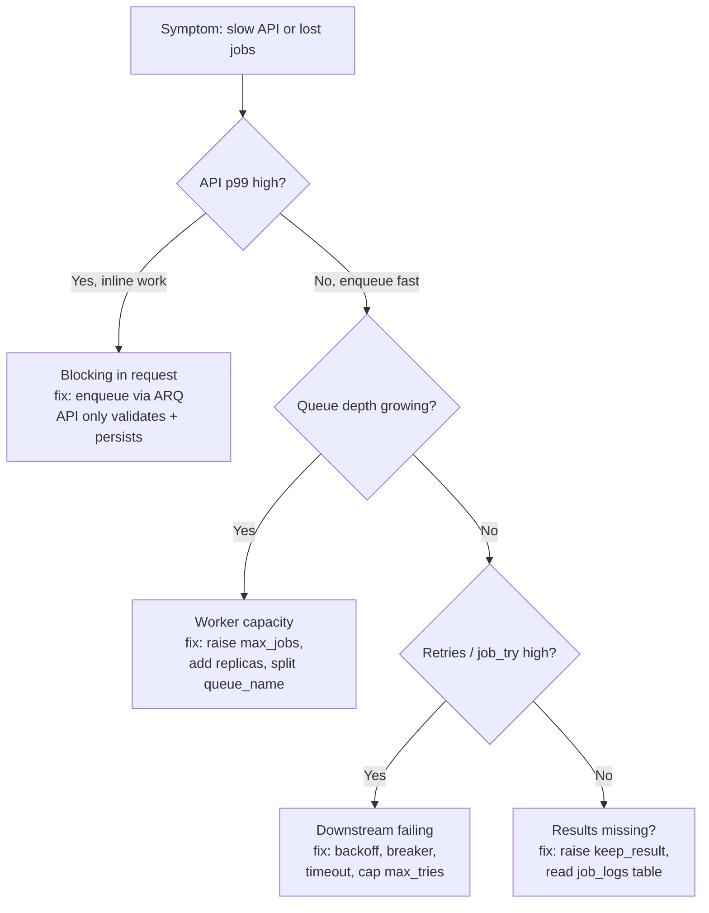

**ARQ vs alternatives (interview one-liner):** use ARQ when you are an async-Python shop needing retries + cron + scheduling with minimal ops (just Redis); use Celery for polyglot/heavy routing, SQS/Kafka when you need multi-consumer durability, strict ordering, or throughput beyond single-Redis.

---

## What is ASGI? Uvicorn vs Granian? (`1_fastapi_asgi_uvicorn_granian`)

FastAPI **is not a server**. It is an ASGI application — a callable `async def __call__(scope, receive, send)`. It cannot bind a port, accept TCP, or parse HTTP. An **ASGI server** (Uvicorn / Granian) does that and invokes your app per request:

```python
# app/main.py — this `app` IS the ASGI callable servers import
def create_app() -> FastAPI:
    app = FastAPI(title=settings.app_name, version="0.1.0")
    app.include_router(health.router, tags=["health"])
    app.include_router(v1_router)  # /api/v1/items + /api/v1/compute
    return app

app = create_app()
# uvicorn app.main:app  |  granian --interface asgi app.main:app
```

| Aspect | WSGI (Flask sync, Gunicorn sync) | ASGI (this project) |
|---|---|---|
| Protocols | HTTP only | HTTP + WebSocket + SSE / HTTP/2 |
| Concurrency | 1 thread per request | 1 event loop, 1000s parked `await`s |
| Async support | No | Yes (`async def`, `await`) |
| Servers | Gunicorn sync, uWSGI | Uvicorn, Granian, Hypercorn, Daphne |

| Feature | Uvicorn | Granian | Rule of thumb |
|---|---|---|---|
| Language / loop | Python + uvloop (asyncio) | Rust + tokio (via PyO3) | Uvicorn = mature default; Granian = faster edge |
| Multi-worker | `--workers N` or Gunicorn master | Built-in `--workers N`, no Gunicorn needed | Avoid Gunicorn chain → Granian |
| Ops maturity | Largest community, `--reload`, Gunicorn signals/graceful restart | Newer, zero-config, smaller image | Regulated / k8s with strict graceful-shutdown → Gunicorn+Uvicorn; cost-sensitive high-RPS → Granian |
| Perf profile | Fast, esp. with `--loop uvloop --http httptools` | Often +10-30% RPS on `/health` + `/io-simulated` benchmarks | Difference only matters at >1k RPS or high conn count |
| Use when | Dev, standard SaaS API, need ecosystem answers | Public edge, fan-out proxy, want fewer pods | Benchmark both with `wrk/he`y before committing |

Concurrency model in this project (`app/api/v1/endpoints/compute.py` + `app/services/compute.py`):

```python
@router.get("/light")
def light_compute(n: int = 10000):          # sync def → threadpool, CPU-bound fibonacci
    return compute_service.light_compute(n)

@router.get("/io-simulated")
async def io_simulated(delay: float = 0.5): # async def → event loop, yields on await
    return await compute_service.io_simulated(delay)  # asyncio.sleep(delay)
```

- `async def` + `await` = yields loop, 1 worker holds 1000s concurrent waits for free. Use for DB/Redis/HTTP waits (`/items`, `/io-simulated`).
- `def` = runs in threadpool so it doesn't freeze loop, but pool is small (~40 threads). Use for tiny blocking bits, **not** for heavy CPU. `fibonacci(n=100000)` still saturates pool/worker — fix is more workers or offload to queue (ARQ/Celery), not a faster server.
- Worker count: `workers = (2 x CPU cores) + 1` is a starting point. 1 worker = dev only. Prod = workers per core, then HPA pods.

When to consider this feature — real-world mapping:

1. **Standard CRUD SaaS (`/api/v1/items`, `/health`) → Uvicorn + Gunicorn.** K8s Deployment with `/health` liveness/readiness probes, `gunicorn -k uvicorn.workers.UvicornWorker -w 4`. You want graceful restarts (`--graceful-timeout 30`), signal handling, StackOverflow answers. Example: B2B dashboard API at 200 RPS — server choice irrelevant, operability wins.
2. **High-RPS public edge / webhook ingest (`POST /ingest`, `GET /health` at 5k RPS) → Granian.** `granian --interface asgi app.main:app --workers 4` drops p99 and pod count. Example: Stripe-style webhook receiver validating HMAC then enqueueing to Kafka — same pattern as Scenario 1 below.
3. **IO-fan-out BFF / proxy (`/io-simulated` shape) → either server, invest in `async def` + timeouts + pools.** `GET /profile` fanning to 6 upstreams with `asyncio.gather`. Server buys ~10%, correct async buys 4x. See System Design Scenario 2.
4. **Mixed CPU + IO (`/compute/light` shape: thumbnails, CSV export, fibonacci, embeddings) → don't fix in server, offload.** Keep API async, push CPU to ARQ worker (`0.2_task_queue_project`) or separate `/reports` service (`6_fastapi_taskiq_background_jobs`). Server/workers only buy linear headroom.
5. **WebSocket / SSE long-lived (`/stream`, chat, live scores) → Granian or Uvicorn+uvloop, scale `pods x workers`, pub/sub fan-out.** Loop cost dominates; Rust core helps most here.
6. **Local dev → Uvicorn `--reload`. Docker prod → pick one Dockerfile (`Dockerfile.uvicorn` vs `Dockerfile.granian`) and benchmark:** `wrk -t4 -c200 -d30s http://localhost:8000/health` then repeat for `/api/v1/compute/io-simulated?delay=0.01` (async) and `/api/v1/compute/light?n=10000` (CPU) — expect Granian win on first two, tie on third.

Summary cheat sheet:

- FastAPI without Uvicorn/Granian does nothing on the wire. Deploy = choose server + workers + probes.
- Default to Uvicorn (mature). Switch to Granian when benchmark proves fewer pods / lower p99 at same `--workers`, or you want to delete Gunicorn.
- `async def` for IO, `def` for tiny blocking, queue/workers for real CPU. No server fixes `fibonacci(n=10M)` in-request.
- Prod checklist: `--workers N`, `--host 0.0.0.0`, `/health` probes, `--timeout 120 --graceful-timeout 30` (Gunicorn) or Granian equivalent, `wrk/hey` benchmark of all 3 endpoint shapes before/after switch.

---

## System Design Perspective: scenario-based problems (ASGI servers)

### Scenario 1: SaaS API on Kubernetes — graceful deploys without dropped payments

**Problem:** 3-replica FastAPI rollout drops in-flight `POST /api/v1/items` during deploy. `SIGTERM` kills worker mid-request. Need zero-downtime + `/health` probes.

**Design (Gunicorn + Uvicorn wins on ops):**

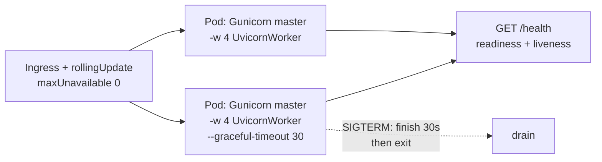

```bash
gunicorn app.main:app -w 4 -k uvicorn.workers.UvicornWorker \
  --bind 0.0.0.0:8000 --timeout 120 --graceful-timeout 30
# Granian equivalent: granian --interface asgi app.main:app --workers 4
# + k8s preStop sleep + readiness probe on /health
```

**Takeaways:**
1. This is why teams stay on Gunicorn+Uvicorn despite Granian RPS: pre-fork master, worker heartbeat-restart, `SIGHUP` reload, well-known k8s snippets.
2. Granian can do the same (built-in workers, `--reload` in dev) — but runbook/Google-ability is thinner. If your org has Gunicorn dashboards/alerts, switching cost > RPS gain at <1k RPS.
3. Health shape matters: `/health` must be cheap (no DB) for probes, like `health.py` returns `{"status":"ok"}` — separate `/ready` if you check DB/Redis.

### Scenario 2: IO-bound BFF — 2k RPS x 6 parallel upstreams

**Problem:** `GET /api/v1/items/{id}` enriched from inventory + pricing + auth. Sequential `httpx.get` = 450ms p50. Under load, sync `def` handler parks threadpool and p99 → 3s.

**Design (server secondary, async primary):**

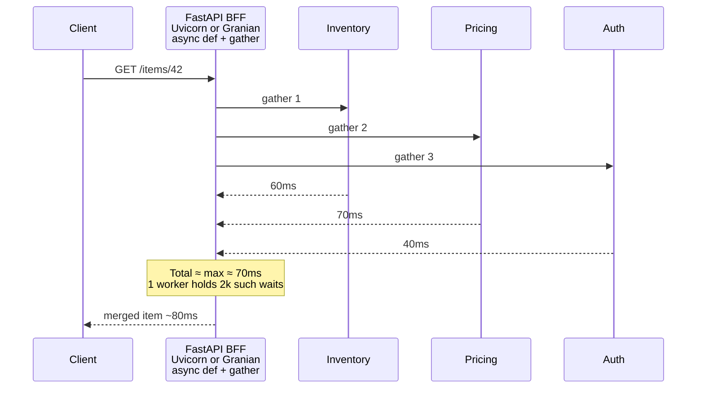

```python
# correct shape (like io_simulated): async def + await + timeout + pool
async def get_item_enriched(item_id: int):
    async with httpx.AsyncClient(timeout=2.0, limits=httpx.Limits(max_connections=500)) as c:
        inv, price, auth = await asyncio.gather(
            c.get(f".../inventory/{item_id}"),
            c.get(f".../pricing/{item_id}"),
            c.get(f".../auth/check"),
        )
```

**Takeaways:**
1. Fix is `async def` + `asyncio.gather` + per-upstream timeout + shared `AsyncClient` pool — mirrors `/io-simulated` (`await asyncio.sleep`). Either server then handles 2k RPS on few workers.
2. Granian vs Uvicorn gap is smallest here if downstream is slow (bottleneck is upstream, not loop). Benchmark with `hey -n 10000 -c 100 .../io-simulated?delay=0.01` — if both saturate equally, add workers/pods, not a new server.
3. Guard retry-storm: breaker + `Retry-After` / 429 shed when in-flight > cap. Faster loop without shedding just times out later.

### Scenario 3: Mixed workload — `fibonacci` kills p99 (CPU poison)

**Problem:** Adding `GET /api/v1/compute/light?n=500000` (PDF render / thumbnail / embedding rerank) to same deployment as `/items` CRUD. Under 100 concurrent CPU hits, even `async` CRUD p99 spikes — threadpool queued, loops starved.

**Design (isolate, don't tune server):**

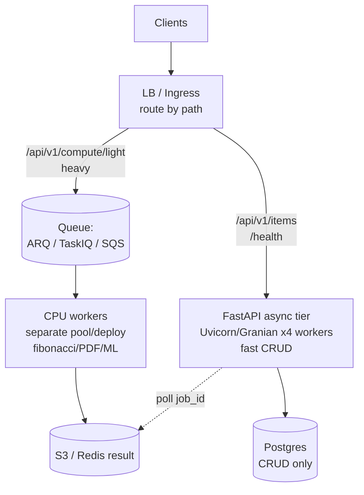

**Takeaways:**
1. `def light_compute` in threadpool only protects the loop for *light* CPU. Heavy CPU must leave the request path: `202 + job_id`, worker computes, `GET /jobs/{id}` polls — exact ARQ pattern from `0.2_task_queue_project` / TaskIQ project 6.
2. If you must keep sync in-request, isolate deployment: `api-fast` (async CRUD) vs `api-heavy` (more workers, higher timeout, separate HPA + rate limit). Never let `n=10M` share workers with checkout.
3. Diagnostic: CPU high + loop lag high + downstream fast = CPU-bound — no server helps. Profile, cap `n`, add `slowapi` rate limit (project 7), offload.

### Scenario 4: Cost squeeze — 8k RPS edge, halve the pods

**Problem:** Public `GET /health` + `GET /items` fleet runs 12 pods x Uvicorn to hold 8k RPS p99 < 100ms. FinOps asks to cut cost 30% without SLO breach.

**Design (Granian consolidation):**

```mermaid
graph TB
    C[8k RPS] --> LB[ALB]
    LB --> G1[Pod Granian --workers 8<br/>Rust tokio, ~1.2x RPS]
    LB --> G2[Pod Granian --workers 8]
    LB --> G3[Pod Granian --workers 8]
    LB --> G4[Pod Granian --workers 8]
    G1 --> R[(Redis cache<br/>project 5 pattern)]
    G2 --> R
    Note over G1,G4: 8 pods Granian ≈ 12 pods Uvicorn<br/>verify with wrk before cutover
```

```bash
# apples-to-apples bake-off, same --workers, same instance type
uvicorn app.main:app --host 0.0.0.0 --port 8000 --workers 4
wrk -t4 -c200 -d30s http://localhost:8000/health
wrk -t4 -c200 -d30s "http://localhost:8000/api/v1/compute/light?n=10000"
granian --interface asgi app.main:app --host 0.0.0.0 --port 8000 --workers 4
wrk -t4 -c200 -d30s http://localhost:8000/health
```

**Takeaways:**
1. Only switch on measured RPS/latency-per-pod, not blog benchmarks. Granian typically wins lightweight + idle-conn shapes, ties CPU shapes. Keep `Dockerfile.uvicorn` vs `Dockerfile.granian` both working for rollback.
2. Pair with caching (project 5 Redis) — server saves 20%, cache saves 80%. Don't scale servers to serve cacheable `GET /items`.
3. Watch maturity gaps: logging (projects 9/16), metrics (project 8 Prometheus), `--reload` parity all fine, but Gunicorn-style graceful semantics + worker-crash alerts need re-mapping in dashboards.

### How to tell in production which fix you need

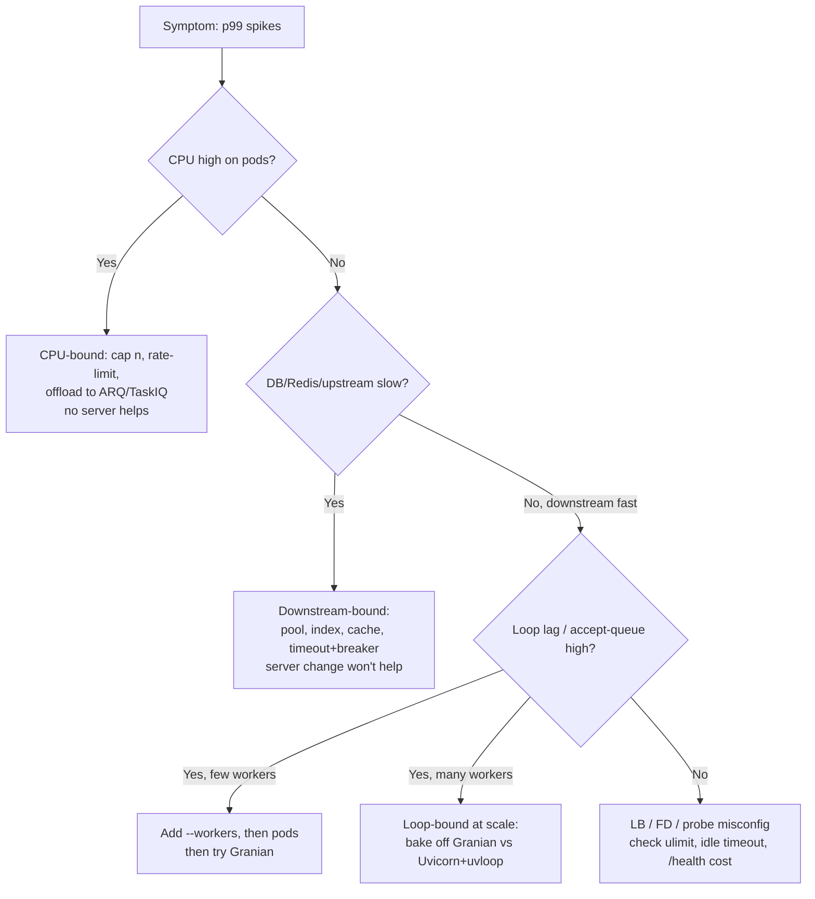

Track together: RPS + p50/p99 per endpoint shape (`/health` vs `/io-simulated` vs `/light`), CPU, loop lag, accept-queue, downstream latency, worker restarts. If `/health` is slow, it is server/workers. If only `/light` is slow, it is CPU isolation. If only `/io-simulated` + downstream slow, it is pool/timeout design.

---

## What is Tortoise ORM? (`2_fastapi_async_orm_sqlmodel_tortoise`)

**Tortoise ORM** is a Django-inspired, **async-native** Python ORM. Unlike SQLAlchemy/SQLModel (Data Mapper + `AsyncSession`), it uses **Active Record** style: the model itself does I/O.

```python
# app/models/task.py — definition is the table
class Task(Model):
    id = fields.IntField(primary_key=True)
    title = fields.CharField(max_length=200)
    status = fields.CharField(max_length=20, default="pending")
    created_at = fields.DatetimeField(auto_now_add=True)
    class Meta:
        table = "tasks"

# app/services/task_service.py — no session to inject, just await
async def create_task(task_data: TaskCreate) -> Task:
    return await Task.create(**task_data.model_dump())

async def list_tasks() -> list[Task]:
    return await Task.all().order_by("-created_at")

async def get_task(task_id: int) -> Task | None:
    return await Task.get_or_none(id=task_id)
```

Wiring is one lifespan call (`app/core/database.py` + `app/main.py`):

```python
TORTOISE_ORM = TortoiseConfig(
    connections={"default": DBUrlConfig(url=settings.db_url)},  # sqlite://, postgres://, mysql://
    apps={"models": AppConfig(models=["app.models"], default_connection="default")},
)
register_orm = partial(RegisterTortoise, config=TORTOISE_ORM, generate_schemas=True)
# lifespan: async with register_orm(app): yield
```

Contrast with SQLModel in same project (`app_sqlmodel/services/task_service.py`): every function takes `session: AsyncSession`, does `session.add(); await session.commit(); await session.refresh()`, and routes inject it via `Depends(get_session)`.

### When to choose Tortoise ORM — decision rule

Choose Tortoise when **all three are true**: (1) greenfield async FastAPI, (2) CRUD-dominated domain, (3) team values velocity over SQL control.

| Choose Tortoise when... | Choose SQLModel / SQLAlchemy instead when... |
|---|---|
| New async project, no legacy SQLAlchemy/Alembic to preserve | Migrating existing SQLAlchemy codebase or sharing models with sync workers |
| Django-background team, want `filter/get/create/update_from_dict` | Team already fluent in `select()` + `AsyncSession` + Alembic |
| Simple relations (FK, M2M, reverse) + `prefetch_related` is enough | Complex joins, CTEs, window functions, hybrid properties, bulk upserts, row-level locking |
| Want zero session plumbing in services/routes/tests | Need explicit transaction/session scope per request (`get_session` dependency) |
| SQLite → Postgres portability with one `DB_URL` change | Need mature migration history, branching, data backfills → Alembic wins over Aerich |
| Microservice with isolated DB, small schema (<30 tables) | Monolith / reporting DB with 100+ tables, views, stored procs |

### Pros

1. **Native async, zero ceremony:** `await Task.create/filter/get/delete` — no engine, no session factory, no `Depends`. Fastest path from `POST /tasks` to `INSERT` (see Request Lifecycle in project README).
2. **Concise query API:** `filter(status="pending").order_by("-created_at").limit(20).offset(0)` covers 90% of CRUD without importing `select`.
3. **Pydantic bridge:** `pydantic_model_creator` or hand-written `TaskCreate/TaskUpdate` schemas; `update_from_dict(model_dump(exclude_unset=True))` gives PATCH-for-free.
4. **Multi-backend + easy lifespan:** same model runs on `sqlite://db.sqlite3` (dev/test with `aiosqlite`) and `postgres://...` (prod via `asyncpg` + `docker-compose.yml`). `RegisterTortoise` handles connect/`generate_schemas`/close.
5. **Lightweight to test:** `httpx.AsyncClient + ASGITransport` + ephemeral SQLite; no session override fixture needed (unlike SQLModel's `get_session_override`).

### Cons

1. **Smaller ecosystem than SQLAlchemy:** fewer StackOverflow answers, fewer extensions (no equivalent of `sqlalchemy-hybrid`, `geoalchemy`, mature asyncpg tuning guides).
2. **Aerich < Alembic:** fine for `init-db / migrate / upgrade / downgrade` on small schemas; painful for branched migrations, partial backfills, zero-downtime renames. Prod teams often keep `generate_schemas=True` only for dev.
3. **Complex SQL is awkward:** aggregation beyond `annotate(Count)`, CTEs, lateral joins, `ON CONFLICT DO UPDATE`, advisory locks → drop to raw SQL (`connections.get("default").execute_query()`) or switch ORM.
4. **Implicit global connection:** convenient until you need per-request transactions, multi-DB routing, or test isolation — `in_transaction()` context exists but is less explicit/auditable than injected `AsyncSession`.
5. **Typing/docs lag SQLModel:** SQLModel model IS the Pydantic schema (better IDE autocomplete); Tortoise splits `fields.*` vs Pydantic schemas by hand, so drift is possible.

### Real-world examples — use vs avoid

1. **Use: SaaS task/ticket tracker (this project shape).** `POST/GET/PATCH/DELETE /api/v1/tasks/` with `status in (pending,in_progress,completed)`. 5 endpoints, 1 table, relations later (`User -> Tasks` FK + `prefetch_related`). Tortoise ships MVP in hours.
2. **Use: MVP startup / hackathon API.** Team of 2–3, need auth + CRUD + Postgres on day 2. One `DB_URL` env switch from SQLite to Postgres, no Alembic boilerplate.
3. **Use: Isolated async microservice (notifications, CMS, IoT ingest).** Own DB, <20 tables, mostly `filter(created_at__gte=...).limit(N)`. Pairs well with ARQ workers (projects `0.2`, `6`) — worker just `await`s models too.
4. **Use: Django → FastAPI migration.** Mental model (`Model.filter`, `auto_now_add`, Aerich ≈ `makemigrations`) transfers directly; retrain cost near zero.
5. **Avoid: Analytics/reporting API.** Needs `GROUP BY date_trunc + window rank() + CTE + HAVING`, materialized views, read replicas. Use SQLAlchemy Core/AsyncSession or raw `asyncpg`.
6. **Avoid: Enterprise monolith on SQLAlchemy+Alembic.** Existing migrations, custom types, event listeners, `selectinload` tuning — rewriting to Tortoise loses more than it saves. Add `async` to SQLAlchemy instead (SQLModel path in this repo).
7. **Avoid: Strict transactional workflows (payments/ledger).** Need explicit `async with session.begin()`, `SELECT ... FOR UPDATE`, idempotency-key unique handling with retry-on-integrity-error. Explicit session beats implicit global.

### System Design Perspective: scenario-based problems

#### Scenario 1: High-concurrency CRUD — why async ORM matters

**Problem:** 2k RPS `GET /tasks` on sync `psycopg2` blocks the single event loop; p99 compounds (50ms → 100ms → 150ms queueing).

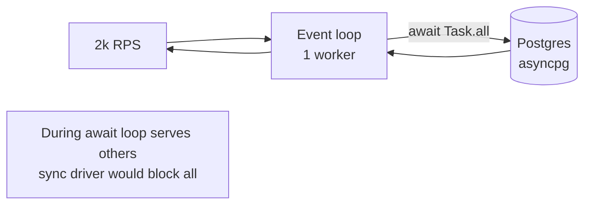

**Takeaway:** any `async def` endpoint touching DB must use async driver (`aiosqlite`/`asyncpg`) + async ORM. Tortoise and SQLModel-async both qualify; sync SQLAlchemy does not.

#### Scenario 2: N+1 on list endpoint — `prefetch_related` vs `selectinload`

**Problem:** `GET /tasks` + `GET /users/{id}/tasks` with FK: naive loop does 1 + N queries.

```python
# Tortoise fix: one extra query, not N
await User.filter(id=user_id).prefetch_related("tasks")
# SQLModel fix equivalent: select(User).options(selectinload(User.tasks))
```

**Takeaway:** if your domain is relation-heavy listings, verify the ORM's eager-loading story before committing. Both work; Tortoise syntax is shorter, SQLAlchemy gives more knobs.

#### Scenario 3: Prod schema evolution — `generate_schemas` vs Aerich vs Alembic

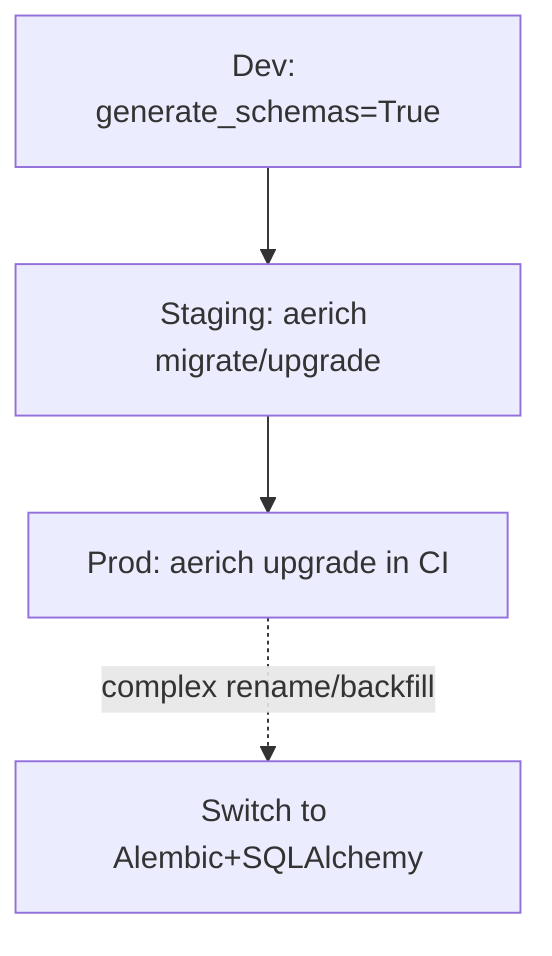

**Takeaway:** tutorial default (`generate_schemas=True`) never reaches prod. Small service → Aerich is enough. First painful zero-downtime rename → that is the signal to prefer SQLModel/Alembic.

### Cheat sheet (interview one-liners)

- Tortoise = Django-style Active Record, async-native, no session injection. SQLModel = SQLAlchemy+Pydantic, session-injected, more control.
- Default to Tortoise for greenfield async CRUD microservices; default to SQLModel/SQLAlchemy when you inherit Alembic, need complex SQL, or do ledger-grade transactions.
- Prod checklist: `DB_URL` via `pydantic-settings`, `RegisterTortoise` in lifespan, Aerich (not `generate_schemas`) for migrations, `prefetch_related` on every list-with-relation, `asyncpg` pool size ≈ `(2*CPU)+1` per worker.

---

## What is asyncpg? (`3_fastapi_asyncpg_database_driver`)

**asyncpg** is a native async **PostgreSQL database driver** for Python — not an ORM. It translates Python calls into PostgreSQL's wire protocol over TCP and decodes results back to Python objects. Every ORM (SQLAlchemy, Tortoise, SQLModel) delegates to a driver at the bottom; this project uses asyncpg directly with raw SQL + repository pattern (`Route → Service → Repository → Pool → Postgres`).

Stack in this project (`app/core/db.py`, `app/repositories/product_repository.py`, `app/main.py`): one module-global `asyncpg.Pool` created in lifespan `connect_db()`, shared by all requests, closed in `close_db()`. Repositories call `pool.fetch/fetchrow/execute` with positional `$1, $2` params; Pydantic schemas validate at the edge.

### Core features only asyncpg provides (others can't)

These are driver-level, not ORM-level. `psycopg2` (sync/text), `aiomysql/aiosqlite` (different DB/text or file), `databases` lib (wrapper over asyncpg), and ORMs (built on top of drivers) cannot match them:

1. **PostgreSQL binary protocol (not text):** `psycopg2/psycopg3/aiomysql` send/receive values as text then parse (`int "42" -> text "42" -> int 42`). asyncpg sends/receives native binary (`int 42 -> 0x2A -> int 42`). Eliminates string encode/parse for ints, numerics, dates, UUIDs. MagicStack measured ~3-5x faster than `psycopg2`; gap widens with concurrency.
2. **Automatic server-side prepared statements:** `await pool.fetch("SELECT ... WHERE id = $1", pid)` prepares plan once, then rebinds params on repeat calls — skips parse/plan. Other drivers either re-parse every time or require manual `PREPARE`. This is why hot CRUD loops (`GET /products/{id}`) stay fast.
3. **Zero-copy decoding directly to Python objects:** `INTEGER` arrives as 4 bytes → `int` with minimal conversion, no intermediate `str`. No ORM or `databases` wrapper can add this back — they only add overhead on top.
4. **Pure-async from ground up, never blocks the loop:** written natively for `asyncio`, not a sync C library wrapped in threads. `psycopg2` blocks the event loop; thread-wrapped drivers cap at pool thread count (~40). One FastAPI worker holds 1000s of parked `await pool.fetch()` waits.
5. **Direct passthrough to Postgres-only features:** `RETURNING *` (insert+read in one round-trip, used in `create_product/update_product/delete_product`), `COPY TO/FROM` bulk streaming, `LISTEN/NOTIFY`, `JSONB/operators`, arrays, `CTEs`, window functions. `databases`/ORMs hide or re-abstract these; `aiomysql/aiosqlite` cannot speak them at all.
6. **Built-in high-performance pool with dual mode:** `pool.fetch/fetchrow/execute` auto-acquire/release (zero boilerplate for single statements) AND explicit `async with pool.acquire() as conn` for pinning one connection across a multi-step transaction. Most drivers give you one or the other, slower, or require external poolers (pgbouncer).

### Re-usable database pool connection? Yes — one shared pool

`app/core/db.py`:

```python
pool: asyncpg.Pool | None = None
pool = await asyncpg.create_pool(dsn=settings.database_url, min_size=2, max_size=10)
```

- `min_size=2`: warm connections ready before first request (no 10-50ms TCP+TLS+auth per request).
- `max_size=10`: ceiling under load; excess requests wait instead of overwhelming Postgres.
- Lifespan (`app/main.py`): `connect_db()` → `CREATE TABLE IF NOT EXISTS` → `yield` (serve) → `close_db()` → `pool.close()`. No per-request pool creation, no leaks.
- Single-statement path auto-manages connections: `rows = await pool.fetch("SELECT ...")`. Transaction path pins one: `async with pool.acquire() as conn`.
- Rule: never create a pool per request; size per worker ≈ `(2*CPU)+1`, then scale workers/pods.

### Multi-step transaction (atomic unit)

`app/repositories/product_repository.py::bulk_update_stock`:

```python
async with pool.acquire() as conn:
    async with conn.transaction():
        for product_id, new_stock in updates:
            await conn.execute("UPDATE products SET stock_quantity = $1 WHERE id = $2", new_stock, product_id)
```

- `pool.acquire()` pins ONE connection (pool auto-mode would use different conns per statement and break atomicity).
- `conn.transaction()` = `BEGIN`/`COMMIT`; any exception → automatic `ROLLBACK` of ALL steps. Critical for stock-transfer, order-create (reserve stock + create order + update inventory), bulk import.
- Nested `async with conn.transaction():` inside another creates a `SAVEPOINT` — inner failure rolls back only inner block.
- Contrast: ORM `session.begin()` / `in_transaction()` adds object-tracking overhead and hides SQL; `databases` `async with database.transaction()` is just a thin wrap over this same asyncpg mechanism but slower.

### Only works with PostgreSQL

Hard constraint, not a bug: asyncpg speaks only the Postgres wire protocol. No MySQL/SQLite/Oracle. Switching DB = rewrite repositories (positional `$1` → `?`/`%s`, drop `RETURNING`, re-tune types). If you need DB-agnostic code, use SQLModel/SQLAlchemy or `databases` lib and accept lower throughput. If you are Postgres-committed (most SaaS), this is the fastest Python path.

### Pros

1. **Maximum throughput/latency:** binary + prepared + zero-copy + native async. Best Python option for high-RPS CRUD and concurrent `await` fan-out.
2. **Full SQL control, no hidden queries:** what you write is what runs. No N+1, no lazy-load surprises, `EXPLAIN` matches code. Debug by reading repository SQL.
3. **Postgres superpowers for free:** `RETURNING`, `ON CONFLICT`, `COPY`, `LISTEN/NOTIFY`, `JSONB`, CTEs without waiting for ORM support.
4. **Tiny dependency surface:** just `asyncpg`. No SQLAlchemy/Alembic/Aerich graph to learn or migrate.
5. **Repository pattern fit:** all SQL in `product_repository.py`, services mock repositories in tests, swap driver without touching routes/services.

### Cons

1. **Postgres-only lock-in:** see above. One DB choice for the life of the service.
2. **Raw SQL boilerplate:** every CRUD writes `$1..$n` + `dict(row)` conversion from `asyncpg.Record`. No `Product.create()`, no finder helpers.
3. **Manual schema/migrations:** `CREATE TABLE IF NOT EXISTS` + `migrations/001_create_products_table.sql` only. No autogenerate/downgrade/branching like Alembic/Aerich; renames/backfills are hand-SQL.
4. **No type-safety across Python↔SQL:** column rename breaks at runtime, not in IDE. Pydantic validates HTTP edge, not SQL strings.
5. **Explicit transaction discipline on you:** forgetting `pool.acquire()` for multi-step writes silently loses atomicity; `dict(row)` forgetting loses fields. ORM session scope enforces more.

### When to use vs avoid (interview one-liners)

- Use raw asyncpg when: Postgres-committed, perf-sensitive CRUD/inventory/payments-ledger writes, complex CTE/window/`COPY` queries, or learning what ORMs hide.
- Avoid (use Tortoise/SQLModel) when: need MySQL/SQLite portability, CRUD-heavy MVP speed, team prefers Python objects, or need Alembic/Aerich migration history.
- Prod checklist: one lifespan pool (`min_size=2, max_size=10` per worker), `$n` params only (never f-string SQL), `RETURNING` to save round-trips, `pool.acquire()+conn.transaction()` for every multi-statement write, indexes on `WHERE/ORDER BY` cols (`idx_products_name`, `idx_products_created_at`), integration tests against real Postgres (Docker) not mocks.

---

## What is Pydantic v2 Validation? (`4_fastapi_pydantic_v2_validation`)

**High-level overview:** A "User Registration and Profile API" that teaches Pydantic v2 as FastAPI's validation/serialization engine. No DB — `app/services/user_service.py` keeps an in-memory `_user_store: dict[int, dict]` + `_next_id`. All correctness lives in `app/schemas/user.py` models. Flow is `Route → Service → Pydantic model → JSON`.

Structure:

```text
4_fastapi_pydantic_v2_validation/
  app/main.py               # create_app() + include_router
  app/api/routes_users.py   # 6 endpoints, response_model on each
  app/schemas/user.py       # 8 models/unions + 2 TypeAdapters (all logic here)
  app/services/user_service.py # dict store, register/get/update/list, dup checks
  benchmark_validation.py   # model_validate vs TypeAdapter batch timing
  tests/                    # test_users.py (API 422/201/404/409), test_schemas.py (validators)
```

Request flow (`README.md` + `routes_users.py:17`):

```text
Client JSON -> FastAPI Endpoint (UserRegister) -> field_validator + model_validator -> Service Layer
```

Response flow (`routes_users.py:16,24,32,43`):

```text
Service dict -> response_model (UserPublicResponse/UserProfile) -> field_serializer + computed_field + alias -> Client JSON
```

Endpoints:

| Method | Path | Request model | Response model | Pydantic trick shown |
|---|---|---|---|---|
| `POST` | `/api/v1/users/` | `UserRegister` | `UserPublicResponse` (201) | Full validation; strips `password`, adds `display_name` |
| `GET` | `/api/v1/users/{id}` | — | `UserProfile` | `full_name` + masked `phone`, `firstName` alias |
| `PATCH` | `/api/v1/users/{id}` | `UserUpdate` (all-optional) | `UserProfile` | `exclude_none=True` partial update |
| `GET` | `/api/v1/users/` | — | `list[UserPublicResponse]` | Bulk serialize |
| `POST` | `/api/v1/users/validate-notification` | `NotificationPreference` union | dict | Discriminated union dispatch on `type` |
| `POST` | `/api/v1/users/validate-batch` | `list[dict]` + `user_register_adapter` | `list[dict]` | `TypeAdapter(list[UserRegister])` batch validate |

**How these Pydantic models help us (why not plain dicts/dataclasses):**

1. **Fail-fast at the edge → 422 for free:** `Field(pattern/min_length)`, `EmailStr`, `field_validator`, `model_validator` run before service code. Invalid email/weak password/mismatch/ZIP never reach business logic; FastAPI returns detailed `422 Unprocessable Entity` automatically.
2. **Security by construction:** `UserPublicResponse` simply omits `password`/`confirm_password`. `UserProfile.mask_phone` masks PII (`***-***-1234`) only on JSON out. No ad-hoc `del user['password']`.
3. **Single source of truth for docs + code:** `Field(description=...)`, `Literal`, discriminated union generate exact OpenAPI/Swagger at `/docs`. Valid/invalid payload examples in README are enforced by code.
4. **Request vs response separation:** `UserRegister` (strict in) vs `UserUpdate` (all `None` defaults for PATCH) vs `UserPublicResponse/UserProfile` (safe out) prevents over-posting (`id` injection) and under-serialization.
5. **Rust-core speed:** v2 `pydantic-core` is 5-50x faster than v1. `benchmark_validation.py` proves batch `TypeAdapter.validate_python` beats per-item `model_validate` loop — critical for CSV import / webhook bursts.
6. **Reusable Python→Python validation:** `model_validate(record)` hydrates dict/ORM rows into responses (`user_service.py:40,47,67,71`); `TypeAdapter` validates types that are not models (`list`, `Union`).

### Pydantic imports used in this project (`app/schemas/user.py:3-13`)

| Import | What it is | How this project uses it (file:line + example) |
|---|---|---|
| `BaseModel` | Base class for all schemas. Owns `model_validate()`, `model_dump()`, JSON schema gen, Rust-core validation. | Everything inherits it: `Address(user.py:16)`, `UserRegister(user.py:28)`, `UserUpdate(user.py:69)`, `EmailNotification(user.py:79)`, `SMSNotification(user.py:84)`, `UserPublicResponse(user.py:95)`, `UserProfile(user.py:110)`. Routes declare it as body/response type so FastAPI validates/serializes automatically (`routes_users.py:17,24`). Service re-validates dicts via `UserPublicResponse.model_validate(record)` (`user_service.py:40`). |
| `ConfigDict` | v2 replacement for `class Config`. Model-wide behavior dict. | `Address` + `UserRegister` + `UserUpdate`: `ConfigDict(str_strip_whitespace=True)` (`user.py:17,29,70`) — `"  John "` → `"John"`. `UserPublicResponse`: `ConfigDict(from_attributes=True)` (`user.py:96`) — allows `model_validate(orm_obj/dict)`. `UserProfile`: `ConfigDict(from_attributes=True, populate_by_name=True, str_strip_whitespace=True)` (`user.py:111`) — accept both `first_name` and alias `firstName`. |
| `Field` | Per-field constraints, defaults, metadata, aliases, discriminators. Drives 422 + OpenAPI. | Constraints: `username: Field(min_length=3, max_length=30, pattern=r"^[a-zA-Z0-9_]+$")` (`user.py:31`); `zip_code: Field(pattern=r"^\d{5}(-\d{4})?$")` (`user.py:22`); `phone: Field(pattern=r"^\+?\d{7,15}$")` (`user.py:75`). Defaults/optional: `address: Address \| None = Field(default=None)` (`user.py:46`); `UserUpdate` all `Field(default=None)` for PATCH. Aliases: `first_name = Field(alias="firstName")` (`user.py:120`). Union discriminator: `Field(discriminator="type")` (`user.py:91`). |
| `TypeAdapter` | Validates/serializes *any* type, not just `BaseModel`. Needed for `list[...]`, `Union`, primitives. | `user_register_adapter = TypeAdapter(list[UserRegister])` (`user.py:142`) — used in `POST /validate-batch`: `user_register_adapter.validate_python(raw_users)` (`routes_users.py:55`). `notification_adapter = TypeAdapter(NotificationPreference)` (`user.py:143`) for ad-hoc union validation outside a route. Benchmark compares it vs `model_validate` (`benchmark_validation.py:26,32`). |
| `computed_field` | Derived read-only property that *is* included in `model_dump()`/JSON + OpenAPI (unlike plain `@property` in v1). | `UserPublicResponse.display_name` (`user.py:104-107`): `f"{first_name} {last_name}"`. `UserProfile.full_name` (`user.py:125-128`): same. Client gets `display_name`/`full_name` without sending/storing it; no extra DB column. |
| `field_serializer` | Customizes outbound serialization for a field (e.g., mask/format, not validation). | `UserProfile.mask_phone` (`user.py:130-139`): `@field_serializer("phone", when_used="json")` turns `"+14155551234"` → `"***-***-1234"`, `None` → `None`. Only affects JSON response, internal `record["phone"]` stays full. Demo of PII-safe responses on `GET /users/{id}`. |
| `field_validator` | Single-field validation (mode `before`/`after`). v2 replacement for `@validator`. | `UserRegister.validate_password_strength` (`user.py:48-60`): `@field_validator("password")` checks uppercase + digit + special char, raises `ValueError("Password must contain...")` → 422. Runs after `Field(min_length=8)` in Rust core, before `model_validator`. |
| `model_validator` | Whole-model / cross-field validation (mode `before`/`after`). v2 replacement for `@root_validator`. | `UserRegister.verify_passwords_match` (`user.py:62-66`): `@model_validator(mode="after")` compares `self.password != self.confirm_password` → `ValueError("passwords do not match")` → 422. Only place to see two fields together; cannot do with `field_validator` alone. |
| `EmailStr` | Validated email string type (requires `pydantic[email]` extra). Regex + deliverability checks in Rust core. | `UserRegister.email: EmailStr` (`user.py:35`), `UserUpdate.email: EmailStr \| None` (`user.py:74`), `EmailNotification.email_address: EmailStr` (`user.py:81`), responses echo `email: EmailStr` (`user.py:100,119`). `"not-an-email"` → `422 value is not a valid email address` without custom code. Needs `pydantic[email]` in `pyproject.toml:10`. |

v1 → v2 cheat (from `README.md:46-56`): `@validator` → `@field_validator`, `@root_validator` → `@model_validator(mode='after')`, `class Config` → `model_config = ConfigDict(...)`, `@json_encoders` → `@field_serializer`, `@property` → `@computed_field`.

When to reach for each — interview rule:

- `Field` + `EmailStr` + `BaseModel` = 90% of validation. Always start here.
- Add `field_validator` for one-field business rules (password strength, ZIP normalization).
- Add `model_validator(mode='after')` only for cross-field rules (password == confirm, start < end).
- Add `computed_field` for derived reads (full name, total = qty*price).
- Add `field_serializer` for outbound-only transforms (mask phone, format datetime, round money).
- Add `TypeAdapter` when validated thing is not a named model (batch `list[X]`, discriminated `Union`, `dict[str, int]`).
- Tune `ConfigDict` once per model (`str_strip_whitespace`, `from_attributes`, `populate_by_name`) instead of per-field hacks.

---

## What is Taskiq Background Jobs? (`6_fastapi_taskiq_background_jobs`)

**High-level overview:** An "Email Report Generator API" pattern. Heavy work (report gen 30s+, emails, data processing) must **not** block the request loop. API validates → creates UUID job row in Redis hash → `await task.kiq()` → returns `202 + job_id` immediately. Separate **Taskiq worker** pulls from Redis broker, runs async task, updates `pending → processing → completed/failed`. Client polls `GET /reports/{job_id}/status`.

Stack: `FastAPI + taskiq + taskiq-redis (RedisStreamBroker + RedisAsyncResultBackend) + redis>=5` (`pyproject.toml:10-14`). DI shared via `TaskiqDepends` (worker) / `Depends(get_redis)` (API).

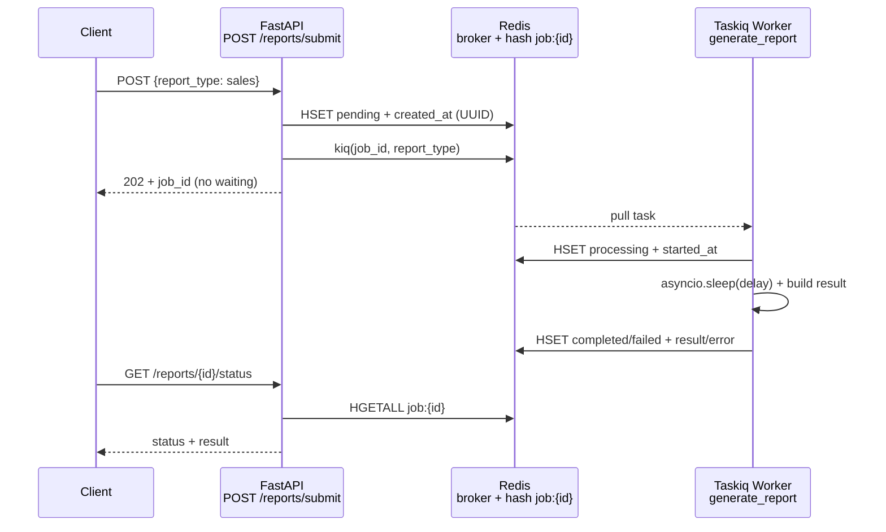

Core primitives in this project:

| Piece | File | What it does |
|---|---|---|
| `RedisStreamBroker(url).with_result_backend(...)` | `app/core/broker.py:11` | Decouples API ↔ worker via Redis streams; `result_ex_time=3600` |
| `await generate_report.kiq(job_id, report_type)` | `app/api/routes_reports.py:54` | Async enqueue (Taskiq equiv. of Celery `.delay()`) |
| `@broker.task` / `@broker.task(retry_on_error=True, max_retries=3)` | `app/tasks/report_tasks.py:14,34` | Plain vs retry task; `retry=true` flag selects it |
| `ReportService` Redis hash | `app/services/report_service.py` | `create_job / update_job_status / get_job_status`, lifecycle `pending→processing→completed/failed` |
| `taskiq-fastapi` lifespan | `app/main.py` | Shares `app.state.redis` with worker via `TaskiqDepends(get_redis)` |

Run: `docker compose up redis -d` → `uvicorn app.main:app --reload` → `taskiq worker app.core.broker:broker app.tasks.report_tasks`.

**Taskiq vs alternatives:** `BackgroundTasks` = in-process, lost on restart, no retry/distribution — only for fire-and-forget <1s. Taskiq = async-native, typed `.kiq()`, low boilerplate, `taskiq-fastapi` DI; pick for async FastAPI shops needing Redis/RabbitMQ + retries. Celery = sync-first, mature routing/canvas/SQS, pick for polyglot/heavy workflows. ARQ (project `0.2`) = same niche as Taskiq (async+Redis+cron); Taskiq has broader broker support.

### When should we consider it — short examples

1. **Slow report/PDF/CSV export (this project):** `POST /reports/submit {"report_type":"sales"}` → 202; worker sleeps/builds 5s+; poll status. Without it: LB/client timeout at 30s + worker threads exhausted.
2. **Email/SMS/push fan-out:** signup → enqueue `send_welcome_email` per user; SMTP 2-5s moves off p99. Same shape, just different task fn.
3. **Flaky 3rd-party calls needing retry:** `{"report_type":"sales","retry":true}` → `generate_report_with_retry` auto-retries 3x; final `failed + error` visible on status endpoint. Use SimpleRetry (any exception) → SmartRetry (backoff+jitter) for rate limits.
4. **Webhook/data pipeline ingest:** validate + persist + `kiq(process_row)` per item; scale by adding `taskiq worker` replicas, not API pods.
5. **Don't use when:** job <500ms and idempotent fire-and-forget → `BackgroundTasks`; need cron/scheduling-heavy → ARQ/Celery Beat; need strict ordering/multi-consumer durability → Kafka/SQS; need result forever → persist to Postgres (Redis hash + `result_ex_time` is volatile).

---

## What is Slowapi Rate Limiting? (`7_fastapi_slowapi_rate_limiting`)

**High-level overview:** A "Public Quotes API" pattern. Every endpoint is guarded by a **Slowapi `Limiter`** that identifies the caller, checks a per-key counter against a limit string (`"5/minute"`), and either lets the request through or raises `RateLimitExceeded` → custom `429 {"error": "Rate limit exceeded"}` handler. No DB — `app/services/quote_service.py` serves in-memory quotes. All correctness lives in `app/core/rate_limit.py` (key funcs + plan logic) + `@limiter.limit(...)` decorators in `app/api/routes_quotes.py`.

Stack: `FastAPI + slowapi (Limiter + RateLimitExceeded + get_remote_address) + limits` (`pyproject.toml`). Wiring is `app.state.limiter = limiter` + `app.add_exception_handler(RateLimitExceeded, rate_limit_exceeded_handler)` in `app/main.py:14-15`.

```mermaid
sequenceDiagram
    participant C as Client<br/>IP or X-API-Key
    participant A as FastAPI<br/>@limiter.limit + key_func
    participant S as Counter store<br/>in-memory (dev) / Redis (prod)
    participant E as Endpoint<br/>quote_service
    C->>A: GET /api/v1/quotes/random
    A->>S: incr key (ip:1.2.3.4 or key:pro_x)
    alt under limit
        S-->>A: count <= limit
        A->>E: get_random()
        E-->>A: quote dict
        A-->>C: 200 + x-ratelimit-limit/remaining/reset
    else over limit
        S-->>A: count > limit
        A-->>C: 429 {"error": "Rate limit exceeded"} + retry-after
    end
```

Core primitives in this project:

| Piece | File | What it does |
|---|---|---|
| `Limiter(key_func=get_remote_address, default_limits=[...], headers_enabled=True)` | `app/core/rate_limit.py:51` | Global limiter; default key = client IP; emits `x-ratelimit-*` headers |
| `@limiter.limit("10/minute")` / `"5/minute"` | `app/api/routes_quotes.py:10,16,31` | IP-based fixed-window limits on `GET /`, `/random`, `/{id}` |
| `get_api_key(request)` | `app/core/rate_limit.py:10` | Key func: `key:{X-API-Key}` if present else `ip:{remote_addr}` — missing key falls back to IP |
| `dynamic_plan_limit(key)` + `PLAN_LIMITS` | `app/core/rate_limit.py:17,32` | Tiered limit by key prefix: `free_→3/min`, `pro_→20/min`, `admin_→1000/min` on `GET /premium` |
| `@limiter.limit(dynamic_plan_limit, key_func=get_api_key)` | `app/api/routes_quotes.py:25` | Callable limit evaluated per-request — the monetization pattern |
| `rate_limit_exceeded_handler` | `app/core/rate_limit.py:41` | Converts plain-text Slowapi 429 into structured JSON `{"error", "detail"}` |
| `app.state.limiter` + exception handler | `app/main.py:14-15` | Required Slowapi registration; without it limits never fire / 429 stays plain-text |

Endpoints:

| Method | Path | Limit | Key | Purpose |
|---|---|---|---|---|
| `GET` | `/api/v1/quotes/` | `10/minute` | IP | List all public quotes |
| `GET` | `/api/v1/quotes/random` | `5/minute` | IP | Random quote (easiest 429 demo: 6 rapid hits) |
| `GET` | `/api/v1/quotes/{id}` | `5/minute` | `X-API-Key` else IP | Per-key isolation demo |
| `GET` | `/api/v1/quotes/premium` | `3/20/1000 per min` | `X-API-Key` plan prefix | Tiered-plans demo |

### When should we consider it — short examples

1. **Public/anonymous read API (this project):** `GET /quotes/random` capped `5/min` per IP. Without it: one scraper loop `while True: GET` starves workers, inflates LLM/DB bills, p99 collapses for everyone.
2. **Auth/key-based quotas + isolation:** `GET /quotes/{id}` keyed by `get_api_key` — `free_bob` burning quota never blocks `pro_alice`. Same shape for per-tenant SaaS APIs.
3. **Monetized tiers without a billing service:** `GET /premium` with `dynamic_plan_limit` — free `3/min` vs pro `20/min` vs admin `1000/min` from key prefix. Interview answer to "how do free/pro/enterprise quotas work": callable limit + key func, upgrade = re-key, not redeploy.
4. **Abuse/DDoS edge + cost guard:** login/OTP (`5/min` per IP+user), webhook ingest, expensive LLM/PDF endpoints — fail fast with `429 + Retry-After` before queue/DB/CPU saturate. Pair with `x-ratelimit-remaining/reset` so clients back off gracefully.
5. **Don't use when:** limit must survive N replicas → in-memory lies (limit x N instances) — switch `storage_uri="redis://..."`; behind Nginx/ALB/Cloudflare → use `get_ipaddr()` (respects `X-Forwarded-For`) not raw remote addr, and trust proxy headers only from your proxy (spoofable otherwise); need smooth burst control → default fixed-window allows 2x edge burst, set `strategy="moving-window"`; need per-user authz (who *may* call) — that's auth (projects `10`), rate limit is *how often*.

---

## What is Prometheus Monitoring? (`8_fastapi_prometheus_monitoring`)

**High-level overview:** A "Simple Orders API" pattern that makes production observable. `prometheus-fastapi-instrumentator` middleware auto-records every request (count, latency histogram, size) and exposes `GET /metrics`; **Prometheus pulls** that endpoint every 15s into a time-series DB; **Grafana** renders PromQL dashboards + alerts. One custom business counter (`orders_created_total{item}`) shows how to instrument domain logic next to infra metrics. No DB — `app/services/order_service.py` keeps an in-memory `_ORDERS` list. All correctness lives in `app/core/monitoring.py::setup_monitoring()` + `app/api/routes_orders.py` (`/slow`, `/error` simulators).

Stack: `FastAPI + prometheus-fastapi-instrumentator>=7.0.0 + prometheus_client + Prometheus v2.54.1 + Grafana 11.3.0` (`pyproject.toml:7-11`, `docker-compose.yml`). Run: `uvicorn app.main:app --reload` (app :8000) + `docker compose up -d` (Prometheus :9090, Grafana :3000 admin/admin).

```text
8_fastapi_prometheus_monitoring/
  app/main.py                # create_app() + /health + setup_monitoring(app)
  app/core/monitoring.py     # Instrumentator config, ORDERS_CREATED Counter
  app/api/routes_orders.py   # 5 order endpoints + /slow + /error
  app/services/order_service.py # in-memory _ORDERS store
  prometheus/prometheus.yml  # scrape job fastapi_orders -> host.docker.internal:8000/metrics
  grafana/provisioning/      # datasource.yml + dashboard.yml/json (auto-provisioned)
  docker-compose.yml         # prometheus + grafana services
```

Request / scrape flow:

```mermaid
sequenceDiagram
    participant C as Client
    participant A as FastAPI 8000 - Instrumentator
    participant M as Metrics endpoint
    participant P as Prometheus 9090 - pull 15s
    participant G as Grafana 3000 - dashboards
    C->>A: POST /api/v1/orders/ item Widget
    A->>A: record http_requests_total + latency + sizes + orders_created_total
    A-->>C: 201 + order dict
    P->>M: GET /metrics scrape fastapi_orders
    M-->>P: counters + histogram buckets store as time-series
    G->>P: PromQL rate, histogram_quantile, sum by
    P-->>G: rate, p50 p90 p99, error percent
    G-->>C: dashboard req-s, latency, status, orders
```

Architecture (pull model):

```mermaid
graph LR
    subgraph App["App"]
        API["FastAPI Orders API - routes_orders.py"]
        MW["Instrumentator middleware - latency, requests, sizes"]
        MET["GET metrics - gzip, hidden from OpenAPI"]
        BC["orders_created_total - business Counter"]
        API --> MW
        MW --> MET
        API -.->|"increment_orders_created"| BC
        BC -.-> MET
    end
    P["Prometheus - prometheus.yml - 15s pull"] -->|"GET metrics"| MET
    G["Grafana - datasource plus dashboard"] -->|"PromQL"| P
```

Core primitives in this project:

| Piece | File | What it does |
|---|---|---|
| `Instrumentator(should_group_status_codes=True, excluded_handlers=["/health","/metrics"])` | `app/core/monitoring.py:16` | Groups `404/422` → `4xx`, `500` → `5xx`; keeps health/scrape traffic out of SLOs |
| `instrumentator.add(metrics.latency(buckets=(0.005,...,10)))` | `app/core/monitoring.py:20` | Histogram `http_request_duration_seconds_bucket{le}` — the p50/p90/p99 source |
| `instrumentator.add(metrics.requests() + request_size() + response_size())` | `app/core/monitoring.py:25-27` | Counter `http_requests_total{method,handler,status}` + size histograms |
| `instrumentator.instrument(app).expose(app, endpoint="/metrics", include_in_schema=False, should_gzip=True)` | `app/core/monitoring.py:28` | One-line middleware + scrape endpoint install |
| `ORDERS_CREATED = Counter("orders_created_total", ..., labelnames=("item",))` | `app/core/monitoring.py:4` | Custom business metric; `increment_orders_created(item)` on `POST /` (`routes_orders.py:25`) |
| `scrape_configs: job fastapi_orders → host.docker.internal:8000/metrics` | `prometheus/prometheus.yml:5-9` | Pull config; `host.docker.internal` lets containerized Prometheus reach host-run Uvicorn |
| Grafana provisioning + `dashboard.json` | `grafana/provisioning/`, `docker-compose.yml` | Auto-wired Prometheus datasource + 8 panels (req/s, p50/90/99, status pie, orders stat/bar, error gauge, sizes) |

Endpoints:

| Method | Path | Purpose in monitoring demo |
|---|---|---|
| `GET` | `/health` | Liveness probe; **excluded** from metrics so k8s polls don't skew SLOs |
| `POST` | `/api/v1/orders/` | 201 path; bumps `orders_created_total{item}` — business-metric demo |
| `GET` | `/api/v1/orders/`, `/{id}` | Normal 2xx traffic; `/{id}` 404 path gives `4xx` label demo |
| `GET` | `/api/v1/orders/slow` | `asyncio.sleep(0.5)` — shifts histogram buckets, makes p99 visible |
| `GET` | `/api/v1/orders/error` | Always 500 — drives `5xx` counter + error-rate gauge |
| `GET` | `/metrics` | Scrape endpoint; verify with `curl localhost:8000/metrics` |

Key PromQL (interview cheat):

```promql
sum(rate(http_requests_total[5m]))                                        # throughput req/s
histogram_quantile(0.99, rate(http_request_duration_seconds_bucket[5m])) # p99 latency
sum(rate(http_requests_total{status="5xx"}[5m])) / sum(rate(http_requests_total[5m])) # error rate
sum by (handler) (rate(http_requests_total[5m]))                          # hottest endpoint
sum by (item) (increase(orders_created_total[1h]))                        # orders/hour by item
```

### When should we consider it — short examples

1. **Any prod FastAPI (this project):** add `setup_monitoring(app)` on day 1 — req/s + p99 + 5xx% per `handler` answers "are we up, fast, correct" before users complain. Without it: blind deploys, p99 regressions found via tickets.
2. **SLO / alerting foundation:** `histogram_quantile(0.99,...) > 1s for 5m → page`; `5xx% > 1% → ticket`. Buckets `(0.005..10)` must bracket your SLO (e.g. `le=1.0` if p99 < 1s is the goal) or quantiles interpolate badly.
3. **Business + infra in one pane:** `orders_created_total{item="Widget"}` next to `http_requests_total` correlates "revenue stopped" with "5xx spiked on POST /orders" — same pattern for `payments_completed`, `signups`, `pdfs_rendered`.
4. **Load-test validation:** hit `/slow` + CRUD with `hey/wrk`, watch p50/90/99 diverge in Grafana; proves which endpoint is tail-latent before k8s HPA tuning (pairs with projects `1`, `7`).
5. **Don't use when:** need per-request debugging ("why did order 5 fail") → that's logs (projects `9/16`, Loguru/structlog); need cross-service latency ("API→DB→cache") → that's traces (OpenTelemetry/Tempo); need long-term/cross-replica accuracy → single Prometheus is local disk, add Thanos/Cortex/Mimir + `storage_uri`/federation, and remember `/metrics` cardinality explodes if you label by `user_id/order_id` — keep labels to `method/handler/status/item`-scale.

---

## What is Loguru Structured Logging? (`9_fastapi_loguru_structured_logging`)

**High-level overview:** A "Payment Events API" pattern that makes production debuggable. Every request gets a correlation ID (`X-Request-ID` or UUID4) bound via `logger.contextualize()` in middleware; **Loguru** logs request start/complete + domain events (create/get/fail) with `enqueue=True` (non-blocking queue + background thread, never blocks the event loop); outputs are dual-sink — pretty colored console (dev) + JSON-serialized rotating file `logs/app.log` (`serialize=True`, `rotation="10 MB"`, `retention="7 days"`, `compression="zip"`). Stdlib `logging` (uvicorn/fastapi) is funneled through `InterceptHandler` so one pipeline owns all logs. No DB — `app/services/payment_service.py` keeps an in-memory `_PAYMENTS` list; all correctness lives in `app/core/logging.py::setup_logging()` + `app/core/middleware.py::request_id_middleware`.

Stack: `FastAPI + loguru>=0.7.0 + uvicorn[standard]` (`pyproject.toml:7-11`). Run: `uvicorn app.main:app --reload` → `curl -H "X-Request-ID: my-trace-123" POST /api/v1/payments/`.

```text
9_fastapi_loguru_structured_logging/
  app/main.py                    # create_app() + /health + middleware + router
  app/core/logging.py            # setup_logging(): dual sinks, InterceptHandler, json_sink
  app/core/middleware.py         # request_id_middleware: X-Request-ID + contextualize + timing
  app/api/routes_payments.py     # 4 payment endpoints + /failed simulator
  app/services/payment_service.py # in-memory _PAYMENTS + masked card logging
  tests/                         # test_payments, test_request_id, test_edge_cases
```

Request / log flow:

```mermaid
sequenceDiagram
    participant C as Client<br/>X-Request-ID?
    participant M as Middleware<br/>request_id_middleware
    participant E as Endpoint<br/>routes_payments.py
    participant S as Service<br/>payment_service.py
    participant L as Loguru<br/>enqueue=True queue
    C->>M: POST /api/v1/payments/ + card_number
    M->>M: request_id = header or uuid4 + contextualize
    M->>M: INFO Request started POST /api/v1/payments
    M->>E: call_next(request)
    E->>S: create(customer, amount, card_number)
    S->>L: INFO Creating payment + DEBUG masked ****4242
    S->>L: INFO Payment created id=4 status=pending
    S-->>E: payment dict (card_last_four only)
    E-->>M: 201 + PaymentResponse
    M->>L: INFO Request completed status=201 duration=0.003s
    M-->>C: 201 + X-Request-ID + X-Process-Time
```

Architecture (dual-sink + intercept):

```mermaid
graph LR
    subgraph App["App"]
        MW["Middleware - request_id + timing<br/>middleware.py"]
        EP["Routes - CRUD + failed<br/>routes_payments.py"]
        SV["Service - mask + levels<br/>payment_service.py"]
        MW --> EP --> SV
    end
    subgraph Log["Loguru pipeline - logging.py"]
        Q["enqueue=True queue<br/>background thread"]
        CON["stderr console - colored<br/>DEBUG + request_id"]
        FILE["logs/app.log - serialize=True<br/>INFO, 10MB, 7d, zip"]
        JS["json_sink - Docker/ELK mode<br/>json_output=True"]
        IH["InterceptHandler<br/>stdlib → Loguru"]
    end
    SV -.->|logger.info/warning/error/exception| Q
    MW -.->|contextualize request_id| Q
    IH -.->|uvicorn/fastapi logs| Q
    Q --> CON
    Q --> FILE
    Q -.->|LOGURU_JSON| JS
    JS -.->|stdout JSON| ELK["ELK / Loki / Datadog"]
    FILE -.->|shipper| ELK
```

Core primitives in this project:

| Piece | File | What it does |
|---|---|---|
| `setup_logging(json_output=False)` | `app/core/logging.py:47` | Removes default sink, installs console + file + stdlib intercept; `json_output=True` for Docker/centralized mode |
| `logger.add(sys.stderr, enqueue=True, backtrace=True, diagnose=True)` | `app/core/logging.py:59` | Dev sink: colored `time \| level \| name:func:line \| request_id \| message`; non-blocking |
| `logger.add("logs/app.log", serialize=True, enqueue=True, rotation="10 MB", retention="7 days", compression="zip")` | `app/core/logging.py:74` | Prod sink: JSON lines, rotate at 10MB, keep 7d, zip old; `level="INFO"` |
| `json_sink(message)` | `app/core/logging.py:23` | Custom Docker sink: builds `{timestamp, level, message, request_id, module, function, line, exception}` JSON to stderr — ELK/Loki-ready |
| `InterceptHandler(logging.Handler)` | `app/core/logging.py:8` | Forwards stdlib/uvicorn records into Loguru with correct call depth + `record.exc_info`; installed via `logging.basicConfig(handlers=[InterceptHandler()], force=True)` |
| `request_id_middleware` + `logger.contextualize(request_id=...)` | `app/core/middleware.py:13` | Correlation: reuse `X-Request-ID` or `uuid4`; every log inside block carries `request_id`; echoes `X-Request-ID` + `X-Process-Time` on response; `logger.exception` on unhandled error |
| Level discipline + `_mask_card()` | `app/services/payment_service.py:35,41` | `DEBUG` masked card `****4242`, `INFO` lifecycle, `WARNING` not-found, `ERROR` + `logger.exception` on failure; full PAN never logged/returned (only `card_last_four`) |

Endpoints:

| Method | Path | Log behavior |
|---|---|---|
| `GET` | `/health` | No domain log; still gets `Request started/completed` + headers (keep cheap for probes) |
| `POST` | `/api/v1/payments/` | `INFO Creating` + `DEBUG masked` + `INFO created id=N`; 201 |
| `GET` | `/api/v1/payments/` | `INFO Listing all payments count=N` |
| `GET` | `/api/v1/payments/{id}` | `INFO retrieved` hit / `WARNING not found` + 404 miss |
| `POST` | `/api/v1/payments/failed` | `ERROR failed` + `logger.exception` traceback + 500 (chaos/error-path demo) |

### When should we consider it — short examples

1. **Any prod FastAPI (this project):** add `setup_logging()` + `request_id_middleware` on day 1 — `request_id` on every line answers "show me everything for failed payment 5" via `grep my-trace-123`. Without it: wall of interleaved text, ungrepable under concurrency.
2. **Async-safe logging under load:** `enqueue=True` moves file/JSON I/O to a background thread so `logger.info()` never blocks the event loop (vs stdlib sync write adding ms per request + interleaved lines). Mandatory for p99-sensitive APIs.
3. **JSON for aggregation/alerting:** `serialize=True` / `json_sink` emits queryable `{timestamp, level, message, request_id, ...}` for ELK/Loki/Datadog — filter `level=ERROR`, count `status=500/min`, alert on `Payment processing failed` rate. Console color stays dev-only.
4. **Safe PII/error discipline:** `_mask_card()` + `card_last_four`-only responses + `DEBUG/INFO/WARNING/ERROR/exception` ladder + `backtrace/diagnose=True` gives full tracebacks without leaking PANs/tokens. Interview answer to "what don't you log".
5. **Don't use when:** need req/s + p99 + 5xx% trends → that's metrics (project `8`, Prometheus/Grafana); need cross-service span latency → that's traces (OpenTelemetry/Tempo, propagate `X-Request-ID` as `trace_id`); running N replicas in Docker/K8s → don't write files in containers, use `json_output=True` to stdout + `json-file` driver (`max-size: 10m`) + central shipper, and size `rotation/retention` against disk.

